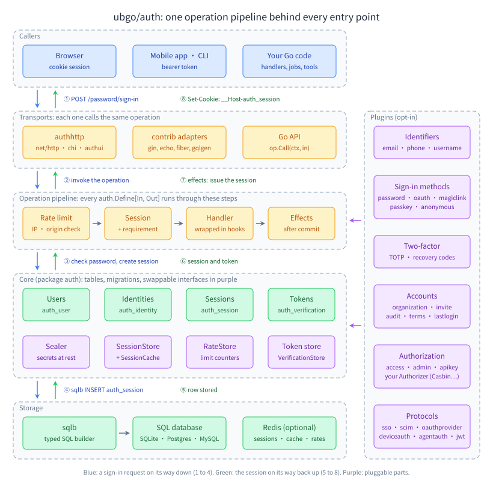
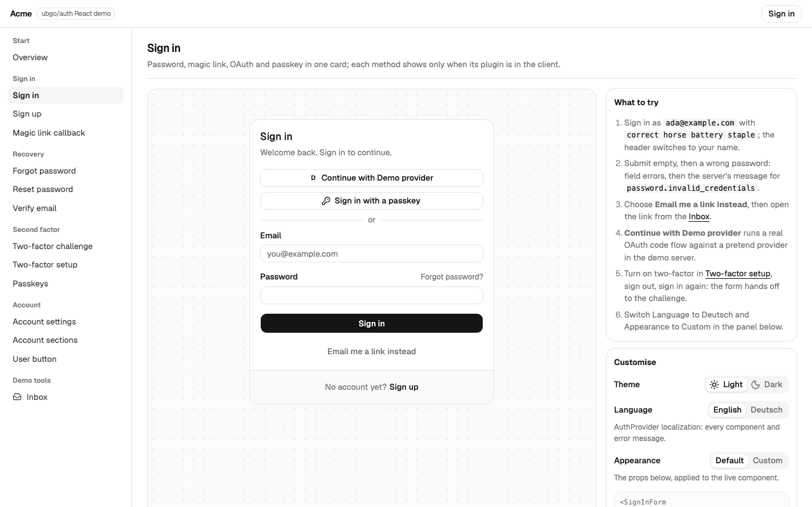

<h1 align="center">auth</h1>
<p align="center"><strong>Authentication you import, not a service you run.</strong></p>
<p align="center">An embeddable, open-source authentication library for every kind of Go app (SaaS, internal tools, APIs, CLIs, serverless): sign-in, sessions, two-factor, passkeys, OAuth and organizations as plugins, stored in your own Postgres, MySQL or SQLite.</p>

<p align="center">
  <a href="LICENSE"></a>
  
  
  
  <a href="COVERAGE.md"></a>
  
</p>

auth is a Go authentication library in the spirit of better-auth: you import it, pass it a list of plugins, and get users, sessions, email and password sign-in, phone codes, usernames, magic links, social sign-in through Google, GitHub or any OpenID Connect issuer, TOTP two-factor, passkeys (WebAuthn), API keys, short-lived JWTs, organizations with invitations, and an admin API. Its tables live in your own database next to your own tables, where your queries may read and join them. It works with net/http, chi, gin, echo, fiber and gqlgen, runs on Postgres, MySQL 8 and SQLite through any `database/sql` driver, and needs no hosted service, no separate identity server and no API key.



> Status: pre-release. The API can still change.

## Contents

- [Why auth?](#why-auth)
- [Quick start](#quick-start)
- [Pages, if you want them](#pages-if-you-want-them)
- [Frontend client](#frontend-client)
- [Examples](#examples)
- [Guides](#guides)
- [Databases](#databases)
- [Sessions](#sessions)
- [Plugins](#plugins)
- [Modules](#modules)
- [Your user struct](#your-user-struct)
- [Stability](#stability)
- [Security](#security)
- [Development](#development)
- [FAQ](#faq)
- [License](#license)

## Why auth?

Go has no better-auth. A Go app today chooses between a hosted identity service that charges per user and keeps the users elsewhere, a self-hosted identity server that is one more system to run and upgrade, or a week of hand-written sign-in, reset, verification and session code that every app gets subtly wrong. auth is the fourth option: a library.

Everything is a plugin, including password sign-in and email addresses. The list of plugins you pass to `auth.New` is the complete answer to "what can sign a user in", and a combination that cannot work (a password with no way to recover it, a sign-in identifier that is not unique) fails at start-up instead of in production.

- **Only what you use.** An app imports only the sign-in methods it offers, and a plugin of your own gets the same powers as the built-in ones: operations, hooks, columns on the user table, its own tables and migrations.
- **Your database, your joins.** The auth tables sit beside yours. Read and join them with typed [sqlb](https://github.com/ubgo/sqlb) columns, so a renamed column is a compile error rather than a production bug. Only writes are closed, because the invariants live in Go.
- **One pipeline for every entry point.** Each feature is one typed operation. A Go call, an HTTP route and a GraphQL resolver all run the same code, so none can skip the rate limit, the CSRF origin check, the session requirement or a hook.
- **Security pinned by tests.** Constant-time comparison of every secret is a source guard that fails the build; one password hash on every sign-in path, known account or not, is a timing test; only verified identities ever match a person; tokens are single-use under concurrency.
- **Three engines, one behaviour.** Values are normalized in Go and compared byte for byte, and one integration suite runs on Postgres, MySQL and SQLite.
- **A dependency-free core.** The core module depends on the standard library and sqlb only, enforced by a test; argon2, WebAuthn and each framework adapter are separate modules you download only if you import them.

| | **auth** | Hosted identity service | Self-hosted identity server | Hand-written on a session library |
|---|---|---|---|---|
| Users stored in your database | ✅ | ❌ | ⚠️ its own database | ✅ |
| Join auth tables in your queries | ✅ typed | ❌ | ❌ | ✅ |
| Nothing extra to run or pay for | ✅ | ❌ | ❌ | ✅ |
| Password, codes, links, OAuth, passkeys, 2FA, orgs | ✅ | ✅ | ✅ | ❌ you write them |
| Rate limits, CSRF and enumeration safety on every route | ✅ one pipeline | ✅ | ✅ | ⚠️ per route, by hand |
| Customise with Go code in your binary | ✅ plugins and hooks | ⚠️ webhooks | ⚠️ extensions | ✅ |

If you want a separate identity product with an admin console and federation across many apps, those options exist and are good. If you want sign-in to be a Go import that lives in your app and your database, that is auth.

## Quick start

```sh
go get github.com/ubgo/auth@latest github.com/ubgo/auth/plugin/password@latest
```

```go
a, err := auth.New(
	auth.WithDB(db, sqlb.PostgresDialect{}),
	auth.WithBaseURL("https://app.example.com"),
	auth.WithPlugins(
		email.New(email.Login(), email.Recover(), email.WithMailer(mailer)),
		password.New(),
	),
)
if err != nil {
	log.Fatal(err) // a broken plugin combination fails here, not in production
}

mux.Handle("/auth/", authhttp.Handler(a, authhttp.Prefix("/auth")))
mux.Handle("/me", authhttp.Middleware(a)(authhttp.RequireUser(meHandler)))
```

Create the tables with `a.Migrate(ctx)`, or wire the `authcli` package into your binary and run `myapp auth migrate` ([examples/cli](examples/cli)). Schedule `myapp auth sweep` (or `a.Sweep`) to delete expired sessions and tokens, and `myapp auth maintain` (or `a.Maintain`) when a plugin has a job of its own, such as `plugin/stale`'s mail to dormant accounts; the library runs no background workers. The full program, runnable with `go run ./quickstart` from `examples/`, is [examples/quickstart](examples/quickstart).

That serves, among others:

```text
POST /auth/password/sign-up      POST /auth/password/forgot
POST /auth/password/sign-in      POST /auth/password/reset
POST /auth/email/verify          GET  /auth/session
POST /auth/sign-out              GET  /auth/sessions
```

Every route is also a typed Go call — `pw.SignIn(ctx, password.SignInRequest{…})` — and both run the same pipeline: rate limits, the CSRF origin check, the session, hooks, one transaction. Errors answer `{"error":{"code":…,"message":…}}` by default; an API with its own error contract (RFC 9457 problem+json, a house envelope) replaces the body with `authhttp.EncodeErrors(enc)`, and the status and `Retry-After` stay the library's.

A frontend calls the same routes through a typed TypeScript client generated from the operation list: `createAuthClient({ baseURL: "/auth", plugins: [password(), twofactor()] })` has a method per operation with its input and output types and error codes as a closed union, and a plugin's methods exist only when the plugin is passed in. The prebuilt copy is [clients/ts](clients/ts); `myapp auth client ts --out <dir>` writes one for your app's own plugins. See the [TypeScript client guides](docs/client/README.md), and [your own plugins](docs/client/custom-plugins.md) for a client generated by your app.

## Pages, if you want them

The library is headless: every feature is a JSON route and a Go call. If you do not want to build the forms, `authui.Handler(a)` serves sign-in, sign-up, forgot and reset password, email verification, magic-link sign-in, the two-factor step and account settings as plain server-rendered pages that work on phones and without JavaScript.

```go
mux.Handle("/", authui.Handler(a, authui.AppName("Acme"), authui.AfterSignIn("/dashboard")))
```

`authui.Templates(fsys)` replaces any page or static file with your own, checked at start-up, and every plugin that implements `authhttp.UIMethod` (OAuth, one button per provider) adds its sign-in button. See [authui](authui) and [examples/ready-made-pages](examples/ready-made-pages).

## Frontend client


The TypeScript client is generated from the Go operations, so a renamed field or a misspelt error code fails to compile instead of failing for a user. It runs in cookie mode in a browser on your site and in bearer mode everywhere else (another site, React Native, a CLI with a file token store, server-side code). The React kit on top is two parts: `@ubgo/auth-react`, an imported headless package (provider, session hooks, gates, plugin gating, OAuth links, error text), and shadcn components you copy in and own (sign-in, sign-up, reset, verification, two-factor, passkeys, user menu, account page).



- [Client learning path](docs/client/README.md#learning-path): thirteen steps from a first typed call to a production frontend, each with a guide and an example, and a [start from your goal](docs/client/README.md#start-from-your-goal) table (React on the same domain, hooks only, mobile, a Node backend, your own Go plugin).
- [Choose a client setup](docs/choosing/client.md): prebuilt or app-generated client, cookie or bearer, same domain or another site, components or hooks or the plain client, which router, which plugins.
- [Feature index](docs/reference/features.md#typescript-client): every client and React feature with its guide section and the example that runs it; [examples/ts-client-flows](examples/ts-client-flows), [ts-client-bearer](examples/ts-client-bearer), [react-headless](examples/react-headless) and [react-demo](examples/react-demo) are the runnable ones.

## Examples

Every recipe in [examples/](examples) is a complete program with a README that walks through it with real output, and a test that drives it end to end, so a recipe that stops working fails the build. The table below is a selection; [examples/README.md](examples/README.md) lists all 117 recipes, and the [feature index](docs/reference/features.md) names the example for each feature.

| Recipe | What it shows |
|---|---|
| [quickstart](examples/quickstart) | Email and password on `net/http` |
| [saas-workspace](examples/saas-workspace) | Sign up and create the user's workspace in one transaction |
| [phone-only](examples/phone-only) | SMS-code sign-up and sign-in, no email and no password |
| [multi-email](examples/multi-email) | Many addresses per account; change an address and undo a change you did not make |
| [custom-plugin](examples/custom-plugin) | Your own plugin: a column on `auth_user`, a data hook and an endpoint |
| [admin-plan](examples/admin-plan) | An admin list joining `auth_user` to your plan tables with typed columns; ban and unban |
| [magic-link](examples/magic-link) | Passwordless sign-in with a single-use link |
| [two-factor](examples/two-factor) | TOTP enrolment, the second-factor step, recovery codes |
| [passkeys](examples/passkeys) | Register a passkey and sign in with it alone |
| [oauth](examples/oauth) | GitHub, Google or any OpenID Connect issuer |
| [login-gate](examples/login-gate) | An internal dashboard for one email domain with no database: `authgate`, the sign-in in a sealed cookie |
| [api-keys-and-jwt](examples/api-keys-and-jwt) | Scoped API keys for scripts; short-lived JWTs for another service |
| [organizations](examples/organizations) | Organizations, invitations by email, role checks |
| [sso](examples/sso) | Enterprise SSO: OIDC and SAML identity providers per customer |
| [scim](examples/scim) | A customer's IdP provisions, groups and deactivates users over SCIM 2.0 |
| [ready-made-pages](examples/ready-made-pages) | The server-rendered pages, with no auth UI written by the app |
| [multi-instance](examples/multi-instance) | Several instances sharing rate limits through the database or Redis |
| [session-strategies](examples/session-strategies) | Every session mode: database, memory, Redis, a custom store, the snapshot and memory caches, stateless, lifetimes per client |
| [cli](examples/cli) | `auth migrate` and `auth sweep` from your own binary |
| [security-events](examples/security-events), [geo-rules](examples/geo-rules), [risk-signals](examples/risk-signals) | The security event stream to your own sink; country rules and impossible travel; IP, bot and trial-abuse checks of your own |
| [gin](examples/gin), [echo](examples/echo), [fiber](examples/fiber) | The quick start on each framework |
| [gqlgen](contrib/gqlgen/example) | Sign up, sign in and `me` through a generated GraphQL server |

## Guides

New here? Follow the [learning path](docs/README.md#learning-path): fourteen steps from install to a production setup, each with a guide and an example, or [start from your goal](docs/README.md#start-from-your-goal). Before writing code, the [decision guides](docs/choosing/README.md) say which transport, sign-in methods, session strategy, database options and plugin set fit your kind of app, and the [feature index](docs/reference/features.md) lists every feature with its guide section and example.

The [guides](docs) cover everything, step by step: [getting started](docs/start/first-app.md), the [concepts](docs/README.md#concepts) (sessions, identifiers, errors, rate limits, security events, geo rules, security, configuration, databases, migrations), a guide for [every plugin](docs/README.md#plugins), every [integration](docs/README.md#integrations) (net/http, chi, gin, echo, fiber, GraphQL, ready-made pages, mobile apps, single-page frontends, the [TypeScript client](docs/client/README.md), Redis, the CLI, other services), [extending](docs/extending/README.md) the library with plugins of your own, and an [HTTP API reference](docs/reference/http-api.md) generated from the code. Every Go snippet is copied from a program the test suite compiles and runs, and every HTTP transcript comes from a real run.

## Databases

Postgres, MySQL 8 and SQLite, through any `database/sql` driver. The library writes SQL for each engine itself and is tested on all three. Values are normalized in Go and compared byte for byte, so the answers are the same everywhere. Column types are overridable per engine with `auth.WithSQLTypes`, such as native `UUID` ids on Postgres, and every built-in plugin's tables follow.

## Sessions

By default a session is an opaque random token whose hash sits in `auth_session`, looked up once per request: sign-out, "sign out everywhere" and bans take effect at once. Every part of that can be swapped, and each piece is an interface you can implement yourself:

| You want | Option | What it costs |
|---|---|---|
| Sessions in Redis, memory or your own backend | `auth.WithSessionStore(…)`: `auth.NewMemorySessionStore()`, `redisrate.NewSessionStore(rdb)`, or any `auth.SessionStore` | One lookup per request in that store; `sessiontest.Run` checks a custom store |
| The database and a fast copy at once | `auth.WithSessionStore(auth.MirrorSessionStore(auth.SQLSessionStore(), redisrate.NewSessionStore(rdb)))` | Reads try the copy first; the database stays authoritative, and a copy that cannot end a session fails the sign-out |
| Fewer lookups | `auth.WithSessionCache(…)`: `auth.NewSnapshotCache(key)` (an encrypted copy the client carries), `auth.NewCompactSessionCache(key)` (a signed copy the client can read), `auth.NewMemorySessionCache(n)`, `redisrate.NewSessionCache(rdb)` | A ban or remote sign-out reaches a client-held copy only when it expires: [one minute](ds:block?id=defaultsessioncachettl-8knzqpgz) by default, [fifteen at most](ds:block?id=maxsessioncachettl-2sh2x4n6); the memory and Redis caches drop the user's entries at once |
| No session storage at all | `auth.WithStatelessSessions(key)`: the token carries the session, sealed | The user is still loaded per request, so bans and "sign out everywhere" work; other devices cannot be listed or ended one by one. `auth.WithSessionRevocations(list)` makes a sign-out end the token everywhere; `auth.WithStatelessRefreshWithoutRead(d)` skips the user query, so a ban waits up to `d` |
| Longer sessions for apps than for browsers | `auth.WithSessionPolicy(auth.ByCredential(web, app))` | Each session keeps the lifetime it was created with, at most [400 days](ds:block?id=maxsessionlifetime-pmz4mcbj) |

[examples/session-strategies](examples/session-strategies) runs every combination, and the guide explains each trade-off.

## Plugins

| Package | What it adds |
|---|---|
| [`plugin/email`](plugin/email) | Email identities, verification links, change with undo, many addresses per user, sign-in codes |
| [`plugin/password`](plugin/password) | argon2id passwords, sign-up, sign-in, reset, change; `password/hibp` checks breaches; a separate module |
| [`plugin/phone`](plugin/phone) | Phone identities, SMS codes, sign-in and sign-up with a code alone |
| [`plugin/username`](plugin/username) | Handles, reserved names, availability |
| [`plugin/ldap`](plugin/ldap) | Sign in with the username and password of an LDAP directory (OpenLDAP, Active Directory, FreeIPA, lldap), checked by the directory and never stored; TLS required, a replaceable `Directory`; a separate module |
| [`plugin/siwe`](plugin/siwe) | Sign-In with Ethereum (ERC-4361): a single-use nonce, the message checked against your site, chain and time window, several wallets per user, a replaceable `Verifier` for smart-contract wallets; a separate module |
| [`plugin/oauth`](plugin/oauth) | Google, GitHub, any OpenID Connect issuer; optional sealed provider tokens, refreshed before expiry |
| [`plugin/twofactor`](plugin/twofactor) | TOTP, mailed or texted codes and security keys, several per user, with recovery codes; asked after password sign-ins by default (better-auth's rule), any other rule through `WithPolicy`; `RequireEnrolment` makes a factor mandatory through a session task |
| [`plugin/passkey`](plugin/passkey) | Passkeys (WebAuthn); a separate module |
| [`plugin/emailchallenge`](plugin/emailchallenge) | Passwordless sign-in by one challenge a link and a code both complete, always signing in the browser that asked |
| [`plugin/magiclink`](plugin/magiclink) | Sign-in by a single-use link to a verified address or number |
| [`plugin/apikey`](plugin/apikey) | API keys with scopes for scripts and integrations |
| [`plugin/jwt`](plugin/jwt) | Short-lived JWTs (EdDSA, RS256 or ES256) from a session, a JWKS, a Go verifier, and named templates shaped for another service (presets for Supabase, Hasura, Convex and Firebase in `jwtpreset`) |
| [`plugin/admin`](plugin/admin) | Find and search users, ban and unban, revoke sessions, roles and permissions decided by a pluggable `Authorizer` (built-in admin and user roles; `plugin/access` roles, Casbin, OpenFGA or your own), impersonate (visible to the user, [one hour at most](ds:block?id=maximpersonationttl-3f39wbus)) |
| [`plugin/invite`](plugin/invite) | Invitation codes with usage tracking, optionally invite-only sign-up |
| [`plugin/referral`](plugin/referral) | User-to-user referral codes and the steps that complete a referral; a separate module |
| [`plugin/terms`](plugin/terms) | Record which terms version each user accepted; block until the current one is |
| [`plugin/anonymous`](plugin/anonymous) | Guest sessions before sign-up, linked to the account by an app hook on every sign-in path |
| [`plugin/lastlogin`](plugin/lastlogin) | Remember how and when each user last signed in |
| [`plugin/metadata`](plugin/metadata) | Public, private and user-editable JSON metadata per user in a table of its own; admin routes decided by your authorizer |
| [`plugin/sessiondata`](plugin/sessiondata) | Per-session app data in a table of its own, removed with the session; the core carries the same data inline on `Session.Data` |
| [`plugin/handoff`](plugin/handoff) | Hand a session to a native app or another client with a three-minute single-use token |
| [`plugin/captcha`](plugin/captcha) | Turnstile, reCAPTCHA or hCaptcha before sign-up, sign-in and reset, or only when a rate rule asks for a challenge; fails closed |
| [`plugin/pow`](plugin/pow) | Proof of work instead of a captcha: a rate or geo rule with the challenge action asks the client for a hashcash proof (`X-Pow-Proof`), with no third party |
| [`plugin/stale`](plugin/stale) | Mail the owners of accounts nobody has signed in to for a year (configurable) and, if you ask for it, delete the ones that never answer; run from your scheduler with `auth maintain` |
| [`plugin/organization`](plugin/organization) | Organizations, teams, members, invitations by email or any identifier kind matched only to verified addresses, roles decided by a pluggable `Authorizer`, an active organization per session, built-in, static and per-organization roles checked by permission, lifecycle hooks, verified email domains that invite, suggest or auto-join; `orgjwt` puts the active organization in a JWT; a separate module |
| [`plugin/access`](plugin/access) | Permission statements and the roles built from them (better-auth's `access`), used by the organization plugin, by the admin plugin through `accessadmin`, by API-key permissions through `accessapikey`, and by any app; a separate module |
| [`plugin/audit`](plugin/audit) | An audit log of security events, filterable by type and organization, with each user's own history; any sink (a SIEM, a log pipeline) through `Sink` and `Querier`, and any operation mapped to an event type |
| [`plugin/sso`](plugin/sso) | Enterprise single sign-on: OpenID Connect and SAML 2.0 identity providers registered at run time per organization or email domain; a separate module |
| [`plugin/samlidp`](plugin/samlidp) | Your app as a SAML 2.0 identity provider for wikis, ticketing and vendor tools: metadata, SP-initiated and opt-in IdP-initiated sign-on, signed assertions; a separate module |
| [`plugin/scim`](plugin/scim) | A SCIM 2.0 server, so Okta, Entra ID and other IdPs provision and deprovision users and groups; a separate module |
| [`plugin/deviceauth`](plugin/deviceauth) | The device authorization grant (RFC 8628) for CLIs and TVs; [`oauthdevice`](plugin/deviceauth/oauthdevice) issues OAuth tokens through `oauthprovider` instead; separate modules |
| [`plugin/oauthproxy`](plugin/oauthproxy) | Provider sign-in on preview deployments through production's callback; [`oauthpopup`](plugin/oauthproxy/oauthpopup) signs in from a popup for apps embedded on other sites; a separate module |
| [`plugin/oauthprovider`](plugin/oauthprovider) | Your app as an OAuth 2.1 authorization server and OpenID Connect provider, for other apps and MCP servers; a separate module |
| [`plugin/webhook`](plugin/webhook) | Signed outgoing webhooks (Standard Webhooks) for user, session, identity and security events, with retries, dead letters, replay and an SSRF guard; `webhook/signature` verifies them; a separate module |
| [`plugin/agentauth`](plugin/agentauth) | AI agents sign in with their own keys and act for a user under the capabilities the user granted (Agent Auth Protocol); a separate module |

Each package has a README with its options, routes, tables, errors and security notes. A plugin of your own implements `Name()` and whichever optional interfaces it needs: operations, hooks, columns on the user table, its own tables and migrations, identifier kinds, delivery channels, session checks, second factors. [examples/custom-plugin](examples/custom-plugin) builds one.

## Modules

The core module `github.com/ubgo/auth` depends on the standard library and `github.com/ubgo/sqlb` only, and a test (`deps_test.go`) fails if its go.mod gains another requirement. Every package in it, every plugin not listed below, [`authhttp`](authhttp) (net/http, chi, gorilla), [`authgate`](authgate) (a login gate with no database) and [`authcli`](authcli), costs nothing extra to import.

A package that needs a third-party module is its own module, so an app downloads that dependency only when it imports the package. So is a feature that is not authentication, such as organizations:

| Module | Why it is separate |
|---|---|
| [`github.com/ubgo/auth/plugin/password`](plugin/password) | argon2id from `golang.org/x/crypto` |
| [`github.com/ubgo/auth/plugin/passkey`](plugin/passkey) | WebAuthn from `go-webauthn` |
| [`github.com/ubgo/auth/plugin/organization`](plugin/organization) | no dependency: grouping users is not authentication, so an app without organizations never carries it |
| [`github.com/ubgo/auth/plugin/access`](plugin/access) | no dependency: permission statements and roles are authorization, not authentication; its `accessadmin` and `accessapikey` adapters plug it into the admin and API-key plugins |
| [`github.com/ubgo/auth/plugin/referral`](plugin/referral) | no dependency: referrals are not authentication |
| [`github.com/ubgo/auth/plugin/sso`](plugin/sso) | SAML through gosaml2, goxmldsig and etree |
| [`github.com/ubgo/auth/plugin/samlidp`](plugin/samlidp) | SAML signing and checking through goxmldsig, etree and xml-roundtrip-validator |
| [`github.com/ubgo/auth/plugin/webhook`](plugin/webhook) | no dependency: sending events to other services is not authentication |
| [`github.com/ubgo/auth/plugin/ldap`](plugin/ldap) | go-ldap |
| [`github.com/ubgo/auth/plugin/siwe`](plugin/siwe) | decred's secp256k1 (never go-ethereum) |
| [`github.com/ubgo/auth/plugin/scim`](plugin/scim), [`plugin/deviceauth`](plugin/deviceauth), [`plugin/oauthproxy`](plugin/oauthproxy), [`plugin/oauthprovider`](plugin/oauthprovider), [`plugin/agentauth`](plugin/agentauth) | no dependency: opt-in protocols most apps never use, so they are compiled only by apps that import them |
| [`github.com/ubgo/auth/plugin/deviceauth/oauthdevice`](plugin/deviceauth/oauthdevice) | the one place `deviceauth` and `oauthprovider` meet |
| [`github.com/ubgo/auth/authui`](authui) | serves the password pages, so it imports `plugin/password` |
| [`contrib/gin`](contrib/gin), [`contrib/echo`](contrib/echo), [`contrib/fiber`](contrib/fiber), [`contrib/gqlgen`](contrib/gqlgen) | the framework |
| [`github.com/ubgo/auth/contrib/redis`](contrib/redis) | a rate store for several instances, on the Redis client |
| [`github.com/ubgo/auth/contrib/phonenumbers`](contrib/phonenumbers) | numbers typed without the country code, on libphonenumber |
| [`github.com/ubgo/auth/contrib/goth`](contrib/goth) | any [goth](https://github.com/markbates/goth) provider as an `oauth.Provider`, on goth and `golang.org/x/oauth2` |

`examples/` and `integration/` are modules too, so their database drivers never reach an app's go.sum.

## Your user struct

Read the auth tables freely; write them only through the library. A composite user loads in one statement: columns on `auth_user` are flat fields, anything from a join is a nested struct.

```go
type User struct {
	auth.User          // ID, Name, Image, CreatedAt
	email.EmailColumns // PrimaryEmail, EmailVerifiedAt
	Phone phone.Data   // joined from auth_identity
}

func (u *User) Bindings() []sqlb.Binding {
	return sqlb.Bindings(auth.UserBindings(&u.User), email.Bindings(&u.EmailColumns), phone.UserBindings(&u.Phone))
}
```

## Stability

The columns listed in [stability_test.go](stability_test.go) keep their names, types and meaning within a major version; the test fails if one disappears. Anything else in the auth tables may change, and each package README says which of its columns are covered.

## Security

The properties this version holds, and the tests that pin them, are listed in [CHANGELOG.md](CHANGELOG.md). In short: constant-time comparison of every secret (a source guard fails the build otherwise), one password hash on every sign-in path (a timing test), single-use tokens under concurrency, only verified identities match a person, and secrets that print as `[redacted]`. Opt-in policies harden sign-in further: country allow and deny rules and impossible-travel detection over a GeoIP source you supply ([geo rules](docs/concepts/geo-rules.md)), and a security event stream (rate limits, credential stuffing, two-factor lockouts, geo refusals) to your own log drain or SIEM ([security events](docs/concepts/security-events.md)). Every database failure of every operation is proven to reach the caller: a test driver fails each database call in turn. To report a vulnerability, see [SECURITY.md](SECURITY.md).

## Development

```sh
task check          # every module, the gqlgen example, the type checks, Markdown wrap and doc drift
task test:engines   # the integration suite on SQLite, Postgres and MySQL
task cover          # statement coverage per package, unit and integration merged
task fuzz           # every fuzz target
task ci             # the full gate on GitHub Actions (task ci:status reads the result)
task --list         # the rest
```

GitHub Actions runs `task check` and the Postgres and MySQL suites on every push to `main` and every pull request.

See [CONTRIBUTING.md](CONTRIBUTING.md) for the rules a change is reviewed against and [COVERAGE.md](COVERAGE.md) for the measured coverage of every package and the few statements no test reaches.

## FAQ

**Is auth a service I have to run?** No. It is a Go library: it runs inside your binary and stores its tables in your database. There is no server, no account and no API key.

**Does it send my users' data anywhere?** No. Nothing leaves your process except what you send: mail and SMS go through the sender you plug in, and OAuth talks only to the providers you configure. The optional `password/hibp` breach check sends the first five characters of a password's SHA-1 hash, never the password.

**Which databases does it support?** Postgres, MySQL 8 and SQLite, through any `database/sql` driver. The same integration suite runs on all three.

**Can I use it with gin, echo, fiber, chi or GraphQL?** Yes. `authhttp` works with net/http and chi; `contrib/gin`, `contrib/echo`, `contrib/fiber` and `contrib/gqlgen` are adapters. Every one calls the same operations.

**How is this different from writing auth myself on a session library?** You get the parts that are easy to get wrong already done and tested: enumeration-safe responses, constant-time comparison, rate limits per IP and per account, single-use tokens, verified-only identity matching, email change with undo, two-factor with recovery codes, and passkeys.

**Can I add my own sign-in method or fields?** Yes. A plugin can add operations, hooks, columns on `auth_user`, its own tables and migrations, and identifier kinds. The [extension guides](docs/extending/README.md) walk through each step, starting with [plugin anatomy](docs/extending/01-plugin-anatomy.md).

**Can I rename the tables?** Yes, per `auth.New` and before the first deploy: `auth.WithTablePrefix("billing_")` prefixes every table, `auth.RenameTable(auth.TableUser, "members")` names one exactly. The argument is a declared table value, never a string, so a rename of a table nothing declares fails at start-up; every statement, migration, index, foreign key and maintenance command follows, and `a.TableName(auth.TableUser)` gives the real name for SQL you write yourself. Columns keep their names. See [databases](docs/concepts/databases.md).

**Does it work for mobile apps and scripts?** Yes. Send `Auth-Token-Mode: bearer` and the session token comes back in a header for a native client, and `auth.ByCredential` gives apps a longer session than browsers; API keys with scopes cover scripts, and short-lived JWTs cover other services.

**Does it hit the database on every request?** By default, one indexed lookup per signed-in request, which keeps sign-out and bans instant. `auth.WithSessionCache` cuts that to one lookup per user per minute, and `auth.WithStatelessSessions` removes the session table altogether; both trade some revocation speed for it, and the [Sessions](#sessions) table says how much.

**Is it ready for production?** Not yet. It is pre-release and the API can still change; the security properties it claims are the ones its tests pin, listed in the changelog.

## License

Apache-2.0. See [LICENSE](LICENSE) and [NOTICE](NOTICE).
