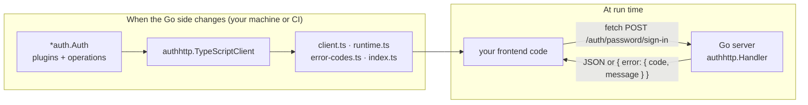
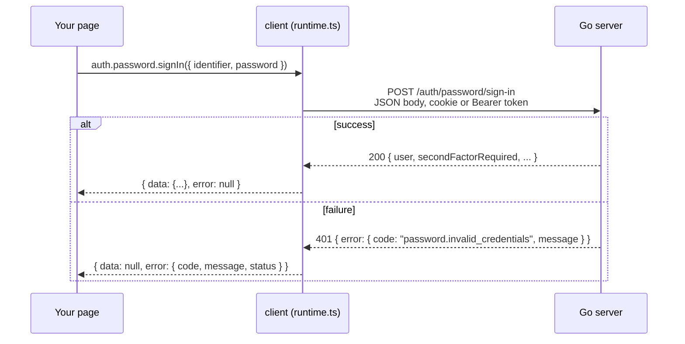
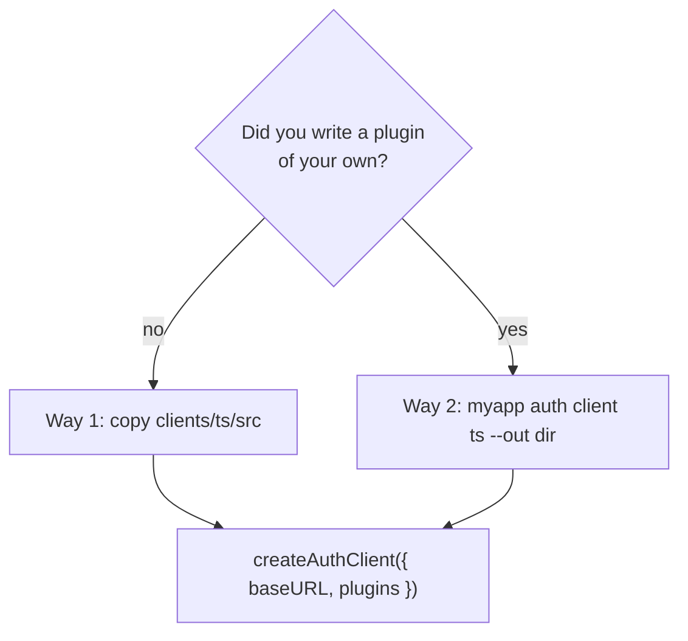

# Client: TypeScript and React

Everything a frontend needs to call the library: a typed TypeScript client generated from the Go operations, for browsers, mobile apps, CLIs and servers, and a React kit (hooks plus copy-in components) on top of it. This page is the way in: a learning path, a table by goal, the picture, and then how the client works, where its files come from, who runs what and when, and which of the two ways to get it fits your app.


## Learning path

Read in this order to go from a first typed call to a production frontend. Each step is one guide and one example that a test runs or type-checks; stop at any step once your app has what it needs. Steps 1 to 8 are the TypeScript client for any frontend or runtime; steps 9 to 12 add the React kit on top of it.

| # | Step | What you learn | Guide | Example |
|---|---|---|---|---|
| 1 | How it works | The generator and the client, the five files, what one call does, the two ways to get it | This page, from [The problem it solves](#the-problem-it-solves) | [clients/ts/examples](../../clients/ts/examples/) |
| 2 | Your first call | Copy the client, create it once, sign up, sign in, read the session, sign out, in a browser on the same site | [Quickstart](quickstart.md) | [spa.ts](../../clients/ts/examples/spa.ts), run by `task ts:smoke` |
| 3 | Plugins | Why you list them, the compile errors you get when you call one you did not list, how a method gets its name, one typed call per namespace | [Plugins](plugins.md) | [plugins.ts](../../clients/ts/examples/plugins.ts) |
| 4 | Errors | `{ data, error }`, narrowing by code, the three `client.*` codes, your own words per code, `Retry-After` | [Errors](errors.md) | [errors.ts](../../clients/ts/examples/errors.ts), [ts-client-flows](../../examples/ts-client-flows/) |
| 5 | Flows | The pending second factor, email verification, password reset, magic link, OAuth, sign-out everywhere, organizations | [Flows](flows.md) | [ts-client-flows](../../examples/ts-client-flows/) |
| 6 | Bearer mode and other runtimes | Token stores, a frontend on another site, server-side code for a browser, mobile, desktop, CLIs | [Bearer mode and other runtimes](bearer-and-mobile.md) | [ts-client-bearer](../../examples/ts-client-bearer/) |
| 7 | The options | `fetch`, per-call `headers`, `signal` and the helper types, each by example | [Reference › The options by example](reference.md#the-options-by-example) | [options.ts](../../clients/ts/examples/options.ts) |
| 8 | Your own plugins | Your app generates its own client with `auth client ts`, typing your operations and error codes, and a test fails when the copy is stale | [Your own plugins](custom-plugins.md) | [ts-client-custom](../../examples/ts-client-custom/) |
| 9 | React quickstart | Link the packages, serve `/auth` on the page's origin, install components from the registry, mount the provider, add the pages mailed links open | [React UI kit](react.md) | [react-demo](../../examples/react-demo/) (`task demo`) |
| 10 | React hooks | The headless package with markup of your own: the session, gates, a sign-in form, sign-out, OAuth buttons, passkeys, text and errors | [React hooks](react-hooks.md) | [react-headless](../../examples/react-headless/) (`task ui:headless`) |
| 11 | React components | Every component's props, slots, texts and results; the account sections alone; re-authentication | [React components](react-components.md) | [react-demo](../../examples/react-demo/) |
| 12 | Your router | `navigate` and `Link` for TanStack Router, React Router, the Next.js App Router or no router; server rendering | [React with your router](react-routers.md) | [react-demo](../../examples/react-demo/) (TanStack Router), [react-router-app](../../examples/react-router-app/) (React Router), [nextjs-app](../../examples/nextjs-app/) (Next.js App Router), [react-headless](../../examples/react-headless/) (no router) |
| 13 | Go to production | One origin or trusted origins, HTTPS, where tokens live, regenerating, the routes mailed links need | [Production checklist](#production-checklist) below, then the server's [Going to production](../start/production.md) | [ts-client-custom](../../examples/ts-client-custom/) (the freshness test), [spa-cross-origin](../../examples/spa-cross-origin/) |

Not sure which client, mode or React layer fits? [Choose a client setup](../choosing/client.md) answers that with decision tables first.

## Start from your goal

| I have… | Read | Run |
|---|---|---|
| A React app on the same domain as the Go server, and I want ready-made screens | [React UI kit](react.md), then [React components](react-components.md) | [react-demo](../../examples/react-demo/) |
| A React app with its own design system: hooks only, my own markup | [React hooks](react-hooks.md) | [react-headless](../../examples/react-headless/) |
| A React app on Next.js, React Router or another router | [React with your router](react-routers.md) | [nextjs-app](../../examples/nextjs-app/), [react-router-app](../../examples/react-router-app/), [react-demo](../../examples/react-demo/) |
| A Vue, Svelte or plain TypeScript app on the same site | [Quickstart](quickstart.md), then [Flows](flows.md) | [spa.ts](../../clients/ts/examples/spa.ts), [ts-client-flows](../../examples/ts-client-flows/) |
| A frontend on another site (`app.example` calling `api.example.com`) | [Bearer mode › Step 4](bearer-and-mobile.md#step-4--a-frontend-on-another-site), [SPA frontends](../integrations/spa-frontends.md) | [spa-cross-origin](../../examples/spa-cross-origin/) |
| A mobile app (React Native, Expo) | [Bearer mode › Step 3](bearer-and-mobile.md#step-3--choose-where-the-token-is-kept), [Mobile apps](../integrations/mobile-apps.md) | [ts-client-bearer](../../examples/ts-client-bearer/), [mobile-bearer](../../examples/mobile-bearer/) |
| A CLI or a Node script that must stay signed in | [Bearer mode › Step 6](bearer-and-mobile.md#step-6--react-native-electron-clis-and-node-scripts) | [ts-client-bearer](../../examples/ts-client-bearer/) (`web/cli.ts`) |
| A Node backend (server rendering, a backend for the frontend) that calls auth for the browser | [Bearer mode › Step 5](bearer-and-mobile.md#step-5--server-side-code-calling-for-a-browser) | [ts-client-bearer](../../examples/ts-client-bearer/) (`web/server.ts`) |
| A Go plugin of my own, to call from TypeScript | [Your own plugins](custom-plugins.md) | [ts-client-custom](../../examples/ts-client-custom/) |
| Mailed links (verify, reset, magic link) that must open a page of my app | [Flows](flows.md), [React UI kit › Step 6](react.md#step-6--add-the-pages-mailed-links-open) | [ts-client-flows](../../examples/ts-client-flows/), [react-demo](../../examples/react-demo/) |
| Error messages in my own words or language | [Errors › Step 4](errors.md#step-4--your-own-words-per-code), [React hooks › Step 8](react-hooks.md#step-8--text-and-errors) | [errors.ts](../../clients/ts/examples/errors.ts), [react-demo](../../examples/react-demo/) |
| No TypeScript at all, or another language | [SPA frontends](../integrations/spa-frontends.md) (plain `fetch`), [HTTP API](../reference/http-api.md), [`openapi.json`](../reference/openapi.json) | [spa-cross-origin](../../examples/spa-cross-origin/) |

## The picture


A password sign-in from a React page, in twelve numbered steps. Blue goes down: the user clicks, `SignInForm` (or your own code on the hooks) calls `client.password.signIn`, the runtime sends it with the cookie or a `Bearer` header, and the Go handler runs the operation through the same pipeline every transport uses, which reads the hash and stores a session row. Green comes back up: `200` with `Set-Cookie` (or `Set-Auth-Token` in bearer mode), the runtime resolves `{ data, error }`, `refreshSession()` refetches `GET /auth/session`, `useSession()` has the user, and the page navigates. The purple column runs only when the Go side changes: the generator walks the operations and writes the four `.ts` files. Without React, the top two layers are your own code calling the client.

## The problem it solves

A Go app that uses this library serves JSON routes under a prefix such as `/auth`: `POST /auth/password/sign-in`, `GET /auth/session` and so on. A frontend can call them with plain `fetch`, but then every field name, every route and every error code is a string typed by hand, and nothing tells you when the Go side changes. Rename a field in Go and the frontend breaks at run time, for a user.

The client removes that gap. It is TypeScript generated **from the same list of operations the Go server serves**, so:

- every route is a method (`client.password.signIn(...)`), with the input and output types of the Go structs;
- every error code is a closed union, so a misspelt code does not compile;
- a plugin's methods exist only when you say the server has that plugin, so the editor offers exactly the calls that work.

## Two parts: the generator and the client

There are two different things, and keeping them apart is the key to the rest of this folder.

| | The generator | The client |
|---|---|---|
| What it is | Go code: `authhttp.TypeScriptClient(a)` | Four TypeScript files in a folder of your frontend |
| Where it runs | On your machine or in CI, when you ask for it | In the browser, a Node server, a mobile app: wherever your frontend runs |
| When it runs | When the Go side changes (a plugin added, a field renamed) | On every call your frontend makes |
| What it reads | The operations an `*auth.Auth` serves, and every declared error code | Nothing at run time: the types are already in the files |
| Who calls it | `task docs:api` (the prebuilt copy) or your app's `auth client ts` command | Your frontend code |

The generator never runs in production, and the client never talks to Go code: it only sends HTTP requests to the routes.



The generator walks the same operation list that `authhttp.Handler` serves and that the OpenAPI document describes, so the client cannot name a route the server does not have:

<!-- ds:block id=authhttp-typescriptclient-4vn8kq2r lines=1-1 -->
**TypeScriptClient** · [`authhttp/typescript.go:150-167`](../../authhttp/typescript.go#L150-L167)

```go
func TypeScriptClient(a *auth.Auth) (map[string][]byte, error) {
```
<!-- /ds:block hash=47607e -->

## The five files

Every client, prebuilt or generated by your app, is the same five files in one folder. They import each other by name, so keep them together.

<!-- ds:block id=authhttp-tsfiles-6qm2xw8k -->
**TSFileClient** · [`authhttp/typescript.go:20-37`](../../authhttp/typescript.go#L20-L37)

```go
const (
	// TSFileClient is the generated part: one TypeScript type per Go input
	// and output type, one operation table and plugin factory per plugin,
	// and createAuthClient typed with the core's operations.
	TSFileClient = "client.ts"
	// TSFileRuntime is the hand-written fetch runtime, the same for every
	// app: request encoding, token modes, error decoding.
	TSFileRuntime = "runtime.ts"
	// TSFileErrorCodes is every error code the linked packages declare
	// (auth.Errors), the same module docs/reference/error-codes.ts is.
	TSFileErrorCodes = "error-codes.ts"
	// TSFileExtensions is the hand-written plugins that are not one
	// request each, the same for every app: oauthPopup() (the popup
	// sign-in of plugin/oauthproxy/oauthpopup) and lastLoginMethod().
	TSFileExtensions = "extensions.ts"
	// TSFileIndex re-exports the four, the module an app imports.
	TSFileIndex = "index.ts"
)
```
<!-- /ds:block hash=632c06 -->

You import `index.ts` (or the folder) and never edit any of them: the next generation overwrites them. `runtime.ts` and `extensions.ts` are the same bytes for every app; `client.ts` and `error-codes.ts` depend on the plugins and error codes the generating program has. `extensions.ts` holds the plugins that are not one request each and so cannot be generated: `oauthPopup()` and `lastLoginMethod()` ([Plugins › Hand-written plugins](plugins.md#hand-written-plugins-popup-sign-in-and-the-last-login-hint)).

## What one call does



A method never throws. It resolves to `{ data, error }` with exactly one of them set; a network failure is an error too (`client.network_error`). Queries are `GET` with the input in the query string, mutations are `POST` with a JSON body, exactly as the server decodes them.

## Two ways to get the client

| | Way 1: the prebuilt package | Way 2: your app generates its own |
|---|---|---|
| Where it comes from | [`clients/ts/src`](../../clients/ts/src/) in this repository (`@ubgo/auth-client`, not on npm) | Your Go binary: `myapp auth client ts --out web/src/auth` |
| What it knows | The core and every built-in plugin, with every built-in error code | The core, exactly the plugins your app wires, **your own plugins** and their error codes |
| How you get it | Copy the five files of `clients/ts/src` into your frontend | Route a word of your command line to `authcli.Main` (one function), then run the command |
| Kept fresh by | This repository's `task docs:api` and `task check` | You: re-run the command when Go changes, and a test or CI step that fails when the copy is stale |
| Guide | [Quickstart](quickstart.md) | [Your own plugins](custom-plugins.md) |

Which one do I need?

| Your situation | Use |
|---|---|
| You only use the library's plugins and want to start in five minutes | Way 1 |
| You wrote a plugin of your own (any `auth.Define` operation) and want to call it from TypeScript | Way 2 |
| Your plugins declare their own error codes and you want them in the union | Way 2 |
| You want the client to have exactly your app's routes, nothing more | Way 2 |
| You are not sure | Start with Way 1; switching later is replacing five files and nothing else in your code |

Both ways produce the same API: the same `createAuthClient`, the same `{ data, error }`, the same plugin factories. Code written against the prebuilt client compiles against your generated one.



## Plugins are switched on per client

The server decides which plugins exist; the client has to be told, because one generated `client.ts` describes every plugin the generating program knows. You list them when you create the client:

<!-- ds:block id=auth-yaqm87ck -->
**auth** · [`clients/ts/examples/quickstart.ts:10-13`](../../clients/ts/examples/quickstart.ts#L10-L13)

```typescript
export const auth = createAuthClient({
  baseURL: "/auth",
  plugins: [email(), password(), twofactor()],
});
```
<!-- /ds:block hash=992ade -->

`auth.password.signIn` and `auth.twofactor.verify` now exist; `auth.magiclink` does not, and calling it is a compile error. [Plugins](plugins.md) explains the rule and lists every factory.

## Requirements

- No dependencies. The client uses `fetch`, `Headers` and `URLSearchParams`, so it runs in every browser, Node 18 and later, Bun and Deno.
- The files are TypeScript with `.ts` import paths, for a bundler (Vite, esbuild, webpack with ts-loader) or a runtime that runs TypeScript files as they are (Node 22.18 and later, or 23.6 and later on the 23 line, with no flag; Bun; Deno). Your `tsconfig.json` needs `"allowImportingTsExtensions": true` and `"moduleResolution": "bundler"`.

## Try it

The shortest end-to-end run needs only Go and Node 22.18 or later: no `npm install`, because the client has no dependencies and Node runs its `.ts` files as they are. [`examples/ts-client-flows`](../../examples/ts-client-flows/) is a Go server with the email, password, magic-link, two-factor and organization plugins and an in-memory inbox, and a script that drives every flow through the prebuilt client in bearer mode:

```sh
cd examples
PORT=8110 go run ./ts-client-flows                                  # terminal 1: the server
AUTH_URL=http://localhost:8110 node ts-client-flows/web/flows.ts    # terminal 2: the client
```

The first and the re-authentication blocks of a real run (the full output has seven blocks and ends with `flows: every step answered as expected`; `go test ./ts-client-flows` compares every line):

```text
email verification
  ok   password.signUp: signed in as Ada
       mail: "Verify your email address"
  ok   email.verify: address verified
  err  email.verify (same link again): auth.token_invalid
...
re-authentication on the current session
  err  password.reauthenticate (wrong password): password.invalid_credentials
  ok   password.reauthenticate: fresh=false secondFactorRequired=true
  ok   twofactor.send
       mail: "Your sign-in code"
  ok   twofactor.reauthenticate: fresh=true
  ok   sessions (the same one, now fresh): same id: true
```

Each `ok` is a call whose `error` was null; each `err` is the typed code the step expected, so a wrong answer stops the script. For the browser side, `task ui:headless` drives the React hooks with no components ([React hooks](react-hooks.md)) and `task ui:e2e` the components ([React components › Try it](react-components.md#try-it)); `task ts:smoke` runs the quickstart's calls in cookie and bearer mode against the [`two-factor`](../../examples/two-factor/) example.

## Production checklist

Before the frontend goes live, beside the server's own [Going to production](../start/production.md):

- **One origin, or the page's origin trusted.** Serve the page and `/auth` from one host (a proxy in development, as [React UI kit › Step 2](react.md#step-2--serve-the-api-on-the-same-origin) does), or list the page's origin in `auth.WithTrustedOrigins` (`AUTH_TRUSTED_ORIGINS` from the environment) and answer CORS for it alone ([SPA frontends › Step 2](../integrations/spa-frontends.md#step-2--trust-the-frontends-origin)). Otherwise every POST answers `auth.origin_not_trusted`.
- **HTTPS everywhere but `localhost`.** The session cookie is `__Host-` and `Secure`; over plain HTTP a browser drops it and the user is signed out right after signing in ([Production › Step 5](../start/production.md#step-5--cookies-https-and-domains)).
- **The server's base URL is the page's origin, and every page a mailed link opens has a route.** Links in mail are built on `auth.WithBaseURL`; a missing page is a link nobody can use ([React UI kit › Step 6](react.md#step-6--add-the-pages-mailed-links-open), [Flows](flows.md)).
- **`plugins` equals the server's plugin list.** A factory the server lacks compiles and answers `auth.unknown_operation` at run time ([Plugins › Pitfalls](plugins.md#pitfalls)).
- **A client that cannot go stale.** An app-generated client has a test that fails when the committed copy differs from what the binary generates ([Your own plugins › Step 7](custom-plugins.md#step-7--fail-the-build-when-the-copy-is-stale)); a prebuilt copy is copied again whenever the library is upgraded.
- **Bearer tokens in the platform's secure storage**, never in a log. The client forgets the token by itself when the server answers an empty `Set-Auth-Token` (the session ended, or the token expired or was revoked), and keeps a pending second-factor token ([Bearer mode › Forget the token](bearer-and-mobile.md#forget-the-token-when-the-session-is-gone)).
- **Rate limits honoured.** A `429` carries `retryAfter`; show it instead of retrying in a loop ([Errors › Step 4](errors.md#step-4--your-own-words-per-code)).
- **React: one React and one query cache, stable provider props.** A linked or duplicated package needs `resolve.dedupe`; inline `paths` or `localization` objects re-render every auth component ([React UI kit › Pitfalls](react.md#pitfalls)).

## Pages in this folder

| Page | What you get |
|---|---|
| [Quickstart](quickstart.md) | A browser app on the same site signs up, signs in, reads the session and signs out, with the prebuilt client |
| [Plugins](plugins.md) | How plugin gating works, the compile errors you will see, every factory, the method naming rule, also one typed call per namespace |
| [Your own plugins](custom-plugins.md) | Way 2 end to end: a Go plugin, the command, the files, calling it from TypeScript, keeping it fresh |
| [Bearer mode and other runtimes](bearer-and-mobile.md) | Token stores, a frontend on another site, mobile, desktop, CLI and server-side code |
| [Errors](errors.md) | The result shape, narrowing by code, the `client.*` codes, your own messages |
| [Flows](flows.md) | Second factor, email verification, password reset, magic link, OAuth, sign-out everywhere, organizations |
| [Reference](reference.md) | Every option and export, options by example, runnable without a server, regenerate commands, troubleshooting, FAQ, what is not built yet |
| [Method reference](../reference/ts-client.md) | Every method of the prebuilt client with its route and types, generated |
| [React UI kit](react.md) | The quickstart: link, same origin, install from the registry, provider, the routes mailed links need, the headless e2e |
| [React components](react-components.md) | Every component's props, slots, text key, result, errors and demo route; account sections alone; re-authentication |
| [React hooks](react-hooks.md) | The headless package, with a sign-in form of your own, gates, sign-out, OAuth and passkeys |
| [React with your router](react-routers.md) | navigate and Link for TanStack Router, React Router, the Next.js App Router and no router; server rendering |
| [Choose a client setup](../choosing/client.md) | Decision tables: prebuilt or generated, cookie or bearer, same domain or not, components or hooks or the plain client, which router, which plugins |
