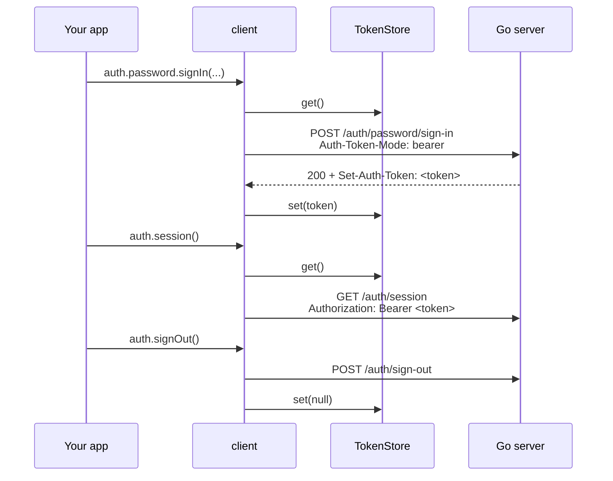

# Bearer mode, other sites, mobile, desktop and servers

You will have the client working where the session cookie cannot: a frontend on another site, a React Native or Electron app, a CLI, and server-side code that calls the API for a browser.

## Before you start

- [How it works](README.md) and the [quickstart](quickstart.md), which uses cookie mode.
- The server side of each case has its own guide: [SPA frontends](../integrations/spa-frontends.md) (origins and CORS), [Mobile apps](../integrations/mobile-apps.md), [Desktop apps and CLIs](../integrations/desktop-apps.md). The server needs no switch for bearer mode; any client may ask for it.

## Step 1 — Know when the cookie cannot work

Cookie mode is the default and the safer one: the session lives in an `HttpOnly` cookie no script can read. It needs a browser that sends the cookie, which it does only to the site that set it.

| Your frontend | Mode |
|---|---|
| A browser page on the same site as the API | cookie (the default) |
| A browser page on another site (`app.example.com` calling `api.other.com`) | bearer |
| React Native, Capacitor, a mobile webview with its own storage | bearer |
| Electron, Tauri, a desktop program | bearer |
| A CLI or a script | bearer |
| Server-side code acting for the browser that made the request | cookie, forwarded (Step 5) |

## Step 2 — Turn on bearer mode

Give the client an absolute `baseURL`, `tokenMode: "bearer"` and somewhere to keep the token:

<!-- ds:block id=native-8sm2nqdz -->
**native** · [`clients/ts/examples/quickstart.ts:18-23`](../../clients/ts/examples/quickstart.ts#L18-L23)

```typescript
export const native = createAuthClient({
  baseURL: "https://app.example.com/auth",
  tokenMode: "bearer",
  tokenStore: memoryTokenStore(),
  plugins: [password()],
});
```
<!-- /ds:block hash=571daa -->

What the client then does on every call:



It sends `Auth-Token-Mode: bearer` so the server answers with the token in the `Set-Auth-Token` header instead of a cookie, stores every token the server issues (a sign-in, a second factor, a refresh each replace the old one), sends it as `Authorization: Bearer`, and forgets it when the server answers `Set-Auth-Token` with an empty value, which it does whenever the token is dead (Step 3 lists when).

## Step 3 — Choose where the token is kept

A `TokenStore` is two functions, `get()` and `set(token | null)`, and either may return a promise. The default, `memoryTokenStore()`, forgets the session when the page or process ends. To stay signed in across launches, use the built-in `keyValueTokenStore(storage, key?)` over any storage with `getItem`, `setItem` and `removeItem` (`localStorage`, `sessionStorage`, React Native's `AsyncStorage`; the key defaults to `"ubgo-auth.token"`), or write a store over the platform's storage.

<!-- ds:block id=tsx-keyvalue-store-3nw7qk2m -->
**persistent** · [`clients/ts/examples/hooks-and-extras.ts:49-54`](../../clients/ts/examples/hooks-and-extras.ts#L49-L54)

```typescript
export const persistent = createAuthClient({
  baseURL: "https://api.example.com/auth",
  tokenMode: "bearer",
  tokenStore: keyValueTokenStore(localStorage),
  plugins: [password()],
});
```
<!-- /ds:block hash=8b05ac -->

Written by hand, the same store over `localStorage` is a few lines:

<!-- ds:block id=bearer-localstore-8wq2mk4z -->
**localStorageTokenStore** · [`clients/ts/examples/bearer.ts:12-20`](../../clients/ts/examples/bearer.ts#L12-L20)

```typescript
export function localStorageTokenStore(key = "auth-token"): TokenStore {
  return {
    get: () => localStorage.getItem(key),
    set: (token) => {
      if (token === null) localStorage.removeItem(key);
      else localStorage.setItem(key, token);
    },
  };
}
```
<!-- /ds:block hash=7897bb -->

Any script on that page can read `localStorage`, including one injected through a cross-site scripting bug, so a token there is only as safe as the page. That is the price of not having the cookie; on your own site, use cookie mode.

A native app should use the platform's secure storage (the iOS keychain, the Android keystore, an encrypted file on a desktop). Every such API is shaped a little differently, so wrap yours in a small interface and build the store on it. The store may be async; the client awaits it:

<!-- ds:block id=bearer-securestorage-3kv9qx7m -->
**SecureStorage** · [`clients/ts/examples/bearer.ts:26-30`](../../clients/ts/examples/bearer.ts#L26-L30)

```typescript
export interface SecureStorage {
  getItem(key: string): Promise<string | null>;
  setItem(key: string, value: string): Promise<void>;
  deleteItem(key: string): Promise<void>;
}
```
<!-- /ds:block hash=93d800 -->

<!-- ds:block id=bearer-securestore-6nm4wq2t -->
**secureTokenStore** · [`clients/ts/examples/bearer.ts:35-40`](../../clients/ts/examples/bearer.ts#L35-L40)

```typescript
export function secureTokenStore(storage: SecureStorage, key = "auth-token"): TokenStore {
  return {
    get: () => storage.getItem(key),
    set: (token) => (token === null ? storage.deleteItem(key) : storage.setItem(key, token)),
  };
}
```
<!-- /ds:block hash=beeb6e -->

On React Native with Expo, `expo-secure-store` (keychain on iOS, keystore on Android) already has that shape under other names, so the wrapper is three lines:

<!-- ds:block id=bearer-expostore-4qw8kx2m -->
**expoSecureStorage** · [`clients/ts/examples/bearer.ts:47-57`](../../clients/ts/examples/bearer.ts#L47-L57)

```typescript
export function expoSecureStorage(store: {
  getItemAsync(key: string): Promise<string | null>;
  setItemAsync(key: string, value: string): Promise<void>;
  deleteItemAsync(key: string): Promise<void>;
}): SecureStorage {
  return {
    getItem: (key) => store.getItemAsync(key),
    setItem: (key, value) => store.setItemAsync(key, value),
    deleteItem: (key) => store.deleteItemAsync(key),
  };
}
```
<!-- /ds:block hash=23be32 -->

Then pass `tokenStore: secureTokenStore(expoSecureStorage(SecureStore))`, or the store over your own wrapped storage, to `createAuthClient`. With a store that persisted a token, a fresh launch starts signed in: the first call sends the stored token.

A CLI or a desktop program can keep the token in a file only the user can read. This store from [`ts-client-bearer`](../../examples/ts-client-bearer/web/cli.ts) writes it with mode 0600, deletes the file on sign-out, reads a missing file as "signed out" and rethrows every other read error, so a permissions problem is not mistaken for a sign-out:

<!-- ds:block id=filetokenstore-az67vtyj -->
**fileTokenStore** · [`examples/ts-client-bearer/web/cli.ts:37-52`](../../examples/ts-client-bearer/web/cli.ts#L37-L52)

```typescript
function fileTokenStore(path: string): TokenStore {
  return {
    get: async () => {
      try {
        return (await readFile(path, "utf8")).trim() || null;
      } catch (err) {
        if (isMissingFile(err)) return null; // no file yet: signed out
        throw err; // unreadable (permissions, a directory): say so, never pretend to be signed out
      }
    },
    set: async (token) => {
      if (token === null) await rm(path, { force: true });
      else await writeFile(path, token, { mode: TOKEN_FILE_MODE });
    },
  };
}
```
<!-- /ds:block hash=d2cb8f -->

The same program passes its own `fetch`, which names the program in `User-Agent` and gives every call a deadline, unless the caller passed a `signal` of its own:

<!-- ds:block id=clifetch-2wa5e3a3 -->
**cliFetch** · [`examples/ts-client-bearer/web/cli.ts:65-69`](../../examples/ts-client-bearer/web/cli.ts#L65-L69)

```typescript
const cliFetch: typeof fetch = (input, init) => {
  const headers = new Headers(init?.headers);
  headers.set("User-Agent", USER_AGENT);
  return fetch(input, { ...init, headers, signal: init?.signal ?? AbortSignal.timeout(CALL_TIMEOUT_MS) });
};
```
<!-- /ds:block hash=531f12 -->

### Forget the token when the session is gone

The server tells the client when its token is dead by answering [`Set-Auth-Token`](ds:block?id=settokenheader-j7vbxqvy) with an empty value, on any call and any status, and the client then empties its `TokenStore`. It does so in two cases. The call itself ended the session: `signOut`, `signOutAll`, revoking the current session from the sessions list, deleting the account, a password reset that signs the user out. Or the token sent names no session any more: it expired, `signOutAll` ran on another device, another device or an admin revoked it, the account was deleted elsewhere; that call answers `auth.signed_out` (401) with the empty header, and the server decides it in [`ForgetRejectedToken`](ds:block?id=authhttp-forgetrejectedtoken-p4n7wq2c). A pending second-factor token is alive, so calls that refuse it with `auth.signed_out` (every signed-in call before `twofactor.verify`) send no header and the store keeps it; so does any other refusal (a wrong password, a rate limit, a network failure), so the user can try again. Against a server older than this header, `signOut` and `signOutAll` still forget the token when they succeed or answer `auth.signed_out`, so a sign-out never leaves a dead token behind:

<!-- ds:block id=bearer-signout-7nk3wq9x -->
**signOutRemote** · [`clients/ts/examples/bearer.ts:74-77`](../../clients/ts/examples/bearer.ts#L74-L77)

```typescript
export async function signOutRemote(): Promise<AuthError | null> {
  const { error } = await remote.signOut();
  return error?.code === "auth.signed_out" ? null : error;
}
```
<!-- /ds:block hash=3c8e4a -->

An app that decides "signed in" from `await store.get()` can therefore trust the store: it is empty after any call that found the session gone. [Reference › Try it](reference.md#try-it) shows a run where a refused sign-out empties the store.

## Step 4 — A frontend on another site

<!-- ds:block id=bearer-client-2xq7kw9n -->
**remote** · [`clients/ts/examples/bearer.ts:61-66`](../../clients/ts/examples/bearer.ts#L61-L66)

```typescript
export const remote = createAuthClient({
  baseURL: "https://api.example.com/auth",
  tokenMode: "bearer",
  tokenStore: localStorageTokenStore(),
  plugins: [password()],
});
```
<!-- /ds:block hash=9849c8 -->

The browser hides every response header a script was not allowed to read, `Set-Auth-Token` included, so the API must answer CORS for the frontend's origin and expose that header; otherwise the client never sees the token and every later call is signed out. The server side is [SPA frontends › Step 3](../integrations/spa-frontends.md#step-3--answer-cors-for-that-origin-only), whose example [`spa-cross-origin`](../../examples/spa-cross-origin/) does exactly this. Check in the browser's network tab: the sign-in response carries `Set-Auth-Token`, and `Access-Control-Expose-Headers` names it.

## Step 5 — Server-side code calling for a browser

A server that renders pages (Node, Bun, Deno, an edge function) sometimes needs to know who the browser is before it answers. It has the browser's `Cookie` header, so it makes a client for that one request and forwards it:

<!-- ds:block id=bearer-serverside-5qk2nw8v -->
**userForRequest** · [`clients/ts/examples/bearer.ts:84-91`](../../clients/ts/examples/bearer.ts#L84-L91)

```typescript
export async function userForRequest(cookieHeader: string): Promise<string | null> {
  const perRequest = createAuthClient({
    baseURL: "http://localhost:8081/auth",
    headers: { Cookie: cookieHeader },
  });
  const { data } = await perRequest.session();
  return data?.user.id ?? null;
}
```
<!-- /ds:block hash=f01d5f -->

This was checked against the [`organizations`](../../examples/organizations/) example: a session cookie forwarded this way from Node returned the signed-in user. Use it for reads. A mutation sent with a session cookie must also carry a trusted `Origin`, which a server-side caller does not naturally have, and copying the browser's would make your server a way around the origin check; let the browser make its own mutations.

The same function in a complete Node HTTP server, [`ts-client-bearer/web/server.ts`](../../examples/ts-client-bearer/web/server.ts): one client per request, carrying that request's `Cookie`, and only a read:

<!-- ds:block id=username-ztrn8raq -->
**userName** · [`examples/ts-client-bearer/web/server.ts:32-43`](../../examples/ts-client-bearer/web/server.ts#L32-L43)

```typescript
async function userName(cookie: string): Promise<string | null> {
  if (cookie === "") return null;
  const perRequest = createAuthClient({ baseURL: `${AUTH_URL}/auth`, headers: { Cookie: cookie } });
  const { data, error } = await perRequest.session();
  if (error) {
    // auth.signed_out is the normal answer for a stale cookie; anything else
    // (the API is down, a 500) is worth a log line, and still renders signed out.
    if (error.code !== "auth.signed_out") console.error(`session: ${error.code} ${error.message}`);
    return null;
  }
  return data.user.name;
}
```
<!-- /ds:block hash=aba03a -->

<!-- ds:block id=handle-mesexndv -->
**handle** · [`examples/ts-client-bearer/web/server.ts:47-52`](../../examples/ts-client-bearer/web/server.ts#L47-L52)

```typescript
function handle(req: IncomingMessage, res: ServerResponse): void {
  void userName(cookieOf(req)).then((name) => {
    if (name === null) res.writeHead(401, { "Content-Type": "text/plain" }).end("signed out\n");
    else res.writeHead(200, { "Content-Type": "text/plain" }).end(`hello ${name}\n`);
  });
}
```
<!-- /ds:block hash=39c8a0 -->

Make the client per request, never one shared client with a cookie in its headers: that client would act as whichever user's cookie it was built with.

## Step 6 — React Native, Electron, CLIs and Node scripts

The client needs only `fetch`, `Headers` and `URLSearchParams`:

| Runtime | Notes |
|---|---|
| React Native | Bearer mode with a secure-storage store (Step 3). Its `fetch` is built in. |
| Electron, Tauri | Bearer mode from the app's code. A page loaded from your own site inside the app can use cookie mode like any browser. |
| A CLI | Bearer mode; keep the token in a file only the user can read (as [`ts-client-bearer`'s `cli.ts`](../../examples/ts-client-bearer/web/cli.ts) does, Try it below), or the OS keychain. To sign in without typing a password into a terminal, see [device codes](../plugins/deviceauth.md) (the `device()` factory). |
| Node 18 or later, Bun, Deno | `fetch` is global. To run the `.ts` files as they are: Node 22.18 or later (23.6 or later on the 23 line), Bun, Deno. Node keeps no cookies, so use bearer mode, or pass a `fetch` that does (`createAuthClient({ fetch })`). |
| Tests | Pass `fetch` to point the client at a test server or a stub. |

The example's [`web/demo.ts`](../../examples/ts-client-custom/web/demo.ts) is a complete Node script in bearer mode, and its real run is in [Your own plugins › Try it](custom-plugins.md#try-it).

## Try it

[`examples/ts-client-bearer`](../../examples/ts-client-bearer/) is Steps 3, 5 and 6 as two Node programs against a real server: `web/cli.ts`, a command line in bearer mode whose token lives in a file only its owner can read (mode 0600, deleted on sign-out), and `web/server.ts`, a small Node HTTP server that forwards the browser's `Cookie` on a client made per request. Start the Go side from `examples/` (Node 22.18 or later runs the `.ts` files as they are):

```sh
PORT=8111 go run ./ts-client-bearer
```

The CLI: every line is a new process, so the session survives only because the token file does:

```sh
export AUTH_URL=http://localhost:8111
node ts-client-bearer/web/cli.ts sign-up ada@example.com "correct horse battery staple" Ada
ls -l .auth-token
node ts-client-bearer/web/cli.ts whoami
node ts-client-bearer/web/cli.ts sign-out
node ts-client-bearer/web/cli.ts whoami
node ts-client-bearer/web/cli.ts sign-in ada@example.com wrong
```

```text
signed up and signed in as Ada; token saved
-rw-------@ 1 khanakia  staff  43 Oct 12 15:11 .auth-token
Ada (token read from .auth-token)
signed out; token file removed
not signed in (auth.signed_out)
The sign-in details are not right. (password.invalid_credentials)
```

The last two exit 1 and a bad command line exits 2, so a script can branch on them. The server-side forwarding, with a cookie a browser would hold (curl's jar stands in for it):

```sh
AUTH_URL=http://localhost:8111 PORT=8112 node ts-client-bearer/web/server.ts &
curl -s -c jar -H 'Origin: http://localhost:8111' -H 'Content-Type: application/json' \
  -d '{"identifier":"bea@example.com","password":"correct horse battery staple","name":"Bea"}' \
  http://localhost:8111/auth/password/sign-up
curl -si -b jar http://localhost:8112/ | sed -n '1p;$p'
curl -si http://localhost:8112/ | sed -n '1p;$p'
```

```text
listening on http://127.0.0.1:8112
{"user":{"id":"usr_olp75ohvtels5x7nf4hivg7v","name":"Bea","image":""},"verificationRequired":false,"secondFactorRequired":false}
HTTP/1.1 200 OK
hello Bea
HTTP/1.1 401 Unauthorized
signed out
```

With the browser's cookie the Node server knows the user; without it, it answers 401. `go test ./ts-client-bearer` runs both: eight CLI processes checking output, exit code and the file's presence and mode, and the server with a cookie, without one, and with the same cookie after sign-out.

## Pitfalls

| Symptom | Cause | Fix |
|---|---|---|
| Signed in, but the next call is `auth.signed_out` (browser, another site) | CORS does not expose `Set-Auth-Token`, so the client never stored a token. | Expose the header (Step 4). |
| Signed out after every app restart | The store is `memoryTokenStore()`. | Pass a persistent store (Step 3). |
| `client.network_error` on every call from a browser on another site | The CORS preflight was refused; the browser reports that as a network failure. | Answer CORS for the frontend's origin. |
| `auth.origin_not_trusted` (403) on a mutation | Cookie mode from a page whose origin the server does not trust. | Trust the origin, or use bearer mode, which the origin check does not apply to. |
| Still "signed in", but every call is `auth.signed_out` | The token is pending a second factor (finish with `twofactor.verify`), or the server predates the empty `Set-Auth-Token`, or CORS does not expose that header, so the client never sees it. | Expose `Set-Auth-Token` (Step 4); against an older server, clear the store on `auth.signed_out` outside the code step ([Step 3](#forget-the-token-when-the-session-is-gone)). |
| `` auth client: this runtime has no global fetch; pass one as the `fetch` option of createAuthClient `` when the client is created | Node 16 or older, or a test environment, with no global `fetch`. | Pass `fetch`, or use Node 18 or later. |
| From Node, cookie mode signs in and the next call is `auth.signed_out` | Node's `fetch` keeps no cookies, and sends no `Origin`. | Bearer mode, or a `fetch` with a cookie jar that also sets `Origin` (as `test/smoke.ts` does). |
| The forwarding server answers 401 although the browser is signed in | The cookie was set for the host `localhost`, and the browser (or curl) asked the Node server on `127.0.0.1`: a different host, so no cookie is sent. | Use one host name for both. |
| One user's data shows for another on a server | A client built once with a `Cookie` header in `headers` and shared across requests. | One client per request (Step 5). |

## Related

- [Flows](flows.md): the pending second factor replaces the token when it is accepted.
- [Errors](errors.md).
- [Reference](reference.md): `TokenStore`, `memoryTokenStore` and every option.
