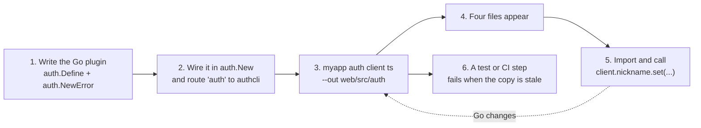

# Your own plugins: the app-generated client

You will have a TypeScript client generated by your own Go binary, typing the operations and error codes of a plugin you wrote, with a frontend calling that plugin's methods, and a test that fails the build when the generated copy falls behind the Go code. This is the second way of [How it works](README.md#two-ways-to-get-the-client).

## Before you start

- Why the prebuilt client is not enough: it is generated by a program that knows only the library's plugins. A plugin you wrote lives in your repository, so only a program that imports it can describe it. Your app is that program.
- What you need: a Go app with `auth.New`, a plugin of your own (an [operation](../extending/02-operations.md) defined with `auth.Define`), and the command line package `authcli` routed from your `main` (Step 2). No new dependency: `authcli` is in the core module.
- The runnable example is [`examples/ts-client-custom`](../../examples/ts-client-custom/): a `nickname` plugin with two operations and its own error code, the generated client committed in `web/src/auth`, and frontend code in `web/src` that calls it. `go test ./ts-client-custom` in `examples/` runs its end-to-end test and its freshness check; `task ts:check` type-checks its frontend under `strict`.

The whole loop:



## Step 1 — Write the plugin

A plugin is a Go type with a `Name` and, to serve routes, an `Operations` list. Each operation is defined once with `auth.Define`: an id, a kind (a `Query` is a `GET`, a `Mutation` a `POST`), a requirement and a path. The client is generated from exactly this:

<!-- ds:block id=nickname-new-5kz9wq3h -->
**New** · [`examples/ts-client-custom/nickname/nickname.go:75-80`](../../examples/ts-client-custom/nickname/nickname.go#L75-L80)

```go
func New() *Plugin {
	p := &Plugin{}
	p.set = auth.Define(auth.OpInfo{ID: EndpointSet, Kind: auth.Mutation, Require: auth.SignedIn, Path: "/set"}, p.doSet)
	p.get = auth.Define(auth.OpInfo{ID: EndpointGet, Kind: auth.Query, Require: auth.SignedIn, Path: "/get"}, p.doGet)
	return p
}
```
<!-- /ds:block hash=b53211 -->

The input and output are ordinary Go structs. Their JSON tags are the wire names, and so the TypeScript field names; a pointer becomes `| null`:

<!-- ds:block id=nickname-types-8mw2xq4t -->
**SetRequest** · [`examples/ts-client-custom/nickname/nickname.go:47-49`](../../examples/ts-client-custom/nickname/nickname.go#L47-L49)

```go
type SetRequest struct {
	Nickname string `json:"nickname"`
}
```
<!-- /ds:block hash=0597a3 -->

An error your frontend should be able to tell apart gets its own code, declared once at package level. `auth.NewError` registers it, and the generator writes every registered code into the client's union:

<!-- ds:block id=nickname-errtoolong-3vq8kd2m -->
**ErrTooLong** · [`examples/ts-client-custom/nickname/nickname.go:37`](../../examples/ts-client-custom/nickname/nickname.go#L37-L37)

```go
var ErrTooLong = auth.NewError("nickname.too_long", http.StatusBadRequest, fmt.Sprintf("A nickname is at most %d characters.", MaxLength))
```
<!-- /ds:block hash=8d27cb -->

The code must be `<plugin>.<name>`, and the message is written for an end user. The rest of the plugin (the column it adds to `auth_user`, the two functions that read and write it) is in [`nickname/nickname.go`](../../examples/ts-client-custom/nickname/nickname.go) and follows [Plugin anatomy](../extending/01-plugin-anatomy.md); nothing in it is specific to the client.

## Step 2 — Wire it, and give the binary the `auth` command

Wire the plugin like any other. Build the `*auth.Auth` in one function that the server, the command and the tests all call, so the client describes exactly what the server serves:

<!-- ds:block id=tsclientcustom-newauth-9pk2wv6r -->
**newAuth** · [`examples/ts-client-custom/main.go:128-138`](../../examples/ts-client-custom/main.go#L128-L138)

```go
func newAuth(db *sql.DB, m email.Mailer) (*auth.Auth, error) {
	return auth.New(
		auth.WithDB(db, sqlb.SQLiteDialect{}),
		auth.WithBaseURL(baseURL),
		auth.WithPlugins(
			email.New(email.Login(), email.Recover(), email.WithMailer(m)),
			password.New(),
			nickname.New(),
		),
	)
}
```
<!-- /ds:block hash=5da7a7 -->

Then hand a word of your command line to `authcli.Main`. Any word works; this app uses `auth`, so `myapp auth client ts ...` reaches the generator and `myapp` alone serves:

<!-- ds:block id=tsclientcustom-command-7xw3kq9p -->
**command** · [`examples/ts-client-custom/main.go:116-121`](../../examples/ts-client-custom/main.go#L116-L121)

```go
func command(ctx context.Context, a *auth.Auth, args []string, stdout, stderr io.Writer) (code int, handled bool) {
	if len(args) == 0 || args[0] != authCommand {
		return authcli.ExitOK, false
	}
	return authcli.Main(ctx, a, args[1:], stdout, stderr), true
}
```
<!-- /ds:block hash=9befd6 -->

`main` handles that word before it migrates or listens, so writing the client needs no database and no free port:

<!-- ds:block id=tsclientcustom-main-4mq8zt2w -->
**main** · [`examples/ts-client-custom/main.go:80-109`](../../examples/ts-client-custom/main.go#L80-L109)

```go
func main() {
	db, err := sql.Open("sqlite", sqliteDSN(dbFile))
	if err != nil {
		log.Fatal(err)
	}
	defer db.Close()

	a, err := newAuth(db, logMailer{})
	if err != nil {
		log.Fatal(err)
	}
	defer a.Close()

	ctx := context.Background()
	if code, handled := command(ctx, a, os.Args[1:], os.Stdout, os.Stderr); handled {
		_ = a.Close() // os.Exit skips the deferred calls
		os.Exit(code)
	}

	applied, err := a.Migrate(ctx)
	if err != nil {
		log.Fatal(err)
	}
	for _, name := range applied {
		log.Printf("migrated %s", name)
	}
	log.Printf("listening on %s", baseURL)
	srv := &http.Server{Addr: addr, Handler: newHandler(a), ReadHeaderTimeout: readHeaderTimeout}
	log.Fatal(srv.ListenAndServe())
}
```
<!-- /ds:block hash=a0609d -->

The same `authcli` routing gives you `auth migrate`, `auth sweep` and the other operator commands; see [CLI](../integrations/cli.md).

## Step 3 — Run the command

From the `examples` folder (where the example's `go.mod` is), a real run:

```sh
go run ./ts-client-custom auth client ts --out ts-client-custom/web/src/auth
```

```text
ts-client-custom/web/src/auth/client.ts
ts-client-custom/web/src/auth/error-codes.ts
ts-client-custom/web/src/auth/index.ts
ts-client-custom/web/src/auth/runtime.ts
```

The command creates the folder when it is missing, overwrites the five files, prints each path and exits [0](ds:block?id=exitok-gnrts3ej). It never touches the database. Without `--out` it prints the usage and exits [2](ds:block?id=exitusage-d43sp75x):

```text
auth client ts: --out is required
```

In your own app the command is your binary's name: `myapp auth client ts --out web/src/auth`, or `go run . auth client ts --out web/src/auth` during development. The example also carries the command as a `go:generate` directive in `main.go`, so `go generate ./ts-client-custom` does the same; use whichever your team already runs.

## Step 4 — What the files hold

The five files are the same set the prebuilt client has ([How it works › The five files](README.md#the-five-files)), but `client.ts` now knows your plugin. Look at the part generated from Step 1 (a real run, in `examples/ts-client-custom`):

```sh
grep -B1 -A2 '^export interface Nickname' web/src/auth/client.ts
sed -n '/^export type NicknameOps/,/^export function nickname/p' web/src/auth/client.ts
grep nickname web/src/auth/error-codes.ts
```

```text
/** The JSON of Go type nickname.Result. */
export interface NicknameResult {
  nickname: string | null;
}
--
/** The JSON of Go type nickname.SetRequest. */
export interface NicknameSetRequest {
  nickname: string;
}
export type NicknameOps = {
  /** `GET /nickname/get` (nickname.get), requires signed_in. */
  readonly get: Op<EmptyInput, NicknameResult>;
  /** `POST /nickname/set` (nickname.set), requires signed_in. */
  readonly set: Op<NicknameSetRequest, NicknameResult>;
};

/** Enables the nickname plugin's methods as `client.nickname`. */
export function nickname(): Plugin<"nickname", NicknameOps> {
  "nickname.too_long": { status: 400, message: "A nickname is at most 32 characters.", plugin: "nickname" },
```

Read it against Step 1: the plugin's name became the factory `nickname()` and the namespace `client.nickname`; the ids `nickname.set` and `nickname.get` became the methods `set` and `get`, each with its route and requirement in its comment; `SetRequest` and `Result` became `NicknameSetRequest` and `NicknameResult`, the `*string` became `string | null`; and the new error code sits in `error-codes.ts` beside the library's.

The list holds every code declared by a package linked into the binary that ran the command. That is why the command belongs to your app: a code is in the client exactly when your server can answer it.

Commit the five files. They are source your frontend compiles against, and a reviewer sees in the diff what changed in the API.

## Step 5 — Import and call

Create the client from the folder the command wrote, listing your plugin's factory beside the library's:

<!-- ds:block id=tsclientcustom-plugins-6wq2mz8k -->
**plugins** · [`examples/ts-client-custom/web/src/app-auth.ts:8`](../../examples/ts-client-custom/web/src/app-auth.ts#L8-L8)

```typescript
const plugins = [email(), password(), nickname()] as const;
```
<!-- /ds:block hash=067357 -->

<!-- ds:block id=tsclientcustom-auth-3kd9xq7v -->
**auth** · [`examples/ts-client-custom/web/src/app-auth.ts:12`](../../examples/ts-client-custom/web/src/app-auth.ts#L12-L12)

```typescript
export const auth = createAuthClient({ baseURL: "/auth", plugins });
```
<!-- /ds:block hash=dd784e -->

Then call it like any built-in plugin. The input is typed (`{ nickname: string }`), `data.nickname` is `string | null`, and your code is in the switch as a literal type:

<!-- ds:block id=tsclientcustom-save-8nq4kw2x -->
**saveNickname** · [`examples/ts-client-custom/web/src/nickname-form.ts:12-25`](../../examples/ts-client-custom/web/src/nickname-form.ts#L12-L25)

```typescript
export async function saveNickname(client: AppClient, value: string): Promise<SaveOutcome> {
  const { data, error } = await client.nickname.set({ nickname: value });
  if (error) {
    switch (error.code) {
      case "nickname.too_long": // the plugin's own code, typed like the library's
        return { error: "That nickname is too long." };
      case "auth.signed_out":
        return { error: "Sign in again to change your nickname." };
      default:
        return { error: error.message };
    }
  }
  return { saved: data.nickname };
}
```
<!-- /ds:block hash=ddd64d -->

<!-- ds:block id=tsclientcustom-show-2vk8mq5t -->
**currentNickname** · [`examples/ts-client-custom/web/src/nickname-form.ts:29-32`](../../examples/ts-client-custom/web/src/nickname-form.ts#L29-L32)

```typescript
export async function currentNickname(client: AppClient): Promise<string | null> {
  const { data } = await client.nickname.get();
  return data?.nickname ?? null;
}
```
<!-- /ds:block hash=0b011f -->

[Try it](#try-it) runs these two functions from Node against the real server.

## Step 6 — Regenerate when the Go side changes

Run the command again whenever something the client is generated from changes:

| You changed | The client changes |
|---|---|
| Added or removed a plugin in `auth.New` | a factory appears or disappears |
| Added, renamed or removed an operation | a method appears, is renamed, or disappears |
| A field of an input or output struct, or its JSON tag | the TypeScript type |
| `omitempty` or `omitzero`, a pointer, a slice | optional and `null` in the type |
| Declared, renamed or removed an error code | the code union in `error-codes.ts` |
| Upgraded `github.com/ubgo/auth` | possibly all of the above, and `runtime.ts` |

Then run your TypeScript type check. Every place the frontend relied on what changed fails to compile, which is the point: the break shows up in your editor, not in a user's browser.

## Step 7 — Fail the build when the copy is stale

A generated file that nobody regenerated is worse than none, because it compiles. Make your gate catch it. The example does it with a Go test, [`TestClient_GeneratedCopyIsCurrent`](ds:block?id=tsclientcustom-fresh-5hm2qw8z), that builds the app with `newAuth`, runs the real command into a temporary folder and compares every file with the committed copy:

<!-- ds:block id=tsclientcustom-fresh-5hm2qw8z lines=13-38 -->
**TestClient_GeneratedCopyIsCurrent** · [`examples/ts-client-custom/main_test.go:119-164`](../../examples/ts-client-custom/main_test.go#L119-L164)

```go
	out := t.TempDir()
	var stdout, stderr bytes.Buffer
	code, handled := command(context.Background(), a, []string{authCommand, authcli.CmdClient, authcli.CmdClientTS, "--out", out}, &stdout, &stderr)
	if !handled || code != authcli.ExitOK {
		t.Fatalf("auth client ts = %d (handled %v): %s", code, handled, stderr.String())
	}
	written, err := os.ReadDir(out)
	if err != nil {
		t.Fatal(err)
	}
	if len(written) != 5 {
		t.Fatalf("auth client ts wrote %d files, want 5", len(written))
	}
	for _, f := range written {
		want, err := os.ReadFile(filepath.Join(out, f.Name()))
		if err != nil {
			t.Fatal(err)
		}
		have, err := os.ReadFile(filepath.Join(generatedDir, f.Name()))
		if err != nil {
			t.Fatalf("%v; run: go generate ./ts-client-custom", err)
		}
		if !bytes.Equal(have, want) {
			t.Fatalf("%s/%s is stale; run: go generate ./ts-client-custom", generatedDir, f.Name())
		}
	}
```
<!-- /ds:block hash=00c0f7 -->

Change the nickname message in Go without regenerating, and `go test ./ts-client-custom` fails with `web/src/auth/error-codes.ts is stale; run: go generate ./ts-client-custom` (tried while writing this page, then reverted). Keep such a test in a package whose imports match the server's, because the code list is whatever the test binary links; the app's `main` package, as here, is the safe place.

If you prefer a CI step to a Go test, regenerate and ask git whether anything moved:

```sh
go run . auth client ts --out web/src/auth
git diff --exit-code -- web/src/auth
```

Then type-check the frontend, which is what `task ts:check` does for the example in this repository: `tsc -p examples/ts-client-custom/web` under `strict`.

## Try it

The example's [`web/demo.ts`](../../examples/ts-client-custom/web/demo.ts) runs Step 5's two functions from Node in bearer mode against the real server. From `examples/`, in two terminals (Node 22.18 or later runs the `.ts` file as it is):

```sh
PORT=8114 go run ./ts-client-custom
AUTH_URL=http://localhost:8114/auth node ts-client-custom/web/demo.ts
```

A real run (only the user id changes from run to run):

```text
password.signUp: user usr_b552aiqvalhgvmk4ilupe7w2
nickname before: null
saveNickname("Ada"): { saved: 'Ada' }
saveNickname(40 letters): { error: 'That nickname is too long.' }
nickname after: Ada
nickname signed out: null
```

The fourth line is the plugin's own error code arriving as `nickname.too_long` and taking the `case` written for it. The last line is the core's requirement: after `signOut()` the call answers `auth.signed_out`, so `currentNickname` returns null. `demo.ts` is run by hand; what the build checks is the Go side and the copy's freshness (`go test ./ts-client-custom` in `examples/`, Step 7) and that the frontend compiles (`task ts:check`).

## Pitfalls

| Symptom | Cause | Fix |
|---|---|---|
| `auth client ts: authhttp: TypeScript name collision: ...` | Two operations of your plugin differ only in punctuation, the plugin is named after a TypeScript keyword or a core method, or a Go type's TypeScript name equals a runtime export. | Rename what the message names. |
| `client.nickname` does not exist on the client | `nickname()` is not in `plugins`, or the files are from before the plugin existed. | Add the factory; regenerate. |
| A code your server sends arrives as `client.unknown_code` | The client was generated by a program that does not import the package declaring the code. | Generate from the app binary, not from a separate tool. |
| `myapp client ts --out ...` starts the server instead | The first word is not the one your `command` function hands to `authcli.Main`. | Type that word first: `myapp auth client ts --out ...`. |
| A field you added in Go is missing in TypeScript, and the frontend still compiles | The committed copy is stale: nobody re-ran the command, and stale generated code compiles happily. | Make the gate compare the copy with a fresh generation (Step 7). |
| Your edit to `client.ts` disappeared | The command overwrites the five files on every run. | Keep your code outside the folder (the example's `app-auth.ts` and `nickname-form.ts` sit beside `auth/`, not in it). |
| A plugin method answers `auth.unknown_operation` (404) | The frontend lists a factory the server binary it talks to does not wire, for example a staging server built from an older commit. | Deploy the server that matches the generated client, or remove the factory. |

## Related

- [Plugins](plugins.md): the naming rules your operations follow.
- [Errors](errors.md): mapping your own codes to messages.
- [Operations](../extending/02-operations.md) and [Ship a plugin](../extending/10-ship-a-plugin.md): more of what a plugin can do.
