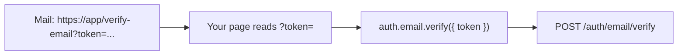

# Flows with the client

You will run every flow beyond a plain sign-in from a browser app: the second factor, email verification, password reset, magic links, OAuth buttons, signing out everywhere, and a first tour of organizations. Each section is the client side; the plugin guide it links is the server side.

## Before you start

- The [quickstart](quickstart.md): one client, cookie mode, same site.
- The snippets come from [`clients/ts/examples/flows.ts`](../../clients/ts/examples/flows.ts), whose client lists the plugins they use: `email()`, `password()`, `twofactor()`, `magiclink()`, `organization()`.
- Two kinds of flow, and the difference matters:

| Kind | Examples | How the client takes part |
|---|---|---|
| A call | sign-in, second factor, resend, forgot password, sign-out | a method: `await auth.x.y(...)` |
| A link in a mail | verify an address, reset a password, magic link | the link opens a page of **your** app; that page reads `token` from the address bar and calls a method with it |
| A redirect through another site | OAuth ("Continue with Google") | the page **navigates** to the start route; no method, because `fetch` cannot follow a redirect to another site |

A mail link never calls the API itself: a `GET` that spent the token would be spent by every mail scanner that previews links. So each link opens a page, and the page posts the token. Every snippet that handles a link reads the token with this helper:

<!-- ds:block id=flows-token-7mw3kq8x -->
**tokenFromLink** · [`clients/ts/examples/flows.ts:15-17`](../../clients/ts/examples/flows.ts#L15-L17)

```typescript
function tokenFromLink(): string {
  return new URLSearchParams(location.search).get("token") ?? "";
}
```
<!-- /ds:block hash=d2bf46 -->



## Second factor: the pending session

A sign-in for a user with two-factor on succeeds with `secondFactorRequired: true`. The session it created is pending: every other call treats it as signed out (`auth.signed_out`) until `twofactor.verify` accepts a code, which replaces it with a full session (in bearer mode the client stores the new token by itself).

<!-- ds:block id=flows-twofactor-5km2qw8x -->
**signInWithSecondFactor** · [`clients/ts/examples/flows.ts:23-30`](../../clients/ts/examples/flows.ts#L23-L30)

```typescript
export async function signInWithSecondFactor(identifier: string, secret: string, askForCode: () => Promise<string>): Promise<boolean> {
  const first = await auth.password.signIn({ identifier, password: secret });
  if (first.error) return false;
  if (!first.data.secondFactorRequired) return true;
  const code = await askForCode(); // from the authenticator app, or a mailed code after auth.twofactor.send()
  const second = await auth.twofactor.verify({ code, trustDevice: true });
  return second.error === null;
}
```
<!-- /ds:block hash=8ea3bf -->

`trustDevice: true` lets this browser skip the second step next time, if the server allows trusted devices. A mailed or texted code instead of an authenticator app is `auth.twofactor.send()` first. Server side: [Two-factor](../plugins/twofactor.md). The smoke run's bearer half shows the whole sequence against the real [`two-factor`](../../examples/two-factor/) example (a real run of `task ts:smoke`; the wait is the TOTP code being single-use within its step):

```text
  ok   password.signIn (two-factor on): {"user":{"id":"usr_nmuzig3wbxt6ov3l43cimzzj","name":"Smoke","image":""},"verificationRequired":false,"secondFactorRequired":true}
  err  session (pending): 401 auth.signed_out "Sign in to continue."
       waiting 30s for the next TOTP step
  ok   twofactor.verify: {"ok":true}
  ok   session (after second factor): {"user":{"id":"usr_nmuzig3wbxt6ov3l43cimzzj","name":"Smoke","image":""},"expiresAt":"2026-10-19T06:03:00.107766Z"}
```

## Email verification

Sign-up mails a verify link to [/verify-email](ds:block?id=defaultverifypage-27eburvg) on your app by default (the email plugin's option changes the page). That page:

<!-- ds:block id=flows-verify-8wq3mk2n -->
**onVerifyEmailPage** · [`clients/ts/examples/flows.ts:34-38`](../../clients/ts/examples/flows.ts#L34-L38)

```typescript
export async function onVerifyEmailPage(): Promise<string> {
  const { data, error } = await auth.email.verify({ token: tokenFromLink() });
  if (error) return error.code === "auth.token_invalid" ? "This link has expired. Ask for a new one." : error.message;
  return `${data.email} is verified.`;
}
```
<!-- /ds:block hash=6ccc0e -->

An expired or used link is `auth.token_invalid`. No mail? Let the user ask for another; the answer is the same for every address, so it tells a stranger nothing:

<!-- ds:block id=flows-resend-3nv8kq5w -->
**resendVerification** · [`clients/ts/examples/flows.ts:43-45`](../../clients/ts/examples/flows.ts#L43-L45)

```typescript
export async function resendVerification(address: string): Promise<void> {
  await auth.email.resend({ email: address });
}
```
<!-- /ds:block hash=231d0d -->

Server side: [Email › Step 2](../plugins/email.md#step-2--verify-an-address-and-resend-the-link).

## Password reset

Step one is the "forgot password" form. It answers the same whether or not the account exists, and the link goes only to a verified recovery address of the account:

<!-- ds:block id=flows-forgot-7xk2mw9q -->
**forgotPassword** · [`clients/ts/examples/flows.ts:50-52`](../../clients/ts/examples/flows.ts#L50-L52)

```typescript
export async function forgotPassword(identifier: string): Promise<void> {
  await auth.password.forgot({ identifier });
}
```
<!-- /ds:block hash=b5df21 -->

The link opens [/reset-password](ds:block?id=defaultresetpage-368asg23) by default; that page asks for the new password and posts it with the token:

<!-- ds:block id=flows-reset-2qw9xn4k -->
**onResetPasswordPage** · [`clients/ts/examples/flows.ts:57-60`](../../clients/ts/examples/flows.ts#L57-L60)

```typescript
export async function onResetPasswordPage(newPassword: string): Promise<boolean> {
  const { error } = await auth.password.reset({ token: tokenFromLink(), password: newPassword });
  return error === null;
}
```
<!-- /ds:block hash=d312b6 -->

Server side: [Password › Step 4](../plugins/password.md#step-4--forgot-and-reset).

## Magic link

Mail a link:

<!-- ds:block id=flows-magiclink-6mq4kw2v -->
**sendMagicLink** · [`clients/ts/examples/flows.ts:64-66`](../../clients/ts/examples/flows.ts#L64-L66)

```typescript
export async function sendMagicLink(address: string): Promise<void> {
  await auth.magiclink.send({ identifier: address });
}
```
<!-- /ds:block hash=de428e -->

The link opens [/magic-link](ds:block?id=defaultpage-uke973qb) by default, and that page signs in with the token. A link works once; a user with two-factor on still gets the second step:

<!-- ds:block id=flows-magicpage-2kx7wq4m -->
**onMagicLinkPage** · [`clients/ts/examples/flows.ts:70-74`](../../clients/ts/examples/flows.ts#L70-L74)

```typescript
export async function onMagicLinkPage(): Promise<"signed-in" | "second-factor" | "expired"> {
  const { data, error } = await auth.magiclink.signIn({ token: tokenFromLink() });
  if (error) return "expired";
  return data.secondFactorRequired ? "second-factor" : "signed-in";
}
```
<!-- /ds:block hash=aba3cd -->

Server side: [Magic links](../plugins/magiclink.md).

## OAuth: "Continue with Google"

The start route answers with a redirect to the provider and binds the flow to this browser with a cookie. That only works as a page navigation: `fetch` cannot follow a redirect to another site, and the provider's sign-in page must be the top-level page anyway. So the button navigates:

<!-- ds:block id=flows-oauth-9vk3qm8w -->
**continueWith** · [`clients/ts/examples/flows.ts:80-83`](../../clients/ts/examples/flows.ts#L80-L83)

```typescript
export function continueWith(provider: string, returnTo = "/"): void {
  const query = new URLSearchParams({ returnTo });
  location.assign(`/auth/oauth/${encodeURIComponent(provider)}/start?${query}`);
}
```
<!-- /ds:block hash=06e2d9 -->

`returnTo` is where the browser lands after the callback signs the user in: a path on your site, or an origin the server trusts. A frontend on another site passes its absolute URL there and starts from the API's absolute start URL. To draw one button per configured provider without hard-coding them, call `auth.oauth.providers()` (a JSON route; add `oauth()` to the client's plugins). The client has methods for the start and callback routes too (`auth.oauth.googleStart`, ...), because they are operations, but calling them with `fetch` does not sign anyone in; navigate. Server side: [OAuth › Step 3](../plugins/oauth.md#step-3--put-a-sign-in-link-on-the-page).

## Sign out, here or everywhere

<!-- ds:block id=flows-signout-4wn8kx2q -->
**signOut** · [`clients/ts/examples/flows.ts:87-90`](../../clients/ts/examples/flows.ts#L87-L90)

```typescript
export async function signOut(everywhere: boolean): Promise<void> {
  if (everywhere) await auth.signOutAll();
  else await auth.signOut();
}
```
<!-- /ds:block hash=185fe7 -->

`signOut` ends this session; `signOutAll` ends every session of the user, on every device. Both are core methods, on every client. In bearer mode the client forgets its token after either succeeds. To list sessions and end one other than the current, the core has `auth.sessions()` and `auth.sessionsRevoke({ ... })`; see [Sessions](../concepts/sessions.md).

## Organizations, a first tour

With the [organization](../plugins/organization.md) plugin on the server and `organization()` in the client: create one (the creator is its owner), invite a colleague by address, list yours with your role in each, and make one active for the session.

<!-- ds:block id=flows-orgs-8qm2wk5n -->
**organizationsTour** · [`clients/ts/examples/flows.ts:95-102`](../../clients/ts/examples/flows.ts#L95-L102)

```typescript
export async function organizationsTour(): Promise<void> {
  const created = await auth.organization.create({ name: "Acme", slug: "acme" });
  if (created.error) return;
  await auth.organization.invite({ orgId: created.data.id, email: "bea@example.com", role: "member" });
  const mine = await auth.organization.list();
  for (const org of mine.data?.orgs ?? []) console.log(org.name, org.role);
  await auth.organization.setActive({ orgId: created.data.id });
}
```
<!-- /ds:block hash=6b2c92 -->

A real run of these calls (in bearer mode, from Node) against the [`organizations`](../../examples/organizations/) example, done while writing this page:

```text
create org_5e2as7wloh3z4ddmx6iyqmej
invite ok
list {"orgs":[{"id":"org_5e2as7wloh3z4ddmx6iyqmej","slug":"acme1791784897317","name":"Acme","createdAt":"2026-10-12T06:01:37.319367Z","role":"owner"}]}
setActive {"activeOrganizationId":"org_5e2as7wloh3z4ddmx6iyqmej","activeTeamId":null,"organization":{"id":"org_5e2as7wloh3z4ddmx6iyqmej","slug":"acme1791784897317","name":"Acme","createdAt":"2026-10-12T06:01:37.319367Z"}}
```

The plugin has many more methods (teams, roles, permissions, invitations); the [method reference](../reference/ts-client.md#organization) lists them with their types.

## Try it

[`examples/ts-client-flows`](../../examples/ts-client-flows/) runs every flow on this page from Node against a real server, through the same client: a Go app with `email`, `password`, `magiclink`, `twofactor` (mailed codes) and `organization`, and a development inbox the script reads the mailed links and codes from, standing in for the user's mail. The script is in bearer mode and each simulated device is its own client with its own token store, so "sign out everywhere" can end the other device's session. From `examples/`, in two terminals (Node 22.18 or later runs the `.ts` file as it is):

```sh
PORT=8110 go run ./ts-client-flows
AUTH_URL=http://localhost:8110 node ts-client-flows/web/flows.ts
```

A real run:

```text
email verification
  ok   password.signUp: signed in as Ada
       mail: "Verify your email address"
  ok   email.verify: address verified
  err  email.verify (same link again): auth.token_invalid
password reset
  ok   password.forgot: check_your_inbox
       mail: "Reset your password"
  ok   password.reset
  err  password.signIn (old password): password.invalid_credentials
  ok   password.signIn (new password): signed in as Ada
magic link
  ok   magiclink.send
       mail: "Your sign-in link"
  ok   magiclink.signIn: signed in as Ada
  err  magiclink.signIn (same link again): auth.token_invalid
sign out everywhere
  ok   session (laptop): Ada
  ok   session (phone): Ada
  ok   signOutAll (from the phone)
  err  session (laptop): auth.signed_out
  err  session (phone): auth.signed_out
second factor by mailed code
  ok   password.signIn: secondFactorRequired=false
  ok   twofactor.enroll: method=delivered enabled=false
       mail: "Your sign-in code"
  ok   twofactor.confirm: 10 recovery codes
  ok   signOut
  ok   password.signIn: secondFactorRequired=true
  err  session (pending): auth.signed_out
  ok   twofactor.send
       mail: "Your sign-in code"
  err  twofactor.verify (wrong code): twofactor.code_invalid
  ok   twofactor.verify
  ok   session: Ada
organizations
  ok   organization.create: Acme
  ok   organization.invite
       mail: "You are invited to join an organization"
  ok   organization.list: Acme (owner)
  ok   organization.setActive: active: Acme
flows: every step answered as expected
```

What to read in it: a second click on a verify or magic link is `auth.token_invalid`; `password.forgot` answers `check_your_inbox` whatever the address; after a reset the old password is refused and nobody is signed in until the new one is used; `signOutAll` from the phone ends the laptop's session too; and with the mailed-code second factor, `twofactor.enroll` mails a first code that `twofactor.confirm` checks (answering 10 recovery codes), a wrong code is `twofactor.code_invalid`, and the pending session answers `auth.signed_out` until `twofactor.verify` succeeds. `go test ./ts-client-flows` runs the script and compares this whole output, and fails, never skips, when Node is missing or too old.

## Pitfalls

- **A mailed link opens a page that must exist in your app.** The library mails links to [/verify-email](ds:block?id=defaultverifypage-27eburvg), [/reset-password](ds:block?id=defaultresetpage-368asg23) and [/magic-link](ds:block?id=defaultpage-uke973qb) on your app by default; it serves the API, not those pages. If the frontend has no route there, the user clicks the link and gets your 404 page. Add the three pages (each is a few lines above), or point the plugin's option at the routes you have.
- **A password reset signs nobody in.** `password.reset` answers `{ ok: true }` and, by default, signs out every session of the user, the one in this browser included, because a reset is often the answer to a stolen account. Send the user to the sign-in form afterwards; do not call `session()` and expect a user.
- **A pending second factor looks signed out.** After a sign-in that answered `secondFactorRequired: true`, `session()` and every other call answer `auth.signed_out` until `twofactor.verify` succeeds. Do not read that as a failed sign-in: route to the code screen first. `twofactor.send` and `twofactor.status` are the calls that work in that state.
- **A TOTP code works once per step.** Verifying the same authenticator code twice within its 30-second step is refused; a test or a retry has to wait for the next code (the smoke run above waits for exactly this reason).
- **A link is spent on first use.** A second click on a magic link, a verify link or a reset link answers `auth.token_invalid`. Treat it as "already used or expired" and offer to send a new one; do not retry automatically.
- **OAuth start is a navigation, never a call.** `client.oauth.googleStart()` compiles but signs nobody in: the answer is a redirect to another site, which `fetch` cannot follow. Navigate to the start route ([OAuth](#oauth-continue-with-google)).
- **`organization.setActive` takes the field you have.** `orgId` and `orgSlug` are both optional; send one to switch, neither to clear the selection.

## Related

- [Errors](errors.md): the codes these flows answer.
- [Bearer mode](bearer-and-mobile.md): the same flows in a native app.
- [Reference](reference.md): troubleshooting and FAQ.
