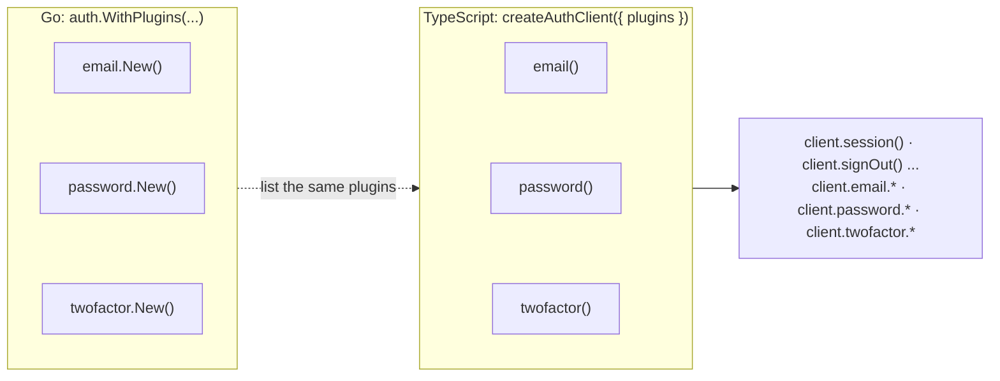

# Plugins in the client

You will know how the client decides which methods exist, what the editor and the compiler tell you when you call a plugin you did not enable, how a Go operation id becomes a method name, and where to find every factory and method.

## Before you start

- [How it works](README.md): one `client.ts` holds every plugin the generating program knows; you choose which of them a client has.
- The full list of factories and methods is generated: [TypeScript client reference](../reference/ts-client.md). This page explains the rules; that page lists what exists today.

## Step 1 — Why you list the plugins

The prebuilt `client.ts` describes every built-in plugin, but your server wires only some of them. If every method were always there, the editor would offer `client.magiclink.send` to an app whose server has no magic links, and the call would fail at run time with a 404. So the client starts with only the core's methods, and each plugin you pass to `createAuthClient` adds its namespace:

<!-- ds:block id=auth-yaqm87ck -->
**auth** · [`clients/ts/examples/quickstart.ts:10-13`](../../clients/ts/examples/quickstart.ts#L10-L13)

```typescript
export const auth = createAuthClient({
  baseURL: "/auth",
  plugins: [email(), password(), twofactor()],
});
```
<!-- /ds:block hash=992ade -->

Rule of thumb: the `plugins` array mirrors the `auth.WithPlugins(...)` list of your Go app. A plugin without routes of its own (a rate challenger such as `captcha`) has no factory, and one that serves routes has exactly one.



## Step 2 — What happens when you call a plugin you did not enable

Nothing reaches the network: the code does not compile. The repository keeps a file of mistakes that must not compile, and `task ts:typecheck` fails unless each one fails with exactly the error it is marked with:

<!-- ds:block id=typecheck-mistakes-6qw2kx9m -->
**mistakes** · [`clients/ts/test/typecheck/bad.ts:17-33`](../../clients/ts/test/typecheck/bad.ts#L17-L33)

```typescript
export async function mistakes(): Promise<void> {
  // A plugin that was not enabled has no namespace.
  await client.twofactor.verify({ code: "123456" }); // expect TS2339
  // The required input left out. (An incomplete object literal is not used:
  // tsc 5 reports it as TS2345 and tsc 7 as TS2741, so the marked code would
  // depend on the compiler version; a missing argument is TS2554 in both.)
  await client.password.signIn(); // expect TS2554
  // A field of the wrong type.
  await client.password.signIn({ identifier: 42, password: "x" }); // expect TS2322
  // A field the server would refuse as unknown.
  await client.password.signIn({ identifier: "a@example.com", password: "x", keepMeIn: true }); // expect TS2353
  // A misspelt error code: the code is a closed union.
  const r = await client.password.signIn({ identifier: "a@example.com", password: "x" });
  if (r.error?.code === "password.invalid_credential") return; // expect TS2367
  // data is null until error is checked.
  console.log(r.data.user.id); // expect TS18047
}
```
<!-- /ds:block hash=3f7e13 -->

What `tsc` prints for it today (a real run of `tsc -p clients/ts/test/typecheck` with TypeScript 7.0.2, the version CI pins, cut to the lines of this block):

```text
bad.ts(19,16): error TS2339: Property 'twofactor' does not exist on type 'AuthClient<CoreOps, readonly [Plugin<"password", PasswordOps, NoActions>], unknown>'.
bad.ts(23,25): error TS2554: Expected 1-2 arguments, but got 0.
bad.ts(25,34): error TS2322: Type 'number' is not assignable to type 'string'.
bad.ts(27,78): error TS2353: Object literal may only specify known properties, and 'keepMeIn' does not exist in type 'PasswordSignInRequest'.
bad.ts(30,7): error TS2367: This comparison appears to be unintentional because the types '"admin.admin_target" | "admin.bad_filter" | "admin.bad_filter_field" | "admin.bad_filter_operator" | "admin.bad_filter_value" | "admin.bad_role" | "admin.bad_search_field" | ... 428 more ... | undefined' and '"password.invalid_credential"' have no overlap.
bad.ts(32,15): error TS18047: 'r.data' is possibly 'null'.
```

The first line is the one this step is about: the client's type names the plugins it has (`readonly [Plugin<"password", PasswordOps, NoActions>]`), and `twofactor` is not among them. In the editor the same thing shows as a red underline on `twofactor`, and autocomplete after `client.` lists only the core's methods and `password`. Add `twofactor()` to `plugins` and the error disappears.

The other lines are the rest of what the types catch: the required input left out, a field of the wrong type, a field the server would refuse as unknown, a misspelt error code, and reading `data` before checking `error`.

Passing the same plugin twice, or a plugin whose name is a core method, throws when the client is created (`auth client: "x" is given twice, or is also a core method`), because the namespaces would overwrite each other.

## Step 3 — Where each method lives

| Methods of | Live on | Example |
|---|---|---|
| The core (sessions, profile, account deletion, sign-out) | the client's root, always | `client.session()`, `client.signOut()`, `client.signOutAll()` |
| A plugin | `client.<plugin name>`, only when its factory is in `plugins` | `client.password.signIn(...)`, `client.twofactor.verify(...)` |

The namespace is the name the plugin registers on the server, which is also the first segment of its routes, written in camelCase. Most are the package name (`password`, `organization`). Two to know: `plugin/deviceauth` registers as `device` (its routes are `/auth/device/*`), so its factory is `device()`; and `oauth` has one set of methods per configured provider (`client.oauth.googleStart`, `client.oauth.githubCallback`), because each provider's routes are separate operations.

## Step 4 — How a method gets its name

A method's name is the operation id after the plugin's prefix, in camelCase, and a name that would start with a digit gets a leading underscore:

| Operation id (Go) | Route | Method |
|---|---|---|
| `password.sign-in` | `POST /auth/password/sign-in` | `client.password.signIn` |
| `organization.add-team-member` | `POST /auth/organization/add-team-member` | `client.organization.addTeamMember` |
| `core.sign-out-all` | `POST /auth/sign-out-all` | `client.signOutAll` |
| `core.session` | `GET /auth/session` | `client.session` |

The generator refuses two operations of one plugin whose ids differ only in punctuation (`list-items` and `list_items` would both be `listItems`), a plugin named after a TypeScript keyword or a core method, and a Go type whose TypeScript name would equal a runtime export, with `authhttp.ErrTypeScriptName` naming both sides. That matters only for [your own plugins](custom-plugins.md).

Every method's doc comment in `client.ts` names its route, its operation id and its requirement (for `signIn`: ``POST /password/sign-in` (password.sign-in), requires public.``), so hovering over a call in the editor shows them.

## Step 5 — Input and output types

Each method takes one input object and resolves to `{ data, error }`, where `data` is the operation's output. The types are named after the Go package and type, so two plugins' `SignInRequest` never collide: `password.SignInRequest` is `PasswordSignInRequest`. They follow what Go's `encoding/json` writes, not what the field looks like in Go:

| In Go | In TypeScript | Why |
|---|---|---|
| a field without `omitempty` or `omitzero` | required | the encoder always writes it; on input, `omitempty` is how a Go type marks a field the caller may leave out |
| a field with `omitempty` or `omitzero` | optional (`?`) | `omitzero` where an empty value means something a missing one does not, such as `scopes: []` (no scopes) against no `scopes` (the defaults) |
| a pointer | `T \| null` | a nil pointer encodes as `null` |
| a slice or a map | `T[] \| null`, `{ [key: string]: T } \| null` | a nil slice or map encodes as `null`, and Go code returns nil slices |
| a field tagged `,string` | `string` | the value travels as a JSON string |
| `time.Time` | `string` | RFC 3339 text |
| `json.RawMessage`, `any`, a type with its own `MarshalJSON` | `unknown` | its fields do not describe its JSON |

An operation with no input fields takes `EmptyInput`, and its argument may be left out: `client.session()`. When every input field is optional, the argument may be left out too.

## Step 6 — One call per namespace

Each namespace has one example call in [`clients/ts/examples/plugins.ts`](../../clients/ts/examples/plugins.ts), a file the build type-checks with every factory enabled. Use it to see what a plugin adds before you open its section of the generated reference; the server guide says what to wire in Go.

| Namespace | Factory | One call | In plugins.ts | Server guide | Every method |
|---|---|---|---|---|---|
| the root (core) | none | `client.sessions()` | [`sessionCount`](ds:block?id=plugins-core-3wq8kn5m) | [core](../concepts/sessions.md) | [reference](../reference/ts-client.md#core-on-the-clients-root) |
| `client.admin` | `admin()` | `client.admin.users()` | [`firstUsers`](ds:block?id=plugins-admin-7kx2mq9w) | [admin](../plugins/admin.md) | [reference](../reference/ts-client.md#admin) |
| `client.anonymous` | `anonymous()` | `client.anonymous.signIn()` | [`continueAsGuest`](ds:block?id=plugins-anonymous-5nw3qk8x) | [anonymous](../plugins/anonymous.md) | [reference](../reference/ts-client.md#anonymous) |
| `client.apikey` | `apikey()` | `client.apikey.list()` | [`apiKeyCount`](ds:block?id=plugins-apikey-8qm4wx2n) | [apikey](../plugins/apikey.md) | [reference](../reference/ts-client.md#apikey) |
| `client.audit` | `audit()` | `client.audit.myEvents()` | [`recentEvents`](ds:block?id=plugins-audit-2kv9nw4q) | [audit](../plugins/audit.md) | [reference](../reference/ts-client.md#audit) |
| `client.device` | `device()` | `client.device.code()` | [`startDeviceSignIn`](ds:block?id=plugins-device-6wq3mk8v) | [deviceauth](../plugins/deviceauth.md) | [reference](../reference/ts-client.md#device) |
| `client.email` | `email()` | `client.email.list()` | [`addressCount`](ds:block?id=plugins-email-4mx8qw2k) | [email](../plugins/email.md) | [reference](../reference/ts-client.md#email) |
| `client.emailchallenge` | `emailchallenge()` | `client.emailchallenge.start()` | [`startEmailChallenge`](ds:block?id=plugins-emailchallenge-9vk2wn5q) | [emailchallenge](../plugins/emailchallenge.md) | [reference](../reference/ts-client.md#emailchallenge) |
| `client.handoff` | `handoff()` | `client.handoff.generate()` | [`handoffToken`](ds:block?id=plugins-handoff-3nq7kx4w) | [handoff](../plugins/handoff.md) | [reference](../reference/ts-client.md#handoff) |
| `client.invite` | `invite()` | `client.invite.create()` | [`inviteLink`](ds:block?id=plugins-invite-7wk4mq2x) | [invite](../plugins/invite.md) | [reference](../reference/ts-client.md#invite) |
| `client.jwt` | `jwt()` | `client.jwt.token()` | [`serviceToken`](ds:block?id=plugins-jwt-5qx2nw8k) | [jwt](../plugins/jwt.md) | [reference](../reference/ts-client.md#jwt) |
| `client.ldap` | `ldap()` | `client.ldap.signIn()` | [`directorySignIn`](ds:block?id=plugins-ldap-8km3wq5n) | [ldap](../plugins/ldap.md) | [reference](../reference/ts-client.md#ldap) |
| `client.magiclink` | `magiclink()` | `client.magiclink.send()` | [`mailSignInLink`](ds:block?id=plugins-magiclink-2wn8kq4x) | [magiclink](../plugins/magiclink.md) | [reference](../reference/ts-client.md#magiclink) |
| `client.metadata` | `metadata()` | `client.metadata.get()` | [`myMetadata`](ds:block?id=plugins-metadata-7qn3wk5x) | [metadata](../plugins/metadata.md) | [reference](../reference/ts-client.md#metadata) |
| `client.oauth` | `oauth()` | `client.oauth.providers()` | [`providerCount`](ds:block?id=plugins-oauth-6kq9wm3v) | [oauth](../plugins/oauth.md) | [reference](../reference/ts-client.md#oauth) |
| `client.oauthprovider` | `oauthprovider()` | `client.oauthprovider.listClients()` | [`registeredClients`](ds:block?id=plugins-oauthprovider-4xw7nq2m) | [oauthprovider](../plugins/oauthprovider.md) | [reference](../reference/ts-client.md#oauthprovider) |
| `client.organization` | `organization()` | `client.organization.list()` | [`myOrganizations`](ds:block?id=plugins-organization-9mq5kw3x) | [organization](../plugins/organization.md) | [reference](../reference/ts-client.md#organization) |
| `client.passkey` | `passkey()` | `client.passkey.loginBegin()` | [`passkeyOptions`](ds:block?id=plugins-passkey-3kw8qn6x) | [passkey](../plugins/passkey.md) | [reference](../reference/ts-client.md#passkey) |
| `client.password` | `password()` | `client.password.signIn()` | [`passwordSignIn`](ds:block?id=plugins-password-7nx4wk2q) | [password](../plugins/password.md) | [reference](../reference/ts-client.md#password) |
| `client.phone` | `phone()` | `client.phone.sendCode()` | [`textSignInCode`](ds:block?id=plugins-phone-5wm2qx8k) | [phone](../plugins/phone.md) | [reference](../reference/ts-client.md#phone) |
| `client.pow` | `pow()` | `client.pow.challenge()` | [`powPuzzle`](ds:block?id=plugins-pow-8qk3nw5x) | [pow](../plugins/pow.md) | [reference](../reference/ts-client.md#pow) |
| `client.referral` | `referral()` | `client.referral.dashboard()` | [`referralCode`](ds:block?id=plugins-referral-2mx9kw4q) | [referral](../plugins/referral.md) | [reference](../reference/ts-client.md#referral) |
| `client.siwe` | `siwe()` | `client.siwe.nonce()` | [`siweNonce`](ds:block?id=plugins-siwe-6vq2wm8k) | [siwe](../plugins/siwe.md) | [reference](../reference/ts-client.md#siwe) |
| `client.terms` | `terms()` | `client.terms.accept()` | [`acceptTerms`](ds:block?id=plugins-terms-4nk8qx2w) | [terms](../plugins/terms.md) | [reference](../reference/ts-client.md#terms) |
| `client.twofactor` | `twofactor()` | `client.twofactor.status()` | [`secondFactorMethods`](ds:block?id=plugins-twofactor-9wk5mq3n) | [twofactor](../plugins/twofactor.md) | [reference](../reference/ts-client.md#twofactor) |
| `client.username` | `username()` | `client.username.available()` | [`usernameFree`](ds:block?id=plugins-username-3xq7kn5w) | [username](../plugins/username.md) | [reference](../reference/ts-client.md#username) |

Two of the calls, as they appear in that file. A query's input travels in the query string, so paging fields such as `limit` are strings, typed as the Go struct declares them:

<!-- ds:block id=plugins-admin-7kx2mq9w -->
**firstUsers** · [`clients/ts/examples/plugins.ts:78-81`](../../clients/ts/examples/plugins.ts#L78-L81)

```typescript
export async function firstUsers(): Promise<number> {
  const { data } = await auth.admin.users({ limit: "20" });
  return data?.total ?? 0;
}
```
<!-- /ds:block hash=975436 -->

`passkey.loginBegin` answers WebAuthn options as `unknown`, because the Go type marshals itself: hand them to the browser's WebAuthn API and post its answer to `passkey.loginFinish` (the [React kit](react.md) has `getPasskeyCredential` for exactly that round trip):

<!-- ds:block id=plugins-passkey-3kw8qn6x -->
**passkeyOptions** · [`clients/ts/examples/plugins.ts:195-198`](../../clients/ts/examples/plugins.ts#L195-L198)

```typescript
export async function passkeyOptions(): Promise<unknown> {
  const { data } = await auth.passkey.loginBegin();
  return data?.options ?? null;
}
```
<!-- /ds:block hash=40ab96 -->

## Hand-written plugins: popup sign-in and the last-login hint

Two plugins are not one request each, so the generator cannot write them from the operation list. They live in `extensions.ts`, the same for every app, and go in `plugins` like any factory.

### `oauthPopup()`: sign in with a provider in a popup

For a page embedded in another site (an iframe in a customer's page), where the browser blocks the auth origin's cookies. The server needs [`plugin/oauthproxy/oauthpopup`](../plugins/oauthpopup.md) with the page's origin in `auth.WithTrustedOrigins`; the client is in bearer mode, so the token the popup hands over is kept in its `TokenStore`:

<!-- ds:block id=tsp-oauthpopup-client-2mq8wk5x -->
**clientFor** · [`clients/ts/examples/plugin-popup.ts:12-19`](../../clients/ts/examples/plugin-popup.ts#L12-L19)

```typescript
export function clientFor(authOrigin: string) {
  return createAuthClient({
    baseURL: `${authOrigin}/auth`,
    tokenMode: "bearer",
    tokenStore: keyValueTokenStore(localStorage),
    plugins: [password(), oauthPopup()],
  });
}
```
<!-- /ds:block hash=297801 -->

`client.oauthPopup.signIn` opens `/auth/oauthpopup/start` on the auth origin (the server's `DefaultMount`; pass `oauthPopup({ mount })` for another), waits for the completion page's message, stores the token and reads the session back with `client.session()` before it answers. Call it from a click, because a browser blocks a window opened outside one:

<!-- ds:block id=tsp-oauthpopup-open-6wk3qn8x -->
**signInWithPopup** · [`clients/ts/examples/plugin-popup.ts:25-37`](../../clients/ts/examples/plugin-popup.ts#L25-L37)

```typescript
export async function signInWithPopup(auth: ReturnType<typeof clientFor>, provider: string): Promise<string> {
  const { data, error } = await auth.oauthPopup.signIn({ provider, timeoutMs: 120_000 });
  if (data) return `Signed in as ${data.session.user.name}`;
  switch (error.code) {
    case "popup.blocked":
      return "Allow popups for this site, then try again.";
    case "popup.closed":
    case "popup.timeout":
      return "The sign-in window closed before you finished.";
    default:
      return `Sign-in failed (${error.rawCode || error.code}).`;
  }
}
```
<!-- /ds:block hash=3f1291 -->

| Input | What it does | Default |
|---|---|---|
| `provider` | The oauth plugin's provider id | required |
| `callbackURL`, `newUserCallbackURL`, `errorCallbackURL` | Where the page says to go next; each must pass the server's `TrustsReturnURL`, and the answer's `redirectTo` carries it | none |
| `scopes` | Extra provider scopes, sent comma-joined | none |
| `requestSignUp` | Create an account when none exists | `false` |
| `additionalData` | Data for the oauth flow, sent JSON-encoded | none |
| `windowFeatures` | The `window.open` features | a centred 500x600 window without menu or tool bars |
| `timeoutMs` | How long to wait | `OAUTH_POPUP_TIMEOUT_MS`, 5 minutes |

A message counts only when it comes from the auth origin, from the window this call opened, with the popup's message type and this call's random nonce; anything else on the page's `message` channel is ignored. The error codes are a closed union: `popup.blocked` (the browser refused the window), `popup.closed` (closed without finishing), `popup.timeout` (the window is closed for you), `popup.busy` (a popup of this client is already open, and is focused), `popup.unavailable` (no window: Node, React Native), the codes the completion page posts (`popup_sign_in_failed`, `invalid_callback_url`, `invalid_error_callback_url`, `invalid_new_user_callback_url`, `provider_not_found`, or the oauth plugin's own code such as `oauth.provider_failed`), and the session read-back's code when the sign-in finished but the session could not be read.

### `lastLoginMethod()`: the method this browser signed in with last

A sign-in page can put the method used last first. In a browser, against a server with [`lastlogin.WithCookie`](../../plugin/lastlogin/README.md), the client reads and clears the server's HttpOnly cookie through `GET /lastlogin/method` and `POST /lastlogin/clear`:

<!-- ds:block id=tsx-lastlogin-web-6kq3wn8v -->
**web** · [`clients/ts/examples/hooks-and-extras.ts:59`](../../clients/ts/examples/hooks-and-extras.ts#L59-L59)

```typescript
export const web = createAuthClient({ baseURL: "/auth", plugins: [password(), lastLoginMethod()] });
```
<!-- /ds:block hash=28ffab -->

<!-- ds:block id=tsx-lastlogin-order-9wq4kn7m -->
**orderMethods** · [`clients/ts/examples/hooks-and-extras.ts:62-65`](../../clients/ts/examples/hooks-and-extras.ts#L62-L65)

```typescript
export async function orderMethods(methods: readonly string[]): Promise<string[]> {
  const { data: last } = await web.lastLoginMethod.getLastUsedLoginMethod();
  return [...methods].sort((a, b) => Number(b === last) - Number(a === last));
}
```
<!-- /ds:block hash=668007 -->

`getLastUsedLoginMethod()` answers `{ data: "password" | … | null, error }`, `isLastUsedLoginMethod(method)` a boolean (`false` when the hint could not be read), `clearLastUsedLoginMethod()` forgets it. React Native and Expo cannot keep that cookie, so give the plugin a `storage` (any `TokenStore`, here over `AsyncStorage`): the client then records the method of every sign-in it makes (the operations marked `signIn: true` in the table; a second factor's promotion keeps the first factor, as the server does) and reads it back with no request:

<!-- ds:block id=tsx-lastlogin-native-2vm8qk5w -->
**nativeClient** · [`clients/ts/examples/hooks-and-extras.ts:70-77`](../../clients/ts/examples/hooks-and-extras.ts#L70-L77)

```typescript
export function nativeClient(asyncStorage: KeyValueStorage) {
  return createAuthClient({
    baseURL: "https://api.example.com/auth",
    tokenMode: "bearer",
    tokenStore: keyValueTokenStore(asyncStorage),
    plugins: [password(), lastLoginMethod({ storage: keyValueTokenStore(asyncStorage, LAST_LOGIN_STORAGE_KEY) })],
  });
}
```
<!-- /ds:block hash=55ec0b -->

The method is the plugin that ran the sign-in (`password`, `oauth`, `magiclink`), the server's `lastlogin.DefaultResolver`; pass `resolve(op)` to name it otherwise. Sign-ups are not sign-in operations, so the device store learns the method at the next sign-in.

### `oauthprovider`'s consent and login pages: `oauth_query` is filled for you

The provider sends its consent and login pages a signed copy of the authorize parameters in the query, and `consent`, `continue` and `publicClientPrelogin` must post it back as `oauth_query`. The client fills it from the page's `location.search` when the call leaves it out, so a consent page calls `client.oauthprovider.consent({ accept: true })`; pass `oauth_query` to send another value, or the `oauthQuery` option of `createAuthClient` where there is no `location`.

## Try it

The negative type test is the proof of Step 2. From the repository root:

```sh
task ts:typecheck
```

```text
ok: tsc rejected all 9 deliberately-wrong lines, each with its marked error
```

The task fails if `bad.ts` compiles, if any marked line fails with a different error, or if a line fails that is not marked, so a change to the generator that loosens a type breaks `task check`. The verbatim compiler output for each line is in Step 2. To see Step 6 compile with every plugin enabled, run `task ts:check`; it type-checks `plugins.ts` with the rest of the examples.

Then open the [TypeScript client reference](../reference/ts-client.md): its first table lists every factory with its namespace, method count and plugin guide, and each section below lists the methods with their routes and types. It is generated from the same operation list as `client.ts` by `task docs:api`, and `task check` fails when it is stale, so it cannot disagree with the client.

## Pitfalls

- **A plugin in `plugins` that the server does not wire compiles and fails at run time.** The client cannot know the server's plugin list. The library's handler answers a path it does not serve with its own JSON error, so the call resolves to `auth.unknown_operation` (404). If something in front of the handler answers first (a router with no route for that path, a proxy), the body is not the library's JSON and the call resolves to `client.invalid_response` with `status: 404` instead. Keep `plugins` equal to the Go app's `auth.WithPlugins(...)`, or generate the client from the app ([Your own plugins](custom-plugins.md)), whose `client.ts` has only the plugins it wires.
- **The prebuilt client's OAuth methods are for Google and GitHub.** `oauth` has one set of methods per configured provider, and the prebuilt client was generated with those two. Your server's providers are what count: `client.oauth.githubStart` compiles even when your app configures only Google, and answers 404. Generate from your app to get your providers' methods, and draw buttons from `client.oauth.providers()` rather than from method names.
- **The start and callback methods do not sign anyone in.** They exist because they are operations, but they answer with redirects to another site, which `fetch` cannot follow; a sign-in with a provider is a page navigation ([Flows › OAuth](flows.md#oauth-continue-with-google)).
- **The same factory twice throws at start-up**, not at compile time: `auth client: "password" is given twice, or is also a core method`. It usually comes from building the `plugins` array from two config sources.
- **`deviceauth` is `device()`.** The namespace is the name the plugin registers, not its Go package: `plugin/deviceauth` registers as `device`, so `deviceauth()` does not exist.
- **Inputs with no fields may be left out, but not replaced with `undefined` properties.** `client.session()` and `client.session({})` are the same request; an object with extra keys is a compile error (`TS2353`, Step 2), because the server refuses unknown fields.

## Related

- [Your own plugins](custom-plugins.md): the same rules for operations you write.
- [Flows](flows.md): the plugins in use.
- [Reference](reference.md): `createAuthClient` options and every runtime export.
- [TypeScript client reference](../reference/ts-client.md): every method of every namespace.
