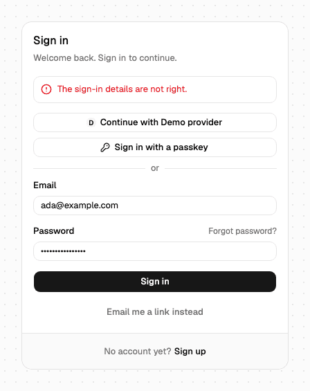
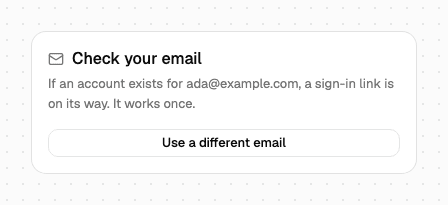
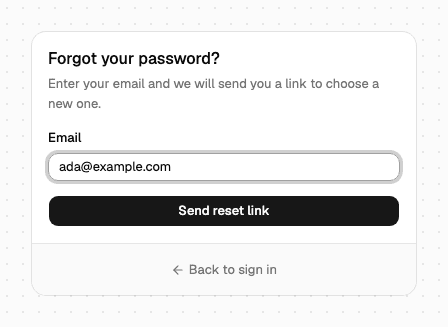
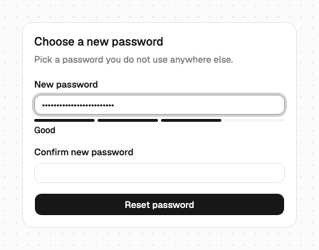
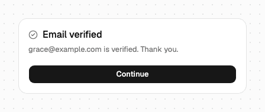
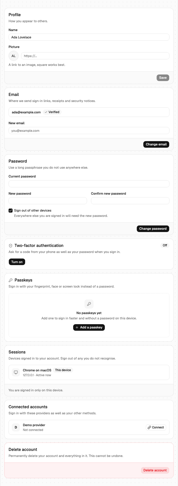
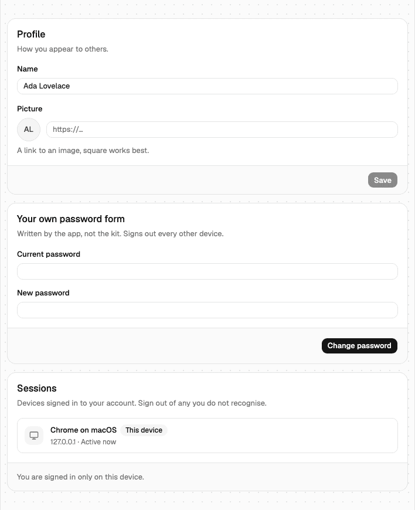

# React components

The reference for every component in the React UI kit's shadcn registry: when to use it, how to install it, its props, slots, text key, the errors it shows and the demo page where you can try it. For the first install, start with the [React UI kit quickstart](react.md); for the hooks the components are built on, see [React hooks](react-hooks.md).

## When you want a component, and when a hook

A component is a finished screen: a card with fields, validation, error messages, loading states, accessibility and keyboard handling, styled by your shadcn theme. It is copied into your app (`components/auth/*.tsx`), so once installed it is your file and you can edit anything in it. Use a component when the screen it draws is close to the one you want; restyle it with `className`, `classNames` and `localization`, and edit the file for anything beyond that.

Use the [hooks](react-hooks.md) instead when the screen is entirely your own design, or for a flow the kit has no component for (organizations, API keys, admin screens). The components call the same hooks, so both can live in one app.

## Before you start

- The quickstart's Steps 1 to 4 are done: the packages are linked, `/auth` is on the page's origin, the `@ubgo` registry is in `components.json`, and `AuthProvider` is mounted ([React UI kit](react.md)).
- The plugin each component needs is wired on the Go server and its factory is in the client's `plugins` list. A component whose plugin is missing from the client renders nothing, or hides the part that needs it.

## Install

Every component is one registry item. `shadcn add` writes the component to `components/auth/`, the primitives it uses to `components/ui/`, and installs its npm dependencies:

```sh
pnpm dlx shadcn@4.21.4 add @ubgo/sign-in-form @ubgo/two-factor-challenge
```

| Item | Component file | Primitives it installs | npm dependencies |
|---|---|---|---|
| `@ubgo/sign-in-form` | `sign-in-form.tsx` | alert, button, card, field, input, spinner | `@tanstack/react-form`, `@tanstack/react-query`, `lucide-react` |
| `@ubgo/sign-up-form` | `sign-up-form.tsx` | alert, button, card, checkbox, field, input, spinner, and the `password-strength` item | same |
| `@ubgo/password-strength` | `password-strength.tsx` | none | none |
| `@ubgo/forgot-password-form` | `forgot-password-form.tsx` | alert, button, card, field, input, spinner | `@tanstack/react-form`, `@tanstack/react-query`, `lucide-react` |
| `@ubgo/reset-password-form` | `reset-password-form.tsx` | as forgot-password-form, plus `password-strength` | same |
| `@ubgo/verify-email` | `verify-email.tsx` | alert, button, card, field, input, spinner | same |
| `@ubgo/magic-link-callback` | `magic-link-callback.tsx` | alert, button, card, spinner | `@tanstack/react-query`, `lucide-react` |
| `@ubgo/two-factor-challenge` | `two-factor-challenge.tsx` | alert, button, card, checkbox, field, input, input-otp, skeleton, spinner | plus `input-otp` |
| `@ubgo/two-factor-setup` | `two-factor-setup.tsx` | alert, badge, button, card, checkbox, dialog, field, input, input-otp, skeleton, spinner | plus `input-otp`, `uqr` (the QR code) |
| `@ubgo/passkey-list` | `passkey-list.tsx` | alert, alert-dialog, badge, button, card, dialog, dropdown-menu, field, input, skeleton, spinner | `@tanstack/react-form`, `@tanstack/react-query`, `lucide-react` |
| `@ubgo/user-button` | `user-button.tsx` | avatar, button, dropdown-menu, skeleton, spinner | `@tanstack/react-query`, `lucide-react` |
| `@ubgo/account-settings` | `account-settings.tsx` | the `user-button`, `two-factor-setup` and `passkey-list` items, plus alert, alert-dialog, badge, button, card, checkbox, dialog, field, input, skeleton, spinner | `@tanstack/react-form`, `@tanstack/react-query`, `lucide-react` |
| `@ubgo/confirm-email-change` | `confirm-email-change.tsx` | the `user-button` item, plus alert, button, card, spinner | `@tanstack/react-query`, `lucide-react` |
| `@ubgo/organization-switcher` | `organization-switcher.tsx` | alert, button, dialog, dropdown-menu, field, input, skeleton, spinner | `@tanstack/react-form`, `@tanstack/react-query`, `lucide-react` |
| `@ubgo/organization-members` | `organization-members.tsx` | alert, avatar, badge, button, card, dropdown-menu, field, input, skeleton, spinner | same |
| `@ubgo/organization-invitations` | `organization-invitations.tsx` | alert, badge, button, card, skeleton, spinner | `@tanstack/react-query`, `lucide-react` |

Installing a component does not install the components it hands off to. `SignInForm` navigates to `paths.twoFactor` when a sign-in needs a second factor, so an app with two-factor on also installs `@ubgo/two-factor-challenge` and gives it a route; the same goes for the pages mailed links open (see [Step 6 of the quickstart](react.md#step-6--add-the-pages-mailed-links-open)).

## What every component takes

Every component's props start from `AuthComponentProps` (the full contract, with the reasoning behind each rule, is [CONTRACT.md](../../clients/react/CONTRACT.md)):

| Prop | What it does |
|---|---|
| `className` | Classes for the root element, merged after the defaults with tailwind-merge, so `max-w-md` replaces the default width |
| `classNames` | Classes per named part (slot). The slot names are a typed union per component (`SignInFormSlot`), so a misspelt slot does not compile |
| `localization` | Text overrides for this one use, over the provider's `localization.<key>` and the English defaults |
| `onSuccess` | Called after the action succeeds, instead of navigating; receives the component's result type |
| `redirectTo` | Where to go after success when there is no `onSuccess`; defaults to the provider's path for the flow. Followed only when it is a path on this site or an origin in `allowedRedirectOrigins` (see Pitfalls) |
| `headingLevel` | The level of the component's title, 1 by default; pass 2 when the page has its own `h1` |

The sections below list only what each component adds. Each also exports its text type and English defaults (`SignInFormText`, `SIGN_IN_FORM_TEXT`), which is the list of every string you can override; the text key is the name under which the provider's `localization` holds overrides for it. Error messages come from the error code, never from a string inside the component: the provider's `localization.errors[code]`, else the server's message, else the code's declared English message ([CONTRACT.md rule 6](../../clients/react/CONTRACT.md#the-rules-in-one-screen)).

## SignInForm

| | |
|---|---|
|  |  |

**When to use it:** your sign-in page. Password, magic link, OAuth buttons and a passkey button in one card, each shown only when its plugin is on: OAuth when the server lists at least one provider, passkey when the browser supports WebAuthn. Where the browser supports conditional mediation, the same passkeys are offered in the identifier field's autofill list, and picking one signs in with no dialog ([React hooks › Passkey autofill](react-hooks.md#passkey-autofill)). The identifier field is "Email", or "Email or username" when the client has `username()`.

**Needs:** `password()` or `magiclink()` for a form; `oauth()` and `passkey()` for their buttons.

| Prop | Default | What it does |
|---|---|---|
| `onSecondFactor` | navigate to `paths.twoFactor`, carrying `redirectTo` | Hand-off when the account has a second factor and the session is pending |
| `defaultMode` | `"password"` | Which form shows first when password and magic link are both on (`"password"` or `"magiclink"`) |
| `showSignUp` | `true` | The "No account yet? Sign up" footer, linking to `paths.signUp` |
| `autoFocus` | `false` | Focus the identifier on mount |
| `providerIcons` | GitHub and Google marks, else the provider's initial | `{ [providerId]: ReactNode }` |
| `passkeyAutofill` | `true` | Offer passkeys in the identifier field's autofill (`autocomplete="username webauthn"`); paused before any other way in and resumed when it fails |

- **Slots** (`SignInFormSlot`): `root`, `header`, `title`, `description`, `content`, `methods`, `providerButton`, `passkeyButton`, `separator`, `form`, `field`, `label`, `input`, `fieldError`, `formError`, `submit`, `toggle`, `footer`, `link`.
- **Text:** key `signInForm`, type `SignInFormText`, defaults `SIGN_IN_FORM_TEXT`. `continueWith` takes `{provider}`, `magicLinkSentDescription` takes `{identifier}`.
- **Result:** `onSuccess({ method: "password" | "passkey", userId })`; without it the form navigates to `redirectTo`, else `paths.afterSignIn`. A magic link and OAuth leave the page, so they finish elsewhere ([MagicLinkCallback](#magiclinkcallback), the OAuth `returnTo`).
- **Errors:** `auth.identifier_invalid` under the identifier, `password.too_long` under the password, everything else (`password.invalid_credentials`, `auth.rate_limited`, a network failure) in the form-level alert. A closed or unmatched passkey prompt shows `passkeyCancelled`, a browser without WebAuthn `passkeyUnsupported`. A passkey picked from autofill that the server refuses shows the server's message, and autofill starts again; a browser without autofill support shows nothing.
- **Demo:** `/sign-in`.

## SignUpForm


**When to use it:** your sign-up page. Creates an account with a password; the identifier is "Email", "Phone number" or "Email or phone number" following the client's `email()` and `phone()`, a Username field appears with `username()`, and OAuth buttons appear when the server lists a provider. A strength meter ([PasswordStrength](#passwordstrength)) sits under the password; it is a hint, and the server's password policy decides. Sign-up never says an address is taken: the server answers the same and mails the owner. When the server wants the address verified before the first sign-in, the card becomes a "check your email" step with a resend button.

**Needs:** `password()` and at least one of `email()`, `phone()`.

| Prop | Default | What it does |
|---|---|---|
| `onVerificationRequired` | the card's "check your email" step | Hand-off when the account exists but no session was issued until the address is verified; receives `{ userId, identifier }` |
| `onSecondFactor` | navigate to `paths.twoFactor` | Hand-off when the new session is pending a second factor |
| `nameField` | `"required"` | `"required"`, `"optional"` or `"hidden"` (the account is created with an empty name) |
| `terms` | none | `{ version, href, privacyHref? }`: a required "I agree" checkbox, and `version` sent as the `Terms-Version` header the terms plugin records; it must equal the server's `terms.Current`, or the server ignores it |
| `minPasswordLength` | `8` | The strength hint's and the pre-submit check's minimum; match the server's `password.MinLength` |
| `showSignIn` | `true` | The "Already have an account? Sign in" footer |
| `autoFocus` | `false` | Focus the first field on mount |
| `providerIcons` | GitHub and Google marks, else the initial | `{ [providerId]: ReactNode }` |

- **Slots** (`SignUpFormSlot`): `root`, `header`, `title`, `description`, `content`, `methods`, `providerButton`, `separator`, `form`, `field`, `label`, `input`, `fieldError`, `formError`, `strength`, `terms`, `checkbox`, `submit`, `resend`, `footer`, `link`.
- **Text:** key `signUpForm` (`SignUpFormText`, `SIGN_UP_FORM_TEXT`), including `optional`, the label marker when `nameField` is `"optional"`. The meter's own text is key `passwordStrength`.
- **Result:** `onSuccess({ userId, identifier })` once a session exists; without it, `redirectTo`, else `paths.afterSignIn`.
- **Errors:** under the identifier `auth.identifier_invalid` and `email.address_rejected`; under the password `password.too_short`, `password.too_long`, `password.weak`, `password.breached`; under the username `username.reserved` (and `auth.identity_taken` when it was the username that clashed); the rest in the form-level alert.
- **Demo:** `/sign-up`.

## PasswordStrength

**When to use it:** under a password field of your own (a custom sign-up, an invite acceptance page). SignUpForm and ResetPasswordForm already include it. It scores what is typed from 0 to 4 with `scorePassword(value, minLength)`, draws a four-segment meter with a label and one line of advice, and renders nothing while the value is empty. It is a hint only: the server's policy (`password.MinLength`, the breach check) is what accepts or refuses.

| Prop | Default | What it does |
|---|---|---|
| `value` | required | The password being typed |
| `minLength` | `DEFAULT_PASSWORD_MIN_LENGTH` (8) | The shortest length the form asks for; match the server's `password.MinLength` |
| `showHint` | `true` | The one-line advice after the label; turn it off while the field shows an error that says the same |
| `id` | none | Put on the root, so the input can point `aria-describedby` at it |
| `className`, `classNames`, `localization` | | As every component; it has no `onSuccess`, `redirectTo` or `headingLevel` |

- **Slots** (`PasswordStrengthSlot`): `root`, `meter`, `segment`, `label`, `hint`.
- **Text:** key `passwordStrength` (`PasswordStrengthText`, `PASSWORD_STRENGTH_TEXT`).
- **Also exported:** `scorePassword(value, minLength)` returning a `PasswordScore` (0 to 4), for a form that wants the score without the meter.
- **Demo:** `/sign-up` (under the password field).

## ForgotPasswordForm



**When to use it:** the "Forgot password?" page `SignInForm` links to (`paths.forgotPassword`). Asks for the email ("Email or username" with `username()`) and calls `password.forgot`. The server answers the same whether or not the account exists, so the "check your email" step says "if an account exists" and offers "Send it again" and "Use a different email".

**Needs:** `password()`.

| Prop | Default | What it does |
|---|---|---|
| `resetPageURL` | the server's `/reset-password` on its base URL | The page the mailed link opens; the server accepts only a page it trusts and answers `password.redirect_invalid` otherwise |
| `defaultIdentifier` | `""` | A starting value, such as the address typed on the sign-in page |
| `showSignIn` | `true` | The "Back to sign in" footer |
| `autoFocus` | `false` | Focus the field on mount |

- **Slots** (`ForgotPasswordFormSlot`): `root`, `header`, `title`, `description`, `content`, `form`, `field`, `label`, `input`, `fieldError`, `formError`, `submit`, `secondary`, `footer`, `link`.
- **Text:** key `forgotPasswordForm` (`ForgotPasswordFormText`, `FORGOT_PASSWORD_FORM_TEXT`).
- **Result:** `onSuccess({ identifier })` replaces the "check your email" step; `redirectTo` navigates instead.
- **Errors:** `auth.identifier_invalid` under the field; `auth.rate_limited` (the forgot route is limited per identifier, so a stranger cannot flood someone's inbox) and the rest in the form-level alert.
- **Demo:** `/forgot-password`.

## ResetPasswordForm



**When to use it:** the page the reset link opens (`/reset-password` unless `resetPageURL` says otherwise). It reads `token` from the address, asks for the new password and its confirmation, and calls `password.reset`. A missing, used or expired token shows a "Request a new link" step linking to `paths.forgotPassword`, instead of a form that can only fail. A reset signs nobody in, so success shows "Continue to sign in".

**Needs:** `password()`.

| Prop | Default | What it does |
|---|---|---|
| `token` | `?token=` from the address | The reset token; pass it when your router owns the query string (server rendering) |
| `minPasswordLength` | `8` | Match the server's `password.MinLength` |
| `confirmPassword` | `true` | Ask for the new password twice |
| `autoFocus` | `false` | Focus the first field on mount |

- **Slots** (`ResetPasswordFormSlot`): `root`, `header`, `title`, `description`, `content`, `form`, `field`, `label`, `input`, `fieldError`, `formError`, `strength`, `submit`, `action`.
- **Text:** key `resetPasswordForm` (`ResetPasswordFormText`, `RESET_PASSWORD_FORM_TEXT`); `missingTitle` heads the page opened without a token.
- **Result:** `onSuccess({ reset: true })`; `redirectTo` navigates instead of the "Continue to sign in" step.
- **Errors:** `auth.token_invalid` switches to the "Request a new link" step; `password.too_short`, `password.too_long`, `password.weak`, `password.breached` and `password.reused` under the new password; the rest in the form-level alert.
- **Demo:** `/reset-password` (open it from a reset mail in the demo's Inbox).

## VerifyEmail



**When to use it:** the page the verification link opens (the email plugin's default is `/verify-email`). It posts the token exactly once and shows "Email verified" with Continue (signed in) or Sign in. When verifying signs the user in with a second factor pending, it hands off like SignInForm. An expired link, or the page opened without a token, shows a "send a new link" form (`email.resend`, which answers the same for every address); a network or server fault offers Try again.

**Needs:** `email()`.

| Prop | Default | What it does |
|---|---|---|
| `token` | `?token=` from the address | The verification token |
| `onSecondFactor` | navigate to `paths.twoFactor` | Hand-off when the session verifying created is pending |
| `showSignIn` | `true` | The "Back to sign in" footer on the resend form |

- **Slots** (`VerifyEmailSlot`): `root`, `header`, `title`, `description`, `content`, `form`, `field`, `label`, `input`, `fieldError`, `formError`, `submit`, `action`, `footer`, `link`.
- **Text:** key `verifyEmail` (`VerifyEmailText`, `VERIFY_EMAIL_TEXT`).
- **Result:** `onSuccess({ email, signedIn })`; `redirectTo` navigates there when verifying signed the user in.
- **Errors:** `auth.token_invalid` (used, expired or unknown) switches to the resend form; the rest offer Try again.
- **Demo:** `/verify-email` (sign up on `/sign-up`, then open the link from the Inbox).

## MagicLinkCallback

**When to use it:** the page a magic link opens (the plugin's default is `/magic-link`). It calls `magiclink.signIn` with the token exactly once, refreshes the session, and navigates on; with a second factor it hands off like SignInForm. A used or expired link shows "Back to sign in"; a network or server fault offers Try again.

**Needs:** `magiclink()`.

| Prop | Default | What it does |
|---|---|---|
| `token` | `?token=` from the address | The magic-link token |
| `onSecondFactor` | navigate to `paths.twoFactor` | Hand-off when the account has a second factor |

- **Slots** (`MagicLinkCallbackSlot`): `root`, `header`, `title`, `description`, `content`, `formError`, `action`.
- **Text:** key `magicLinkCallback` (`MagicLinkCallbackText`, `MAGIC_LINK_CALLBACK_TEXT`); `missingTitle` heads the page opened without a token.
- **Result:** `onSuccess({ userId, created })`, `created` true when the link made the account; without it, `redirectTo`, else `paths.afterSignIn`.
- **Errors:** `auth.token_invalid` shows "Back to sign in"; the rest offer Try again.
- **Demo:** `/magic-link` (choose "Email me a link instead" on `/sign-in`, then open the link from the Inbox).

## TwoFactorChallenge


**When to use it:** the page at `paths.twoFactor` (`/two-factor` by default), the step after a sign-in that answered `secondFactorRequired`. Until it succeeds, the session is pending and signs nobody in. It asks `twofactor.status` which kind of code to ask for (an authenticator app, or a delivered code with a Send button) and whether "Trust this device" is on, so it needs no props to match the server. Six (or eight) boxes submit on the last digit; a wrong code clears them and says why; "Use a recovery code" switches to a text field; a pending session older than ten minutes shows "Sign in again" instead of a form that can only fail. "Sign in as someone else" ends the pending session.

**Needs:** `twofactor()`; renders nothing without it.

| Prop | Default | What it does |
|---|---|---|
| `digits` | `6` | `6`, or `8` when the server was built with `twofactor.WithDigits(8)`; the server does not report it |
| `autoFocus` | `true` | Focus the code field on mount |
| `autoSubmit` | `true` | Submit as soon as the last digit is typed or pasted |
| `defaultTrustDevice` | `false` | Whether "Trust this device" starts ticked, when the server offers it |
| `showCancel` | `true` | "Sign in as someone else", which ends the pending session |

- **Slots** (`TwoFactorChallengeSlot`): `root`, `header`, `title`, `description`, `content`, `form`, `field`, `label`, `otp`, `otpSlot`, `input`, `fieldError`, `formError`, `trustDevice`, `submit`, `sendCode`, `toggle`, `footer`, `link`.
- **Text:** key `twoFactorChallenge` (`TwoFactorChallengeText`, `TWO_FACTOR_CHALLENGE_TEXT`).
- **Several factors:** when the user has security keys (`twofactor.WithSecurityKeys`), a "Use a security key" button runs the server's challenge, the browser prompt and `twofactor.verify` with `method: "security_key"`; when only a key is on, the code field is hidden and the description says to use the key. When both an authenticator app and delivered codes are on, a picker chooses which code to type, sent as `method`.
- **Result:** `onSuccess({ method: "code" | "recovery" | "security_key", trustedDevice })`; without it, `redirectTo`, else `paths.afterSignIn`.
- **Errors:** `twofactor.code_invalid` under the code; `twofactor.security_key_invalid` and a closed key prompt in the form-level alert; `auth.signed_out` (the pending session expired or ended) switches to "Sign in again"; the rest in the form-level alert.
- **Demo:** `/two-factor` (turn two-factor on in `/two-factor/setup`, sign out, sign in again).

The component does not read `?redirectTo=` from the address. SignInForm carries `redirectTo` along to `paths.twoFactor` in the query string, so the page that renders TwoFactorChallenge reads it and passes it on, after checking it is a path on your own site (see [Pitfalls](#pitfalls)).

## TwoFactorSetup

| | |
|---|---|
|  |  |

**When to use it:** a settings card that turns the second factor on and off for the signed-in user. Off: Turn on, then a QR code (dark on white in both themes, so scanners read it), the key in groups of four with Copy, an "open in an authenticator app on this device" link for phones, then the first code. Recovery codes are shown once with Copy all and Download, and Done stays disabled until "I have saved these codes" is ticked. On: New recovery codes and Turn off, each in a dialog that takes a current code or a recovery code. Servers built with `SkipVerificationOnEnable` go straight to the codes. AccountSettings' Security section renders it.

**Needs:** `twofactor()`; renders nothing without it.

| Prop | Default | What it does |
|---|---|---|
| `requirePassword` | `false` | Ask for the current password when turning on or off and when making new codes; set it when the server uses `twofactor.RequirePassword()`, which the server does not report |
| `digits` | `6` | `6` or `8`, as the challenge |
| `method` | the authenticator app when the server offers it | `"totp"` or `"delivered"` |
| `recoveryCodesFileName` | `recovery-codes.txt` | The downloaded recovery-codes file's name |
| `variant` | `"card"` | `"embedded"` drops the card's border, background, padding and title, for a settings section with its own heading |
| `onFreshSessionRequired` | the card's own "Sign in again" prompt | `(retry) => void`: called on `auth.fresh_session_required`, so an account page opens its own re-auth dialog; once the user has confirmed it's them, `await retry()` reruns the refused action (turn on, confirm, new recovery codes, turn off) with the same code and password |
| `securityKeys` | `true` | Show the security keys section ([SecurityKeys](#securitykeys), embedded) under the overview; it renders nothing when the server does not offer keys. A first key turns two-factor on and the last one removed turns it off, reported through `onSuccess` like the code flow |

- **Slots** (`TwoFactorSetupSlot`): `root`, `header`, `title`, `description`, `status`, `content`, `form`, `field`, `label`, `input`, `otp`, `fieldError`, `formError`, `qr`, `secret`, `codes`, `code`, `primaryButton`, `secondaryButton`, `dialog`, `footer`.
- **Text:** key `twoFactorSetup` (`TwoFactorSetupText`, `TWO_FACTOR_SETUP_TEXT`).
- **Text:** `descriptionOnSecurityKey` is the description when a security key is the user's only second factor.
- **Result:** `onSuccess({ action: "enabled" | "disabled" | "regenerated" })`; without it, it navigates to `redirectTo` only when given, so a settings card stays put.
- **Errors:** `twofactor.code_invalid` under the code; `password.invalid_credentials` under the password (with `requirePassword`); `auth.fresh_session_required` shows "Sign in again", or calls `onFreshSessionRequired`; the rest in the form-level alert.
- **Demo:** `/two-factor/setup`.

## SecurityKeys

**When to use it:** TwoFactorSetup already renders it as a section under its overview (`securityKeys`, on by default), so most apps never mount it themselves; use it alone (`variant="card"`, the default) on a page without TwoFactorSetup, when the server offers security keys as a second factor (`twofactor.WithSecurityKeys`). Lists the user's keys, adds one (an optional name, the server's registration options, the browser prompt, `twofactor.security-key/register-finish`) and removes one (`twofactor.remove-factor`). With two-factor already on, adding and removing first ask for proof in a dialog: a code from the authenticator app, a delivered code, a recovery code, or a tap of a key. The first key turns two-factor on and returns recovery codes, shown once; the change is reported only after "I saved them", so a page that navigates on success never hides them. Renders nothing when the server does not offer keys. Security keys are not passkeys: they never sign anyone in on their own and are not in PasskeyList.

**Needs:** `twofactor()` on a server with `twofactor.WithSecurityKeys(pk.SecurityKeys())` and the passkey plugin.

| Prop | Default | What it does |
|---|---|---|
| `variant` | `"card"` | `"embedded"` is a titled section with no card, as TwoFactorSetup uses it |

- **Slots** (`SecurityKeysSlot`): `root`, `header`, `title`, `description`, `content`, `list`, `key`, `add`, `input`, `formError`, `status`, `dialog`.
- **Text:** key `securityKeys` (`SecurityKeysText`, `SECURITY_KEYS_TEXT`). `added` takes `{date}`, `removeLabel` `{name}`.
- **Result:** `onSuccess({ action: "added" | "removed", twoFactorEnabled })`. It also re-reads the factor status TwoFactorSetup and TwoFactorChallenge share, and the session, because a first key that ends the `setup-mfa` task replaces the session.
- **Errors:** a wrong proof (`twofactor.code_invalid`, `twofactor.security_key_invalid`) under the dialog's code field; a closed prompt, a key already registered and the rest in the card's alert.
- **Demo:** `/two-factor/setup` and `/setup-two-factor`, inside TwoFactorSetup.

## TaskSetupMFA

**When to use it:** the page a session lands on when the server requires a second factor before the session works (`twofactor.RequireEnrolment` opens the `setup-mfa` session task, and every other operation answers `403 auth.session_task_pending`). It explains why, runs TwoFactorSetup (with its security keys section), and when a factor is on (the server has issued an ordinary session) re-reads the session and goes on. "Sign out instead" is the only other way out. Mount `SessionTaskRedirect` from `@ubgo/auth-react` once in the layout so a session with the task is sent here from any page; the page lives at `paths.setupTwoFactor` (`/setup-two-factor` by default).

**Needs:** `twofactor()`.

| Prop | Default | What it does |
|---|---|---|
| `requirePassword`, `digits`, `method` | TwoFactorSetup's | Passed to TwoFactorSetup |

- **Slots** (`TaskSetupMfaSlot`): `root`, `header`, `title`, `description`, `content`, `setup`, `signOut`.
- **Text:** key `taskSetupMfa` (`TaskSetupMfaText`, `TASK_SETUP_MFA_TEXT`).
- **Result:** `onSuccess(result)` with TwoFactorSetup's result once the factor is on; without it, `redirectTo`, else `paths.afterSignIn`. Without the task open, it says there is nothing to set up and offers Continue.
- **Demo:** `/setup-two-factor`; sign in as `mfa@example.com`, whom the demo server requires to enrol.

## PasskeyList and AddPasskey


**When to use them:** `PasskeyList` is the settings card for the signed-in user's passkeys from `passkey.list`: name, "Synced" when backed up, the added date and last use in the browser's language. The row menu renames (a dialog) and removes (a confirm dialog that shows the server's refusal where the click happened, such as `auth.last_sign_in_method`). An empty list is a call to action with the add button. `AddPasskey` is the add button alone, for onboarding or a banner: it runs register-begin, the browser prompt and register-finish, and names the passkey "{browser} on {os}" until renamed.

**Needs:** `passkey()`; both render nothing without it.

| Prop | Default | What it does |
|---|---|---|
| `authenticatorAttachment` | both | `"platform"` (this device) or `"cross-platform"` (a security key, a phone) |
| `variant` | `"card"` | `"embedded"`, as TwoFactorSetup |
| `onFreshSessionRequired` | the card's own "Sign in again" prompt | `(retry) => void`; `await retry()` reruns the refused add or remove. Rename needs no recent sign-in |

AddPasskey takes `authenticatorAttachment`, `name` (the new passkey's name; default "{browser} on {os}"), `onError(message, error, retry)` (receives a failure instead of the button showing it; `retry` runs the whole registration again) and `variant` (the button's: `"default"`, `"outline"`, `"secondary"`, `"ghost"`; outline by default).

- **Slots** (`PasskeyListSlot`): `root`, `header`, `title`, `description`, `content`, `list`, `item`, `itemIcon`, `itemName`, `itemMeta`, `badge`, `actions`, `empty`, `addButton`, `formError`, `dialog`. AddPasskey (`AddPasskeySlot`): `root`, `button`, `error`.
- **Text:** key `passkeyList` (`PasskeyListText`, `PASSKEY_LIST_TEXT`), shared by both. `addAlreadyRegistered` is shown when the authenticator already holds a passkey for the account.
- **Result:** PasskeyList `onSuccess({ action: "added" | "renamed" | "removed", passkey })`; AddPasskey `onSuccess(passkey)`.
- **Errors:** `auth.fresh_session_required` on add and remove (re-auth, as above); `auth.last_sign_in_method` when removing the only way left to sign in; a closed browser prompt shows `addCancelled`, a browser without WebAuthn `addUnsupported`, and an authenticator that already holds a passkey for the account `addAlreadyRegistered`.
- **Also exported:** `PASSKEY_LIST_QUERY_KEY`, for an app that adds passkeys elsewhere and wants the list read again.
- **Demo:** `/passkeys`.

## UserButton


**When to use it:** your app header. Signed in, the avatar (or initials) opens a menu with the name and primary email, Manage account (`paths.account`), your own items and Sign out. Signed out it is a Sign in link (`signedOut="hidden"` renders nothing); while the session loads it is a skeleton of the same size, so the header does not jump.

**Needs:** nothing beyond the core; the email comes from `email()` when it is on.

| Prop | Default | What it does |
|---|---|---|
| `showName` | `false` | Show the user's name beside the avatar (from the `sm` breakpoint up) |
| `signedOut` | `"sign-in"` | `"sign-in"` (a link to `paths.signIn`) or `"hidden"` |
| `accountHref` | `paths.account` | Where "Manage account" goes; `null` removes the item |
| `menuItems` | none | Your own `DropdownMenuItem` elements, between "Manage account" and "Sign out" |
| `align` | `"end"` | Which side of the trigger the menu aligns to: `"start"`, `"center"` or `"end"` |

- **Slots** (`UserButtonSlot`): `root`, `trigger`, `avatar`, `name`, `content`, `header`, `headerName`, `headerEmail`, `item`, `signOut`, `signIn`, `skeleton`.
- **Text:** key `userButton` (`UserButtonText`, `USER_BUTTON_TEXT`).
- **Sign out** calls `useSessionActions().signOut()`, which clears every cached auth entry and navigates to `paths.afterSignOut`.
- **Also exported:** `UserAvatar` (the avatar with its initials fallback, for a profile header of your own), `usePrimaryEmail()` (`{ email, verified, isPending }`, read through `email.list` under `EMAIL_LIST_QUERY_KEY`), and `initialsOf(name, email)`.
- **Demo:** `/user-button`, and the demo's header.

## AccountSettings



**When to use it:** your account page (`paths.account`, `/account` by default). It renders, in order, ProfileSection, EmailSection, PasswordSection, SecuritySection, SessionsSection, LinkedAccountsSection and DeleteAccountSection. A section renders only when its plugin is on (email, password, twofactor or passkey, oauth with at least one provider); profile, sessions and delete are core. Signed out, it renders nothing; while the session loads, a skeleton.

| Prop | Default | What it does |
|---|---|---|
| `sections` | `ACCOUNT_SECTIONS`: `profile`, `email`, `password`, `security`, `sessions`, `linkedAccounts`, `delete` | Which sections to show, in this order |
| `hideHeader` | `false` | Drop the page heading, for an app that draws its own (sections then sit at `headingLevel`) |
| `confirmEmailChangeBy` | `"link"` | Passed to EmailSection; `"code"` for a server on `email.VerifyByCode` |
| `onUploadImage` | none | Passed to ProfileSection: `(file) => Promise<url>`; given, the picture field gets an Upload button |
| `children` | none | Sections of your own, rendered before "Delete account" |

- **Slots** (`AccountSettingsSlot`), shared by every section: `root`, `header`, `title`, `description`, `section`, `sectionHeader`, `sectionTitle`, `sectionDescription`, `sectionContent`, `sectionFooter`, `field`, `label`, `input`, `fieldError`, `formError`, `status`, `submit`, `list`, `row`, `rowTitle`, `rowMeta`, `badge`, `action`, `dangerAction`, `dialog`. `root` is the page; it is not handed to the sections, so the page's class does not land on every card.
- **Text:** key `accountSettings` (`AccountSettingsText`, `ACCOUNT_SETTINGS_TEXT`), shared by every section and the re-auth dialog. `locale` sets the language of dates and relative times (empty: the browser's).
- **Headings:** `headingLevel` sets the page heading; sections sit one level below it.
- **Result:** `onSuccess` receives an `AccountChange`, a union tagged by `section` (below); without it, deletion lands on `redirectTo`, else `paths.afterSignOut`, and the other sections stay put.
- **Confirmations** are AlertDialogs, never `window.confirm`; deletion asks the user to type a word (`deleteConfirmWord`, "delete" in English).
- **Demo:** `/account`.

### The sections on their own



Each section is exported and works alone, for a settings page laid out your own way. Each takes the shared props with its own slice of `AccountChange` as its result, defaults to `headingLevel={2}`, renders nothing while signed out, and hides itself when its plugin is off.

| Section | What it does | Calls | Extra props | `onSuccess` receives |
|---|---|---|---|---|
| `ProfileSection` | Name and picture | `client.profile` | `onUploadImage` | `{ section: "profile", user }` |
| `EmailSection` | The primary address with its verification state (resend), and the change-email flow | `email.list`, `email.resend`, `email.change`, `email.confirmChangeCode` | `confirmChangeBy` (`"link"` or `"code"`) | `{ section: "email", email, pending }` |
| `PasswordSection` | Change the password, optionally signing out every other session | `password.change` | `revokeOthersDefault` (`true`: "Sign out of other devices" starts ticked) | `{ section: "password", revokedOthers }` |
| `SecuritySection` | The TwoFactorSetup and PasskeyList cards, each when its plugin is on, sharing one re-auth dialog | (the two cards) | `twoFactorClassName`, `passkeysClassName`, `children` (replaces the content, for your own second-factor UI) | none (it is not an `AccountSectionProps`; use the cards' own `onSuccess`) |
| `SessionsSection` | Every session of the user, this device first, with Sign out per row and "Sign out of other devices" | `client.sessions`, `client.sessionsRevoke` (one call per session) | none | `{ section: "sessions", revoked }` |
| `LinkedAccountsSection` | Every configured OAuth provider: linked accounts with Disconnect, the rest with Connect | `oauth.accounts`, `oauth.unlink`; Connect is a page navigation to the start route with `link: true` | `providerIcons` | `{ section: "linkedAccounts", provider, linked: false }` |
| `DeleteAccountSection` | Delete the account after a typed confirmation; with `ConfirmByLink` on the server, mail a link instead | `client.accountDelete` | none | `{ section: "delete", deleted, confirmationSent }` |

Errors: the password fields take `password.invalid_credentials` (under "Current password") and `password.too_short`, `password.too_long`, `password.weak`, `password.breached`, `password.reused` (under "New password"). A server without account deletion answers `auth.unknown_operation`, which DeleteAccountSection shows as its `deleteOff` text. A failed Connect comes back to the page with `?error=<code>`, and LinkedAccountsSection shows that code's message once.

**Demo:** `/account-sections` renders `ProfileSection` and `SessionsSection` alone, with a password form of the app's own between them (below), and `task ui:e2e` drives it (see Try it).

The query keys the sections read sit under `AUTH_QUERY_ROOT`, so `signOut()` clears them: `SESSIONS_QUERY_KEY`, `OAUTH_ACCOUNTS_QUERY_KEY` (both exported from `account-settings.tsx`) and `EMAIL_LIST_QUERY_KEY` (from `user-button.tsx`). Invalidate one after a change your own code makes, so the section shows it.

### Re-authentication

Changing the password, changing the email, unlinking a provider, deleting the account, and in the Security section turning two-factor on or off, new recovery codes and adding or removing a passkey all need a recent sign-in. The server's window is the [fresh window](../concepts/configuration.md), [ten minutes](ds:block?id=defaultfreshwindow-5mt8jqw7) by default. A refused call answers `auth.fresh_session_required`, and the section opens a dialog that re-authenticates the session the user already has: the password (`password.reauthenticate`) or a passkey (`passkey.reauthenticateBegin` and `reauthenticateFinish`), then, when the account has two-factor on, the code in the same dialog (`twofactor.reauthenticate` with the ticket the first step answered; a mailed or texted factor gets its code sent when the step opens). Nothing signs in again: the session keeps its row, cookie and token and only becomes fresh, so cancelling at any step leaves the user signed in exactly as before, and the session list still shows this device once. Once the session is fresh, the refused action runs again by itself with the same inputs.

A user with a linked provider account also gets one "Continue with <provider>" button per linked provider (`oauth.reauthenticate`), the only proof a user who signs in with a provider alone has. That one is a page navigation: the dialog posts the start, the browser goes to the provider, and the server sends it back to the same page with `?reauth=fresh`. The page has reloaded, so the refused action cannot rerun by itself; `AccountSettings` reads the marker once, removes it from the address, and says "You confirmed it's you. Make the change again to finish it." (`reauthConfirmed`), and the change then goes through within the fresh window. When the account's second factor is due after a provider sign-in, the marker is `second_factor` with a ticket and the dialog reopens at the code step; when the person picked another account at the provider, the page shows `oauth.reauth_not_linked`. The dialog does not know whether the user has a password, so with the password plugin on it shows the password field above the provider buttons. Without the password, passkey and oauth plugins, or when the server answers `auth.reauthentication_unsupported`, the dialog says so and offers a link to the sign-in page that comes back.

`useReauth(t, classNames)`, `ReauthDialog` and `useReauthReturn()` are exported for operations of your own that the server guards the same way. On a page of your own that renders the dialog, call `useReauthReturn()` once: it returns `[returned, dismiss]`, where `returned` is `{ status: "fresh" }`, `{ status: "second_factor", ticket }` (render `ReauthDialog` with `open` and `ticket={returned.ticket}`) or `{ status: "failed", code }`, or null when the page was not reached through a provider re-authentication. `useReauth` returns `{ request, element }`: render `element` once, and call `request(retry)` when a call answers `auth.fresh_session_required`; `retry` runs once the current session is fresh again. `t` is the `accountSettings` text, which you get with `useLocalization("accountSettings", ACCOUNT_SETTINGS_TEXT)`.

The demo's `/account-sections` page guards a form of its own this way: it calls `password.change` itself, hands a refused call to `request` with the same call as the retry, and after the change invalidates `SESSIONS_QUERY_KEY` so the `SessionsSection` beside it drops the devices the change signed out. The component calls `const reauth = useReauth(t)` once and renders `{reauth.element}` inside its card; the call itself:

<!-- ds:block id=change-twfep354 -->
**OwnPasswordForm.change** · [`examples/react-demo/web/src/routes/account-sections.tsx:43-59`](../../examples/react-demo/web/src/routes/account-sections.tsx#L43-L59)

```tsx
  async function change() {
    if (password === null) return
    const { error } = await password.change({ current, new: next, revokeOtherSessions: true })
    if (error?.code === FRESH_SESSION_REQUIRED) {
      // The dialog confirms the session the user already has, then runs this again.
      reauth.request(() => void change())
      return
    }
    if (error !== null) {
      setStatus(messageFor(error))
      return
    }
    setCurrent("")
    setNext("")
    setStatus("Password changed. Other devices are signed out.")
    await queryClient.invalidateQueries({ queryKey: SESSIONS_QUERY_KEY })
  }
```
<!-- /ds:block hash=bdb019 -->

### describeAgent

Use this when a page of your own lists sessions or devices and should name them the way SessionsSection does ("Chrome on macOS", a phone or a monitor icon). `describeAgent(userAgent)` is exported from `account-settings.tsx`, the file `task ui:add` copied into your app, so import it from there:

```tsx
import { describeAgent } from "@/components/auth/account-settings"

function DeviceName({ userAgent }: { userAgent: string }) {
  const device = describeAgent(userAgent)
  if (device === null) return <span>Unknown device</span>
  return <span>{device.browser} on {device.os}{device.mobile ? " (mobile)" : ""}</span>
}
```

It takes the `userAgent` the server recorded for a session (`AuthSessionView.userAgent`, from the request's `User-Agent` header) or `navigator.userAgent`, and answers:

| Result | Values | Notes |
|---|---|---|
| `browser` | `"Edge"`, `"Opera"`, `"Firefox"`, `"Chrome"`, `"Safari"`, or `"Browser"` | Checked in that order, because Edge and Opera also say Chrome and every Chromium browser also says Safari; `"Browser"` when only the OS was recognised |
| `os` | `"iOS"`, `"Android"`, `"ChromeOS"`, `"macOS"`, `"Windows"`, `"Linux"`, or `"Unknown OS"` | iPadOS that reports itself as a Mac reads as `"macOS"`; `"Unknown OS"` when only the browser was recognised |
| `mobile` | `true` / `false` | `true` for an agent that says `Mobi`, `iPhone` or `Android`; SessionsSection picks the phone icon from it |
| the whole value | `null` | Neither a browser nor an OS was recognised (an empty string, `curl/8.4`, a server-to-server client); SessionsSection then shows `unknownDevice` |

SessionsSection is its only caller in the kit: each row's name is `deviceName` (`"{browser} on {os}"`) filled from it, and the revoke dialog names the device the same way. PasskeyList names a new passkey from `navigator.userAgent` with a parser of its own (`defaultName`, `defaultNameUnknown` in its text), so changing `describeAgent` does not change passkey names.

It is a heuristic for a human-readable label, never a fact to decide anything on. The user agent is whatever the client sent: anyone can send any string, browsers freeze or trim it (Chrome's reduced user agent reports a fixed macOS and Windows version, so it carries no version here at all), and brands it does not list (Brave, Vivaldi, Samsung Internet, in-app browsers) read as the engine they build on, usually `"Chrome"` or `"Safari"`. Do not use it for security decisions, analytics you report as exact, or to tell two sessions apart; the session id does that. Replace it when you need more brands or versions: parse the stored `userAgent` with a library such as `ua-parser-js` in your own row component, or edit the copied file, which is yours after `ui:add`, and keep the same return shape so SessionsSection keeps working.

## ConfirmEmailChange

**When to use it:** the two pages the change-email flow mails. `/confirm-email-change` (sent to the new address) posts `email.confirmChange` once and shows done, expired or retry. With `action="undo"` it serves `/undo-email-change` (sent to the old address), which restores the old address and signs out every session, this one included.

**Needs:** `email()`.

| Prop | Default | What it does |
|---|---|---|
| `action` | `"confirm"` | `"confirm"` or `"undo"` |
| `token` | `?token=` from the address | The token from the link |

- **Slots** (`ConfirmEmailChangeSlot`): `root`, `header`, `title`, `description`, `content`, `formError`, `action`.
- **Text:** key `confirmEmailChange` (`ConfirmEmailChangeText`, `CONFIRM_EMAIL_CHANGE_TEXT`).
- **Result:** `onSuccess({ action: "confirm", email })` or `onSuccess({ action: "undo" })`.
- **Errors:** `auth.token_invalid` shows the expired state; the rest offer Try again.
- **Demo:** `/confirm-email-change` and `/undo-email-change` (change the address on `/account`, then open either link from the Inbox).

## OrganizationSwitcher

**When to use it:** your app header or sidebar, in an app with workspaces. A menu button showing the session's active organization; the menu lists the user's organizations with their role, the personal account (no active organization), and "Create organization", a dialog with a name and a slug suggested from it until the slug is edited. A created organization becomes the active one, as the server does by default. Renders nothing when the client has no organization plugin or nobody is signed in, and a skeleton while it loads.

**Needs:** `organization()`.

| Prop | Default | What it does |
|---|---|---|
| `hidePersonal` | `false` | Leave the personal account out of the menu |
| `allowCreate` | `true` | Offer "Create organization"; the server may still refuse it (`organization.create_forbidden`) |
| `align` | `"start"` | Which side of the trigger the menu aligns to |

- **Slots** (`OrganizationSwitcherSlot`): `root`, `trigger`, `logo`, `name`, `content`, `label`, `item`, `role`, `create`, `error`, `dialog`, `form`, `field`, `input`, `fieldError`, `submit`, `skeleton`.
- **Text:** key `organizationSwitcher` (`OrganizationSwitcherText`, `ORGANIZATION_SWITCHER_TEXT`). `triggerLabel` takes `{name}`, `role` takes `{role}`.
- **Result:** `onSuccess(organization)` after a switch or a create, `null` for the personal account. Without it, a switch stays on the page and goes to `redirectTo` only when one is given.
- **Errors:** `organization.slug_taken` and `organization.bad_slug` under the slug; anything else from create in the dialog's alert; a failed switch below the trigger, linked to it with `aria-describedby`.
- **Also exported:** `slugFromName(name)` and `OrgMark` (the logo or initial square).
- **Demo:** `/organizations`.

## OrganizationMembers

**When to use it:** an organization's settings page. Its members a page at a time (avatar, name, "You", role, join date), its pending invitations, and an invite form with a role picker. The invite form shows only when the server says the caller may invite (`organization.has-permission` for `invitation: ["create"]`), and each Cancel button only when they may cancel (`["cancel"]`), so the controls follow whatever roles or authorizer the server runs. Each member row has a menu: the role choice when the caller may update members (`member: ["update"]`), Remove when they may delete them (`member: ["delete"]`), and Leave on the caller's own row for every member. Remove and Leave open an alert dialog to confirm first.

**Needs:** `organization()`.

| Prop | Default | What it does |
|---|---|---|
| `orgId` | the session's active organization | The organization to show |
| `pageSize` | `10` | Members per page; previous and next appear when there are more |
| `inviteRoles` | `["member", "admin"]` | The roles the invite form offers, the first preselected; the server's role names |
| `memberRoles` | `["member", "admin", "owner"]` | The roles a member's menu offers; the server refuses what the caller may not grant (only an owner grants owner) |
| `onLeave` | none | `(orgId) => void`, called after the caller left the organization; without it the component shows the no-organization line |

- **Slots** (`OrganizationMembersSlot`): `root`, `header`, `title`, `description`, `content`, `list`, `member`, `avatar`, `memberName`, `badge`, `pagination`, `inviteForm`, `input`, `roleTrigger`, `submit`, `fieldError`, `formError`, `status`, `invitations`, `invitation`, `cancelButton`, `memberMenu`, `memberError`, `confirmDialog`.
- **Text:** key `organizationMembers` (`OrganizationMembersText`, `ORGANIZATION_MEMBERS_TEXT`). `range` takes `{from}`, `{to}` and `{total}`; `invited` and `cancelInvitationLabel` take `{email}`; `memberActions`, `removeTitle` and `roleChanged` take `{name}` (`roleChanged` also `{role}`); `removeDescription` takes `{name}` and `{organization}`, `leaveTitle` `{organization}`.
- **Result:** `onSuccess({ email, role })` after an invitation is sent; the component stays on the page either way and says "Invitation sent".
- **Errors:** `organization.invite_address`, `organization.already_member` and `organization.already_invited` under the email; the rest in the form's alert; a failed cancel on its row; a refused role change, removal or leave (`organization.last_owner`, `organization.forbidden`) on the member's row, linked to its menu button.
- **No active organization:** a line asking to choose or create one.
- **Demo:** `/organizations`, under the switcher.

## OrganizationInvitations

**When to use it:** the page invitation mails link to, `/invitations` by default on the server. Lists the open invitations addressed to the signed-in user's verified identifiers, with Accept and Decline; it needs no token, because the server matches the invitation to the verified address.

**Needs:** `organization()`.

- **Slots** (`OrganizationInvitationsSlot`): `root`, `header`, `title`, `description`, `content`, `list`, `invitation`, `badge`, `accept`, `decline`, `error`, `status`.
- **Text:** key `organizationInvitations` (`OrganizationInvitationsText`, `ORGANIZATION_INVITATIONS_TEXT`). `joined`, `acceptLabel` and `declineLabel` take `{organization}`.
- **Result:** `onSuccess(organization)` after Accept; without it, `redirectTo` when given, else the page stays and says "You joined …". Accepting does not change the session's active organization.
- **Errors:** on the invitation's row (an expired or cancelled invitation, `organization.invite_invalid`).
- **Demo:** `/invitations` (invite `grace@demo.test` on `/organizations`, then sign in as Grace Hopper with the Demo provider).

## OrganizationDomains

**When to use it:** an organization's settings page, below OrganizationMembers, on a server with `organization.Domains(...)`. The organization's verified domains (the active one's by default): add one, publish the TXT record it shows (`recordName`, `recordValue`) until it is verified, check it with Verify, choose how it brings people in (invite by hand, send an invitation, suggest joining, join automatically), and remove it after a confirmation. Below, the open requests to join that a "suggest joining" domain brought in, with Approve and Reject. Domain controls show when the server says the caller may update the organization (`organization: ["update"]`), requests when they may add members (`member: ["create"]`); members see the list read-only. Renders nothing when the server does not serve domains.

**Needs:** `organization()`.

| Prop | Default | What it does |
|---|---|---|
| `orgId` | the session's active organization | The organization to show |
| `defaultEnrollmentMode` | the server's (invite by hand) | The mode a new domain starts with |

- **Slots** (`OrganizationDomainsSlot`): `root`, `header`, `title`, `description`, `content`, `list`, `domain`, `badge`, `record`, `modeTrigger`, `addForm`, `input`, `submit`, `fieldError`, `formError`, `status`, `requests`, `request`, `confirmDialog`.
- **Text:** key `organizationDomains` (`OrganizationDomainsText`, `ORGANIZATION_DOMAINS_TEXT`); `modes` names each enrollment mode. `record` takes `{name}` and `{value}`; `removeTitle` and `verifiedNow` `{domain}`; `requestVia` `{domain}`; `approveLabel` and `rejectLabel` `{name}`.
- **Result:** `onSuccess(domain)` after a domain is added.
- **Errors:** `organization.bad_domain`, `public_domain`, `domain_taken` and `domains_limit` under the domain field; `domain_not_verified` (the TXT record is not there yet), `domain_check_failed` and the rest in the card's alert.
- **Demo:** `/organizations`; add `example.com`, which the demo verifies without DNS because Ada holds a verified address there.

## DomainSuggestions

**When to use it:** a home, onboarding or invitations page. The organizations the signed-in user could join because a verified address of theirs is at a domain the organization verified and set to "suggest joining", each with Request to join (`organization.accept-suggestion`); a request already sent shows as Requested, and an admin approves it in OrganizationDomains. Renders nothing when there is nothing to suggest.

**Needs:** `organization()`.

- **Slots** (`DomainSuggestionsSlot`): `root`, `header`, `title`, `description`, `content`, `list`, `suggestion`, `badge`, `button`, `error`.
- **Text:** key `domainSuggestions` (`DomainSuggestionsText`, `DOMAIN_SUGGESTIONS_TEXT`). `matched` takes `{domain}`, `requestLabel` `{organization}`.
- **Result:** `onSuccess(suggestion)` after a request was sent.
- **Demo:** `/invitations`, signed in as `linus@example.com` once Ada's `example.com` suggests joining.

## AdminUsersTable

**When to use it:** an admin area's user list. Every user a page at a time (avatar, name, id, Admin and Banned badges, created, last active), with a search box (an email or name fragment through `admin.search-users`, sent once typing pauses), a role filter (admins or not), a status filter (banned or not), a sort (newest, oldest, name A–Z or Z–A), and a numbered pager: first, previous, page numbers with gaps, next, last, "1–50 of N" and a rows-per-page menu. Keyboard: `/` focuses the search, `Esc` clears it, `←` and `→` turn pages when focus is not in a field or menu. Shown only when the server says the caller may list users (`admin.has-permission` for `user: ["list"]`); anyone else reads a "no access" line, and the server refuses the list anyway.

**Needs:** `admin()`.

| Prop | Default | What it does |
|---|---|---|
| `userHref` | `(id) => "/admin/users/" + id` | Where a row links to when there is no `onSuccess` |
| `pageSizes` | `ADMIN_PAGE_SIZES` (10, 25, 50, 100) | The rows-per-page choices; the server clamps above 200 |
| `defaultPageSize` | `50` | The page size at first render, the server's own default |
| `shortcuts` | `true` | The `/`, `Esc`, `←` and `→` keys; turn off when the page has its own |

- **Slots** (`AdminUsersTableSlot`): `root`, `header`, `title`, `description`, `content`, `toolbar`, `search`, `filter`, `table`, `row`, `badge`, `pagination`, `pageButton`, `formError`.
- **Text:** key `adminUsersTable` (`AdminUsersTableText`, `ADMIN_USERS_TABLE_TEXT`). `range` takes `{from}`, `{to}` and `{total}`; `perPage` `{size}`; `pageLabel` `{page}`; `openUser` `{name}`; `searchPlaceholder` `{field}`.
- **Result:** `onSuccess(user)` when a row is opened (each row is then a button); without it, each row is a link to `userHref(user.id)`.
- **Errors:** a failed read (`admin.forbidden`, `auth.rate_limited` when searches come faster than the server's `SearchRate`) in the alert above the table; the previous page stays on screen.
- **Demo:** `/admin`.

## AdminUserDetail

**When to use it:** the page a row of AdminUsersTable opens. One user as an admin sees them: name, id, badges, created, last active, session count, role (a menu when the caller may set roles), sign-in identifiers with verified and primary marks, their second factor (pause, switch back on, reset), and their sessions (device, IP, last seen, an Admin mark on an impersonation), each with Revoke. The header has Impersonate, Ban or Unban, and a menu with Set password, Revoke all sessions and Delete user. Delete, revoke all and reset ask in an alert dialog first; Ban opens a dialog with a reason (shown to the user at sign-in) and a length. Each control shows only when the server says the caller may use it (`admin.has-permission`), and the actions the server refuses on an admin target (ban, impersonate, set password, pause or reset the second factor, delete) are not offered on one; nothing is offered on the caller's own page.

**Needs:** `admin()`. The second-factor section appears only when the server has a second-factor plugin.

| Prop | Default | What it does |
|---|---|---|
| `userId` | required | The user to show |
| `backHref` | `"/admin/users"` | The "All users" link, and where the page goes after a delete; `null` hides the link |
| `roles` | `["user", "admin"]` | The roles the role menu offers, as the server names them |
| `banDurations` | an hour, a day, a week, `0` | The ban lengths offered, in minutes; `0` is until unbanned |
| `onDeleted` | none | `(userId) => void` after a delete, instead of going to `backHref` |
| `onFreshSessionRequired` | none | `(retry) => void` when an action needs a recent sign-in; without it the card shows "This action needs a recent sign-in" with a Sign in again button that comes back to this page |

- **Slots** (`AdminUserDetailSlot`): `root`, `header`, `title`, `content`, `toolbar`, `badge`, `section`, `sessions`, `formError`, `status`, `dialog`.
- **Text:** key `adminUserDetail` (`AdminUserDetailText`, `ADMIN_USER_DETAIL_TEXT`). `bannedWithReason` takes `{reason}`; `roleChanged` `{role}`; `revokeLabel` `{device}`; `twoFactorOn` and `twoFactorPaused` `{method}`; `banHours` `{hours}`, `banDays` `{days}`; the dialog titles and descriptions `{name}`.
- **Result:** `onSuccess(result)` after an impersonation started (`AdminImpersonateResult`: the user and when it ends); without it, `redirectTo` when given, else `paths.afterSignIn`. Every other action stays on the page and says what it did.
- **Errors:** `auth.fresh_session_required` as above; password errors (`password.too_short`, `password.breached`, …) under the set-password field; the rest (`admin.admin_target`, `admin.forbidden`, `twofactor.not_enrolled`) in the card's alert.
- **The role menu shows the roles the server reports** (`roles` on the user, several joined with commas) and sets one; pass an app's own role names in `roles`. The table shows an app's own roles as badges beside Admin, and each row's primary address under the name (the id when the user has none).
- **Metadata:** with `metadata()` in the client and a server that serves `metadata.admin-get` (`metadata.WithAdmin`), a Metadata section shows the user's public document; it is hidden when the server refuses or does not serve it.
- **Demo:** `/admin?user=<id>`, opened from the table; Linus has public metadata.

## ImpersonationBanner

**When to use it:** once, in the app's layout. A strip that says an admin is acting as this user, with Stop impersonating (`admin.stop-impersonating`); it renders nothing otherwise, so it costs a page nothing. It knows the session is an impersonation from the user's own session list (`impersonated` on the current session).

**Needs:** `admin()`.

| Prop | Default | What it does |
|---|---|---|
| `adminHref` | `"/admin/users"` | Where a restored admin goes when there is no `onSuccess` and no `redirectTo` |

- **Slots** (`ImpersonationBannerSlot`): `root`, `message`, `button`, `error`.
- **Text:** key `impersonationBanner` (`ImpersonationBannerText`, `IMPERSONATION_BANNER_TEXT`). `message` takes `{name}`.
- **Result:** `onSuccess({ restored })`: `restored` is true when the admin's own session came back, false when the browser is signed out (the flow cookie was gone). Without it, `redirectTo`, else `adminHref` when restored and `paths.signIn` when not.
- **Errors:** on the strip, beside the button.
- **Demo:** the demo shell mounts it under the header; impersonate a user on `/admin` to see it.

## Try it

`task demo` serves every component on its own route at `http://localhost:5180`, with the demo user `ada@example.com` / `correct horse battery staple` already seeded. Each page has a "What to try" list and a Customise panel (theme, Deutsch, custom `classNames`):

| Route | Components on it |
|---|---|
| `/sign-in`, `/sign-up` | SignInForm; SignUpForm with PasswordStrength and the terms checkbox |
| `/forgot-password`, `/reset-password`, `/verify-email`, `/magic-link` | ForgotPasswordForm, ResetPasswordForm, VerifyEmail, MagicLinkCallback (the last three open from links in `/inbox`) |
| `/two-factor`, `/two-factor/setup`, `/passkeys` | TwoFactorChallenge (with a security key), TwoFactorSetup with SecurityKeys, PasskeyList with AddPasskey |
| `/setup-two-factor` | TaskSetupMFA, where `mfa@example.com` is sent by `SessionTaskRedirect` |
| `/account` | AccountSettings with every section, and its re-authentication dialog |
| `/account-sections` | ProfileSection and SessionsSection alone, an app's own form using `useReauth` and `SESSIONS_QUERY_KEY` |
| `/user-button` | UserButton three ways (avatar, with name, with an app item) |
| `/confirm-email-change`, `/undo-email-change` | ConfirmEmailChange in both actions (open from `/inbox` after changing the address) |
| `/admin` | AdminUsersTable, and AdminUserDetail for `?user=<id>`; ImpersonationBanner in the shell. The demo user is an admin, and the server seeds 64 more users (3 banned), `linus@example.com` and `mfa@example.com` (who must set up a second factor first) with the same password |

`task ui:e2e` drives the components headless (Playwright) against a throwaway server and app on ports of their own, so it runs beside `task demo`. Its server has an 8-second fresh window (`DEMO_FRESH_WINDOW`), so the re-authentication steps take seconds instead of ten minutes. A real run (the screenshot path, which the script prints in full, is shortened here):

```sh
task ui:e2e
```

```text
  ok   sign-in page shows every enabled method
  ok   empty submit shows field errors and focuses the first
       message: "The sign-in details are not right."
  ok   wrong password shows the typed error message
  ok   correct password signs in and useSession updates
  ok   sign out clears the session
  ok   redirectTo to another site lands on the default path
  ok   redirectTo written as //host lands on the default path
  ok   redirectTo to a path on this site is followed
  ok   magic link mode sends and confirms
  ok   the demo inbox shows the magic link and opens it in the app
  ok   Continue with Demo provider signs in through the pretend provider
  ok   a stale session asks to confirm and offers the linked provider
  ok   another account at the provider is refused back on the page
  ok   the linked account confirms on the same session and the change goes through
all 14 steps passed; screenshots in examples/react-demo/web/.shots/e2e/
  ok   ProfileSection and SessionsSection render on their own
  ok   a second browser shows up in SessionsSection
  ok   a stale session: the app's own form opens the kit's re-auth dialog (useReauth)
  ok   confirming the password reruns the change and SESSIONS_QUERY_KEY refreshes the list
account-sections: all 4 steps passed
```

The first script drives SignInForm, UserButton's sign-out, MagicLinkCallback through the Inbox and AccountSettings' provider re-authentication on `/account`; the second, on a fresh server (the first signs Ada in often enough to reach the sign-in rate limit), drives `/account-sections`. A failed step stops the run and leaves a `-FAIL.png` screenshot beside the others. Sign-up, reset, verify email, two-factor and passkeys are not driven by a test yet: try them by hand on the routes above.

## Pitfalls

- **A token page must spend its token once.** VerifyEmail, MagicLinkCallback, ConfirmEmailChange each post their token through a query keyed on the token (never a GET, never refetched), so React's StrictMode double mount in development, a re-render or a remount share one call. If you rewrite one of them, keep that: a `useEffect` that posts the token runs twice under StrictMode, and the second call answers `auth.token_invalid` because the first one spent it, so the user sees "this link expired" on a link that worked.
- **Install the pages a component hands off to.** SignInForm, SignUpForm, VerifyEmail and MagicLinkCallback navigate to `paths.twoFactor` when the account has a second factor; without a route there, the user lands on a 404 with a pending session.
- **`redirectTo` from the address is attacker-controlled, and the components check it.** Every component passes its `redirectTo` through `useSafeRedirect`, which follows only a path on this site (starts with `/`, not `//` or `/\`, no scheme, no control characters, checked again after percent-decoding) and otherwise uses the component's default, so the demo can pass `?redirectTo=` straight through and `/sign-in?redirectTo=https://evil.example` lands on `paths.afterSignIn`. An app whose auth pages live on another origin than the app lists that origin in `AuthProvider`'s `allowedRedirectOrigins`. A page that navigates to `?redirectTo=` itself should use `safeRedirect(target, fallback)` from `@ubgo/auth-react` the same way.
- **Props the server does not report.** `digits`, `requirePassword`, `minPasswordLength` and `terms.version` must match the server's configuration by hand: the server does not tell the client its code length, whether two-factor needs a password, its minimum length, or the terms version.
- **Re-authentication is rate limited like sign-in.** `password.reauthenticate` has [its own limits](ds:block?id=password-reauthlimits-6wq3nx8p), the same numbers as sign-in, counted per user, so a person or a test script confirming the password over and over hits `auth.rate_limited`, which the dialog shows. Within the fresh window one confirmation covers every guarded action, and a passkey confirmation does not count against the password limit.
- **Delete shows even when the server cannot delete.** DeleteAccountSection does not know whether the server has `auth.WithAccountDeletion`; it finds out on the click (`auth.unknown_operation`, shown as `deleteOff`). Leave `delete` out of `sections` when your server has deletion off.
- **Undo signs everyone out.** The undo link restores the old address and ends every session, the one on this device included, so the page says so and its button goes to `paths.signIn`.
- **A primitive you already had.** When `shadcn add` asks to replace one of your `components/ui` files and you keep yours, the component uses your primitive at your density; that works because the registry's primitives keep shadcn's exports and props, but a primitive you changed the props of breaks the component's type check.

## Related

- [React UI kit](react.md): the quickstart, installing the first component, the routes mailed links need.
- [React hooks](react-hooks.md): the headless package the components are built on.
- [React with your router](react-routers.md): TanStack Router, React Router, Next.js and no router.
- [clients/react/CONTRACT.md](../../clients/react/CONTRACT.md): the customisation contract.
- [clients/react/BUILDING.md](../../clients/react/BUILDING.md): how a new component is added to the kit.
