# React UI kit

You will have sign-in, sign-up, password reset, email verification, two-factor, passkeys (with autofill), a user menu, an account page and organization switching in a React app, as components you copy in and own, styled by your shadcn theme, talking to the library through the [TypeScript client](README.md). Nothing here is on npm: the kit is private like the library.

## What it is, and when you want it

Two parts, kept apart on purpose:

| Part | Where | What it holds |
|---|---|---|
| `@ubgo/auth-react` | [`clients/react/src`](../../clients/react/src/) | Headless: `AuthProvider`, `useSession`, `useSessionActions`, `<SignedIn>`/`<SignedOut>`, `usePlugin`/`usePluginClient`, `useOAuthProviders`, the localization helpers, the passkey ceremonies and `usePasskeyAutofill`, and the organization hooks (`useActiveOrganization`, `useOrganizations`, `useOrganizationActions`, `useOrganizationMembers`, `useOrganizationInvitations`, `useReceivedInvitations`, `useOrganizationPermission`), and the admin hooks (`useAdminPermissions`, `useAdminUsers`, `useAdminUser`, `useAdminUserSessions`, `useAdminTwoFactor`, `useImpersonation`, `useAdminActions`). Built on TanStack Query. Documented in [React hooks](react-hooks.md) and, for the newest hooks, [below](#passkey-autofill). |
| The registry | [`clients/react/registry`](../../clients/react/registry/) | shadcn components you install with `shadcn add`: the auth components and the Base UI primitives they use, at a compact density (13px text, `h-7` controls). Once copied, the files are yours to edit. Documented in [React components](react-components.md). |

The package is imported; the components are copied. That split is why a component can be restyled or rewritten without forking the session logic, and why an upgrade of the session logic never overwrites your edits.

| Component | What it does |
|---|---|
| [`SignInForm`](react-components.md#signinform) | Password, magic link, OAuth buttons and passkey in one card, each only when its plugin is on, with passkeys also offered in the email field's autofill; hands a pending second factor to `TwoFactorChallenge` |
| [`SignUpForm`](react-components.md#signupform) | Fields from the client's identifier plugins, OAuth buttons, a strength hint, an optional terms checkbox, the verify-your-email step |
| [`ForgotPasswordForm`](react-components.md#forgotpasswordform), [`ResetPasswordForm`](react-components.md#resetpasswordform) | The two halves of a password reset |
| [`VerifyEmail`](react-components.md#verifyemail), [`MagicLinkCallback`](react-components.md#magiclinkcallback), [`ConfirmEmailChange`](react-components.md#confirmemailchange) | The pages mailed links open; each spends its token in exactly one call |
| [`TwoFactorChallenge`](react-components.md#twofactorchallenge), [`TwoFactorSetup`](react-components.md#twofactorsetup) | The second step of a sign-in; turning the factor on (QR code, recovery codes) and off |
| [`PasskeyList`, `AddPasskey`](react-components.md#passkeylist-and-addpasskey) | Add, rename and remove passkeys |
| [`UserButton`](react-components.md#userbutton) | The avatar menu for a header |
| [`AccountSettings`](react-components.md#accountsettings) | Profile, email, password, security, sessions, connected accounts and deletion, each section also usable alone |
| [`OrganizationSwitcher`](#organizations) | The session's active organization as a menu: switch, go back to the personal account, create one |
| [`OrganizationMembers`](#organizations) | An organization's members a page at a time, its pending invitations, an invite form, and a menu per member to change their role, remove them or leave, each for those allowed to |
| [`OrganizationInvitations`](#organizations) | The invitations waiting for the signed-in user, with Accept and Decline; the page an invitation mail opens |
| [`AdminUsersTable`](react-components.md#adminuserstable) | Every user a page at a time for an admin: search, role and status filters, sort, a numbered pager with a page-size choice, keyboard shortcuts |
| [`AdminUserDetail`](react-components.md#adminuserdetail) | One user for an admin: sessions (revoke one or all), ban and unban, role, password, second factor, impersonate, delete; each action only for those allowed to |
| [`ImpersonationBanner`](react-components.md#impersonationbanner) | The strip that says an admin is acting as this user, with Stop impersonating |
| [`SecurityKeys`](react-components.md#securitykeys) | Security keys as a second factor: list, add (the first returns recovery codes), remove |
| [`TaskSetupMFA`](react-components.md#tasksetupmfa) | The page a session must finish setting up two-factor on before it works |
| [`OrganizationDomains`](react-components.md#organizationdomains), [`DomainSuggestions`](react-components.md#domainsuggestions) | Verified domains of an organization with requests to join; the organizations a user could ask to join |

What they look like out of the box, in the [react-demo](../../examples/react-demo/) with the default shadcn theme:

| | | |
|---|---|---|
| 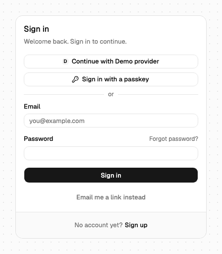 | 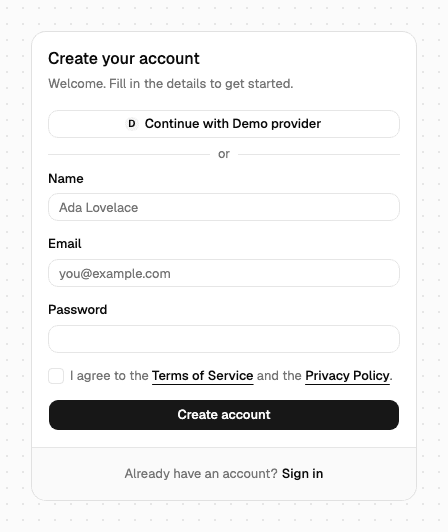 | 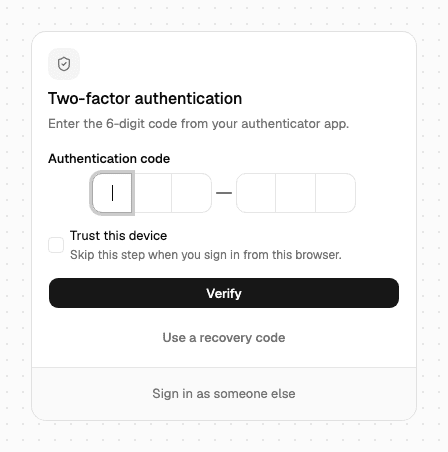 |
| 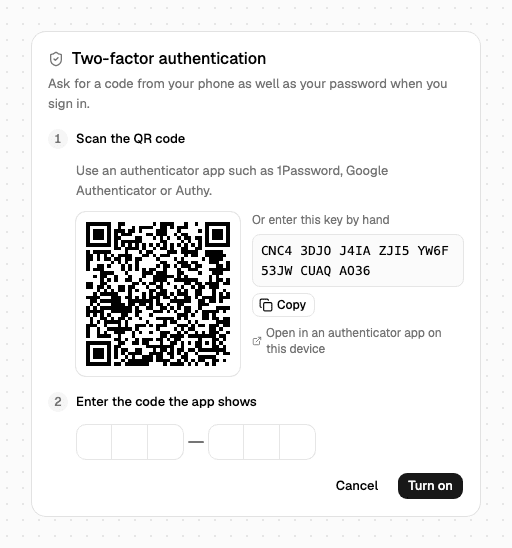 | 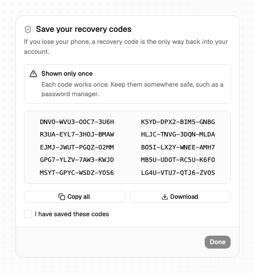 | 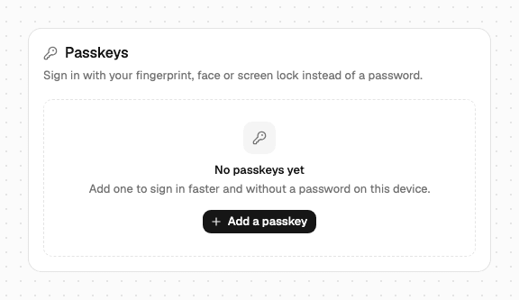 |

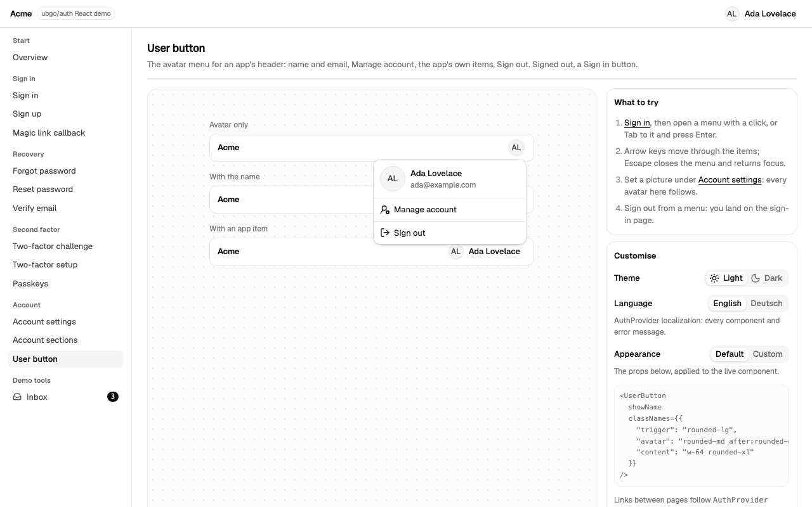

Every component has its own screenshot in [React components](react-components.md). The images are taken headless from the demo and the router examples by `task docs:shots`, which starts throwaway servers, writes compressed PNGs into `docs/assets/screenshots/` and replaces the old set; rerun it after a visible change to a component and commit the images with the change.

Use the components when their screens are close to the ones you want, and the [hooks](react-hooks.md) alone when every screen is your own design; both work in one app. For a frontend that is not React, use the [TypeScript client](flows.md) directly.

## Before you start

- **A Go server** with the library mounted under `/auth` through `authhttp` (or an adapter), with the plugins your screens need. The [react-demo server](../../examples/react-demo/main.go) wires email with verification, password, magic links, two-factor, passkeys, OAuth, terms, organizations, session listing and account deletion.
- **A React 19 app** built with a bundler that resolves TypeScript sources (Vite in every example here). The package's peers are React `^19.0.0` and TanStack Query `^5.0.0`.
- **shadcn set up for Base UI and Tailwind v4**: a `components.json` and `cn` in `@/lib/utils`. The registry's primitives are shadcn's Base UI ones (not Radix), and the components use Tailwind v4 classes and the shadcn CSS variables. The demo pins shadcn 4.21.4 and Tailwind 4.3.3.
- **pnpm and Node** that your bundler supports; the commands below use `pnpm`, and the library's Taskfile tasks (`task ui:install`, `task demo`) need [Task](https://taskfile.dev) and Go.
- **The library checked out next to your app.** The paths below assume `../ubgo-auth`.

## Try it first

The [react-demo](../../examples/react-demo/) is a full app with a page per flow, a "what to try" list on each, and a panel that switches theme, language and `classNames`. It needs no setup:

```sh
task ui:install   # once
task demo         # http://localhost:5180, Ctrl-C stops it
```

Sign in as `ada@example.com` with `correct horse battery staple`. Mailed links land in a demo-only Inbox page, and "Continue with Demo provider" runs a real OAuth flow against a pretend provider inside the demo server; neither exists in the library.


| | |
|---|---|
| 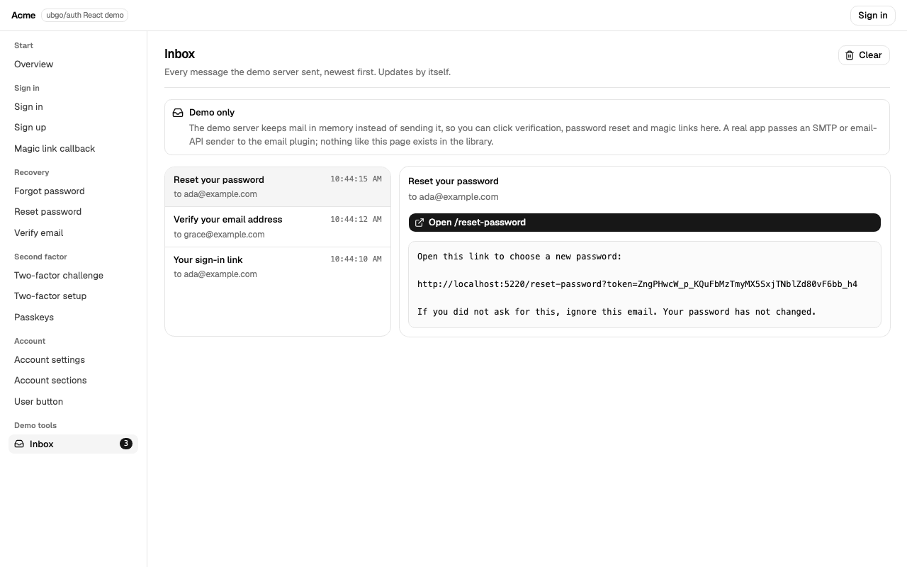 | 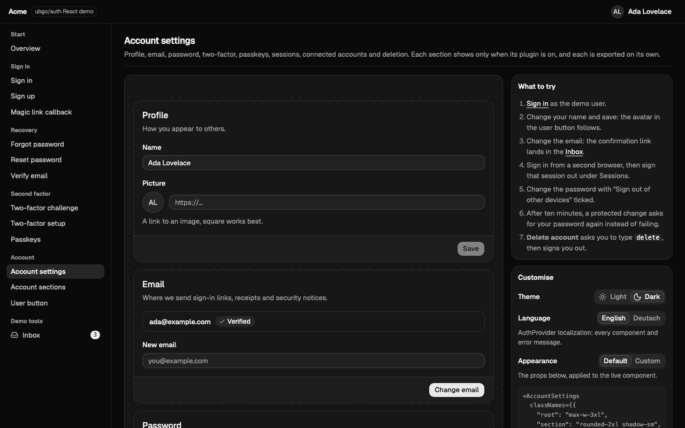 |
| 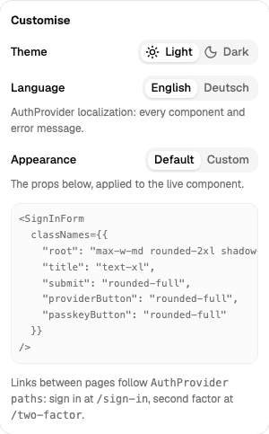 | 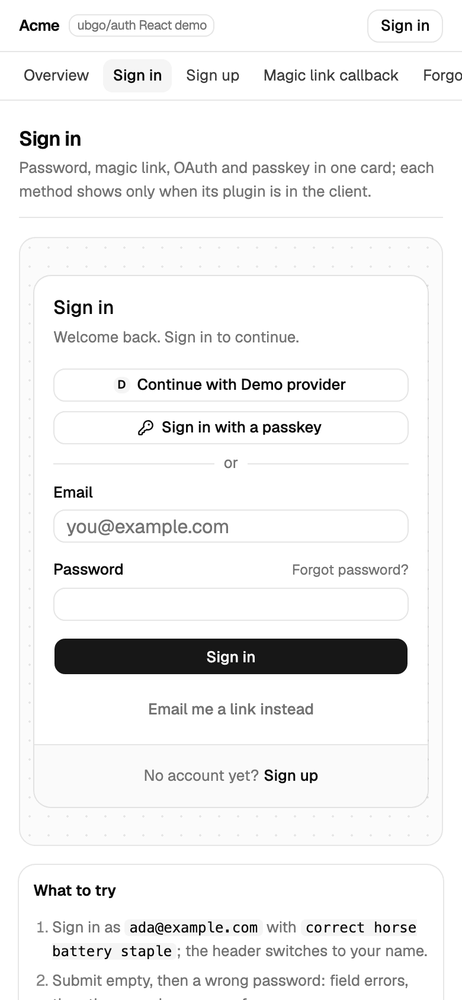 |

## Step 1 — Link the packages

Link the client and the package from a checkout of the library, and add TanStack Query, which the package uses for the session:

```sh
pnpm add @ubgo/auth-client@link:../ubgo-auth/clients/ts @ubgo/auth-react@link:../ubgo-auth/clients/react
pnpm add @tanstack/react-query@5.104.1
```

A linked package brings its own `node_modules`, so tell the bundler to keep one React and one query cache. In Vite: `resolve.dedupe: ["react", "react-dom", "@tanstack/react-query"]`, as the demo's [`vite.config.ts`](../../examples/react-demo/web/vite.config.ts) does beside the proxy of Step 2.

An app that generates its own client ([Way 2](README.md#two-ways-to-get-the-client)) points the name `@ubgo/auth-client` at its folder in `tsconfig.json` paths and the bundler's alias instead of linking `clients/ts`.

## Step 2 — Serve the API on the same origin

The kit uses cookie mode, so the page and `/auth` must share an origin: the session cookie is then first-party, and the browser's `Origin` header is the app's own, which the server checks on every POST. In development, proxy `/auth` from the dev server to the Go app, as the demo's `vite.config.ts` does (`server.proxy`), and leave `changeOrigin` off so the Go server sees the app's host. In production, serve both from one host. A frontend on another site needs bearer mode, see [Bearer mode](bearer-and-mobile.md).

The server must trust the page's origin and build mailed links on it. The demo passes it as `APP_URL`, which the server uses as its base URL:

```sh
cd examples && PORT=8097 APP_URL=http://localhost:5180 go run ./react-demo
```

## Step 3 — Install components from the registry

Build the registry once in the library checkout (`task ui:registry`), serve it over HTTP (shadcn reads registries only over HTTP), map the `@ubgo` namespace to it in your `components.json`, and add what you need:

```json
{ "registries": { "@ubgo": "http://localhost:5181/{name}.json" } }
```

```sh
python3 -m http.server 5181 --bind 127.0.0.1 -d ../ubgo-auth/clients/react/registry/r &
pnpm dlx shadcn@4.21.4 add @ubgo/sign-in-form @ubgo/two-factor-challenge @ubgo/account-settings
```

This writes `components/auth/*.tsx` and the primitives they use (`components/ui/button.tsx`, ...), and installs their npm dependencies. When a primitive already exists, shadcn asks before replacing it; keeping yours works, because the registry's primitives keep shadcn's exports and props. The [install table](react-components.md#install) lists what each item brings.

## Step 4 — Create the client and mount the provider

List the plugins the server wires. A component shows a method only when its plugin is in this list, so keep it equal to the server's:

<!-- ds:block id=auth-hat5p6k4 -->
**auth** · [`examples/react-demo/web/src/auth.ts:8-11`](../../examples/react-demo/web/src/auth.ts#L8-L11)

```typescript
export const auth = createAuthClient({
  baseURL: "/auth",
  plugins: [email(), password(), magiclink(), twofactor(), passkey(), oauth(), terms(), organization(), admin(), metadata()],
})
```
<!-- /ds:block hash=eaaae2 -->

Mount `AuthProvider` once, inside your router so the components navigate and link through it. The demo passes the router's `navigate` (wrapped in `useCallback`, so the provider's value stays stable), a router-aware `Link`, and the language the user picked:

<!-- ds:block id=shell-3sn7fvmr -->
**Shell** · [`examples/react-demo/web/src/components/demo-shell.tsx:87-114`](../../examples/react-demo/web/src/components/demo-shell.tsx#L87-L114)

```tsx
function Shell() {
  const router = useRouter()
  const pathname = useRouterState({ select: (s) => s.location.pathname })
  const { language } = useDemoCustomise()
  const navigate = useCallback((href: string) => void router.navigate({ href }), [router])
  return (
    <AuthProvider client={auth} navigate={navigate} Link={RouterLink} localization={language === "de" ? GERMAN : undefined}>
      <div className="flex h-svh flex-col bg-background text-[13px] text-foreground">
        <header className="flex h-11 shrink-0 items-center justify-between gap-2 border-b px-4">
          <RouterLink href="/" className="flex items-center gap-2 font-semibold tracking-tight">
            Acme
            <span className="rounded-md border px-1.5 text-[11px] font-normal text-muted-foreground">ubgo/auth React demo</span>
          </RouterLink>
          <UserButton showName />
        </header>
        <ImpersonationBanner adminHref="/admin" />
        <SessionTaskRedirect />
        <MobileNav pathname={pathname} />
        <div className="flex min-h-0 flex-1">
          <Sidebar pathname={pathname} />
          <main className="min-w-0 flex-1 overflow-y-auto">
            <Outlet />
          </main>
        </div>
      </div>
    </AuthProvider>
  )
}
```
<!-- /ds:block hash=d30a08 -->

`RouterLink` is a plain anchor that hands a left click to the router; how to write it for TanStack Router, React Router and Next.js is in [React with your router](react-routers.md). The provider's other props are `baseURL` (the client's, for flows that are page navigations), `queryClient` (it reuses the app's `QueryClientProvider` when there is one) and `paths`, where the components send people:

<!-- ds:block id=default-auth-paths-ebuuq6mh -->
**DEFAULT_AUTH_PATHS** · [`clients/react/src/context.tsx:60-69`](../../clients/react/src/context.tsx#L60-L69)

```tsx
export const DEFAULT_AUTH_PATHS: AuthPaths = {
  signIn: "/sign-in",
  signUp: "/sign-up",
  forgotPassword: "/forgot-password",
  twoFactor: "/two-factor",
  setupTwoFactor: "/setup-two-factor",
  account: "/account",
  afterSignIn: "/",
  afterSignOut: "/sign-in",
};
```
<!-- /ds:block hash=691a3a -->

Override any of them on its own: `paths={{ signIn: "/login" }}`, from a constant so the object does not change on every render.

## Step 5 — Render a component

A page renders the component; `redirectTo` is where a finished sign-in goes. This is the demo's sign-in page, which also shows the custom `classNames` and passes `headingLevel={2}` because the page has its own `h1`:

<!-- ds:block id=signinpage-gvz25mv8 -->
**SignInPage** · [`examples/react-demo/web/src/routes/sign-in.tsx:23-56`](../../examples/react-demo/web/src/routes/sign-in.tsx#L23-L56)

```tsx
export function SignInPage() {
  const { custom } = useDemoCustomise()
  // Passed straight through: the form follows it only when it is a path on
  // this site, so /sign-in?redirectTo=https://evil.example lands on "/".
  const redirectTo = new URLSearchParams(window.location.search).get("redirectTo") ?? undefined
  return (
    <DemoPage
      title="Sign in"
      description="Password, magic link, OAuth and passkey in one card; each method shows only when its plugin is in the client."
      customCode={CUSTOM_CODE}
      tryThis={[
        <>
          Sign in as <code>{DEMO_USER.email}</code> with <code>{DEMO_USER.password}</code>; the header switches to your name.
        </>,
        <>Submit empty, then a wrong password: field errors, then the server's message for <code>password.invalid_credentials</code>.</>,
        <>
          Choose <b>Email me a link instead</b>, then open the link from the <RouterLink href="/inbox">Inbox</RouterLink>.
        </>,
        <>
          <b>Continue with Demo provider</b> runs a real OAuth code flow against a pretend provider in the demo server.
        </>,
        <>
          Turn on two-factor in <RouterLink href="/two-factor/setup">Two-factor setup</RouterLink>, sign out, sign in again: the form hands off to the challenge.
        </>,
        <>
          Add a passkey under <RouterLink href="/passkeys">Passkeys</RouterLink>, sign out, then click the Email field: the browser offers the passkey in its autofill list (conditional mediation), and picking it signs in.
        </>,
        <>Switch Language to Deutsch and Appearance to Custom in the panel below.</>,
      ]}
    >
      <SignInForm redirectTo={redirectTo} classNames={custom ? CUSTOM : undefined} headingLevel={2} />
    </DemoPage>
  )
}
```
<!-- /ds:block hash=a559cd -->

## Step 6 — Add the pages mailed links open

Mails from the server link to pages in your app, at the library's default paths on its base URL. Give each a route that renders its component, which reads `?token=` from the address by itself:

| Path | Component | Mailed by |
|---|---|---|
| `/verify-email` | `VerifyEmail` | the email plugin, after sign-up and on resend |
| `/reset-password` | `ResetPasswordForm` | `password.forgot` |
| `/magic-link` | `MagicLinkCallback` | `magiclink` sign-in |
| `/confirm-email-change` | `ConfirmEmailChange` | an email change, to the new address |
| `/undo-email-change` | `ConfirmEmailChange action="undo"` | an email change, to the old address |
| `/invitations` | `OrganizationInvitations` | an organization invitation (the organization plugin's default invite page) |

Plus the pages the components send people to, from `paths`: `/sign-in`, `/sign-up`, `/forgot-password`, `/two-factor` and `/account`. These are the demo's routes, one line each:

<!-- ds:block id=routes-72e2hh2j -->
**routes** · [`examples/react-demo/web/src/router.tsx:38-59`](../../examples/react-demo/web/src/router.tsx#L38-L59)

```tsx
const routes = [
  page("/", HomePage),
  page("/sign-in", SignInPage),
  page("/sign-up", SignUpPage),
  page("/magic-link", MagicLinkPage),
  page("/forgot-password", ForgotPasswordPage),
  page("/reset-password", ResetPasswordPage),
  page("/verify-email", VerifyEmailPage),
  page("/two-factor", TwoFactorPage),
  page("/two-factor/setup", TwoFactorSetupPage),
  page("/passkeys", PasskeysPage),
  page("/setup-two-factor", SetupTwoFactorPage),
  page("/account", AccountPage),
  page("/account-sections", AccountSectionsPage),
  page("/user-button", UserButtonPage),
  page("/confirm-email-change", ConfirmEmailChangePage),
  page("/undo-email-change", UndoEmailChangePage),
  page("/organizations", OrganizationsPage),
  page("/invitations", InvitationsPage),
  page("/admin", AdminPage),
  page("/inbox", InboxPage),
]
```
<!-- /ds:block hash=e5145a -->

## Passkey autofill

With the passkey plugin in the client, `SignInForm` offers the user's passkeys in the email field's autofill list, the way a password manager offers saved passwords: picking one signs in with no dialog. This is WebAuthn conditional mediation. The field carries `autocomplete="username webauthn"`, and on mount the form calls `passkey.loginBegin` and asks the browser for a credential with `mediation: "conditional"`, only when `PublicKeyCredential.isConditionalMediationAvailable()` says the browser can. The "Sign in with a passkey" button stays for browsers that cannot, and for people who prefer the dialog.

A browser runs one credential request at a time, so the form aborts the pending autofill request before any other way in (the passkey button, a password submit, a magic link, an OAuth button) and starts it again when that way fails. It also aborts on unmount. A passkey the server refuses (an expired ceremony, a passkey it does not know) shows the server's message, and autofill starts again so another pick works. A browser without conditional mediation, or a failed `loginBegin`, simply gets no autofill; nothing is shown. Pass `passkeyAutofill={false}` to turn it off.

For a sign-in form of your own, `usePasskeyAutofill` is the same logic as a hook, and `runPasskeyAutofill` is the framework-free ceremony under it:

<!-- ds:block id=passkeyautofill-5gb93jhu -->
**PasskeyAutofill** · [`clients/react/src/autofill.ts:34-46`](../../clients/react/src/autofill.ts#L34-L46)

```typescript
export type PasskeyAutofill = {
  readonly status: PasskeyAutofillStatus;
  /**
   * Aborts the pending request now, synchronously, and keeps it stopped.
   * Call it first thing when the person picks another way in (the passkey
   * button, a password submit, an OAuth button): a browser runs one
   * credential request at a time, so the passkey dialog fails while an
   * autofill request is pending.
   */
  readonly pause: () => void;
  /** Starts it again after pause, for when the other way in failed and the form is back. */
  readonly resume: () => void;
};
```
<!-- /ds:block hash=e3c7f7 -->
<!-- /ds:block hash=e3c7f7 -->

```tsx
const autofill = usePasskeyAutofill({
  onSignedIn: async () => {
    await refreshSession()
    navigate("/")
  },
  onError: (error) => setMessage(messageFor(error)),
})
// <input autoComplete="username webauthn" ... />, and call autofill.pause() before any other way in.
```

## Keeping the session fresh

`useSession()` reads the session once and again on window focus once it is a minute old ([`SESSION_STALE_MS`](ds:block?id=session-stale-ms-frks37zb)). A page that must notice a session revoked elsewhere (another device, an admin) sooner can poll it, and `isRefetching` tells a later read from the first one (`isPending`):

<!-- ds:block id=usesessionoptions-4ru6ttpw -->
**UseSessionOptions** · [`clients/react/src/session.ts:61-76`](../../clients/react/src/session.ts#L61-L76)

```typescript
export type UseSessionOptions = {
  /**
   * Ask the server again every this many milliseconds while the component is
   * mounted, so a session revoked elsewhere (another device, an admin) leaves
   * this tab within that time. False (the default) polls never; the session
   * is still re-read on window focus once it is SESSION_STALE_MS old.
   */
  readonly refetchInterval?: number | false;
  /** Keep polling while the tab is in the background. False by default, so a hidden tab costs nothing. */
  readonly refetchIntervalInBackground?: boolean;
  /**
   * Re-read when the window regains focus: true (the default) once the
   * session is SESSION_STALE_MS old, "always" on every focus, false never.
   */
  readonly refetchOnWindowFocus?: boolean | "always";
};
```
<!-- /ds:block hash=772923 -->
<!-- /ds:block hash=772923 -->

The options apply to that one use: the demo's overview polls every 30 seconds with `useSession({ refetchInterval: 30_000 })`, and every other component reading the same session entry keeps its own settings.

## Organizations

With `organization()` in the client and `organization.New()` on the server, three components cover what an app with workspaces needs on screen. The active organization belongs to the session, as on the server (`POST /auth/organization/set-active`): it survives a reload, and another device signed in as the same user has its own.

- **`OrganizationSwitcher`**: a menu button showing the active organization. It lists the user's organizations with their role, the personal account (no active organization; `hidePersonal` removes it), and "Create organization", a dialog with a name and a slug suggested from it. A created organization becomes the active one. Switching stays on the page; pass `onSuccess` or `redirectTo` to move on.
- **`OrganizationMembers`**: the active organization's members (or `orgId`'s), `pageSize` at a time with previous and next, its pending invitations, and an invite form with a role picker (`inviteRoles`, `member` and `admin` by default). The invite form and the Cancel buttons show only when the server says the caller may use them (`organization.has-permission` for `invitation: ["create"]` and `["cancel"]`), so they follow whatever roles or authorizer the server runs; the server checks again on the action itself. Each member has a menu with a role choice (`memberRoles`, shown with `member: ["update"]`), Remove (with `member: ["delete"]`), and on the caller's own row Leave, which every member may use; Remove and Leave ask for confirmation in an alert dialog first, and a refusal such as `organization.last_owner` (the last owner cannot be demoted, removed or leave) shows on the member's row.
- **`OrganizationInvitations`**: the invitations addressed to the signed-in user's verified addresses, with Accept and Decline. Route it at `/invitations`, where invitation mails link.

The headless hooks under them, for screens of your own: `useOrganizations` (the list), `useActiveOrganization`, `useOrganizationMembers`, `useOrganizationInvitations`, `useReceivedInvitations`, `useOrganizationPermission`, and `useOrganizationActions` for the calls that change state, each updating the cache entries it affects:

<!-- ds:block id=organizationactions-pmrrj2p2 -->
**OrganizationActions** · [`clients/react/src/organization.ts:156-191`](../../clients/react/src/organization.ts#L156-L191)

```typescript
export type OrganizationActions = {
  /** Makes an organization the session's active one (null clears it), then re-reads everything scoped to it. */
  readonly setActive: (target: ActiveOrganizationTarget) => Promise<AuthError | null>;
  /**
   * Creates an organization with the caller as its owner. The server makes it
   * the active one unless `keepCurrentActiveOrganization` is set.
   */
  readonly create: (input: OrganizationCreateRequest) => Promise<{ readonly organization: OrganizationOrg | null; readonly error: AuthError | null }>;
  /** Invites someone into an organization (the active one when `orgId` is left out). */
  readonly invite: (input: OrganizationInviteRequest) => Promise<AuthError | null>;
  /** Cancels a pending invitation. */
  readonly cancelInvitation: (inviteId: string) => Promise<AuthError | null>;
  /** Accepts an invitation addressed to the caller and joins its organization. */
  readonly acceptInvitation: (inviteId: string) => Promise<{ readonly organization: OrganizationOrg | null; readonly error: AuthError | null }>;
  /** Declines an invitation addressed to the caller. */
  readonly rejectInvitation: (inviteId: string) => Promise<AuthError | null>;
  /**
   * Removes another member (`organization.remove-member`); needs member:delete,
   * and only an owner may remove an owner. The last owner is refused with
   * `organization.last_owner`.
   */
  readonly removeMember: (input: OrganizationMemberTarget) => Promise<AuthError | null>;
  /**
   * Takes the caller out of an organization (the active one when `orgId` is
   * left out): `organization.remove-member` naming themselves, which any
   * member may do except the last owner (`organization.last_owner`). The
   * session's active organization is cleared when it was this one.
   */
  readonly leave: (orgId?: string) => Promise<AuthError | null>;
  /**
   * Changes a member's role (`organization.set-role`); needs member:update.
   * Only an owner may grant the owner role or change an owner's, and the last
   * owner cannot be demoted (`organization.last_owner`).
   */
  readonly setRole: (input: OrganizationRoleChange) => Promise<AuthError | null>;
};
```
<!-- /ds:block hash=d53f49 -->
<!-- /ds:block hash=adb3a4 -->

Every entry lives under `ORGANIZATION_QUERY_ROOT`, and sign-out clears them with the rest of the auth cache. The demo's page puts the switcher above the member list and the organization's domains:

<!-- ds:block id=organizationspage-hcwvmukj -->
**OrganizationsPage** · [`examples/react-demo/web/src/routes/organizations.tsx:35-74`](../../examples/react-demo/web/src/routes/organizations.tsx#L35-L74)

```tsx
export function OrganizationsPage() {
  const { custom } = useDemoCustomise()
  return (
    <DemoPage
      title="Organizations"
      description="The active organization lives on the session: the switcher sets it, and the member list, its invitations, the invite form and its verified domains follow it."
      customCode={CUSTOM_CODE}
      tryThis={[
        <>
          <RouterLink href="/sign-in?redirectTo=/organizations">Sign in</RouterLink> as <code>{DEMO_USER.email}</code>, open the switcher and choose <b>Create organization</b>: it becomes active, with you as its owner.
        </>,
        <>
          Invite <code>grace@demo.test</code> as an admin: the invitation is listed as pending and its mail is in the <RouterLink href="/inbox">Inbox</RouterLink>.
        </>,
        <>Create a second organization, then switch between the two and back to your personal account.</>,
        <>
          Once Grace has accepted, open the <b>…</b> menu on her row to change her role or remove her; on your own row, try making yourself an admin or leaving: the last owner is refused.
        </>,
        <>Under Domains, add <code>example.com</code> (verified at once: you hold an address there), set it to <b>Suggest joining</b>, let <code>{SECOND_USER.email}</code> request to join from Invitations, then approve here.</>,
        <>Switch Language to Deutsch and Appearance to Custom in the panel below.</>,
      ]}
    >
      <SignedIn>
        <div className="flex w-full max-w-xl flex-col items-start gap-3">
          <OrganizationSwitcher classNames={custom ? CUSTOM_SWITCHER : undefined} />
          <OrganizationMembers classNames={custom ? CUSTOM_MEMBERS : undefined} headingLevel={2} />
          <OrganizationDomains headingLevel={2} />
        </div>
      </SignedIn>
      <SignedOut>
        <p className="text-[13px] text-muted-foreground">
          <RouterLink href="/sign-in?redirectTo=/organizations" className="text-foreground underline underline-offset-3">
            Sign in
          </RouterLink>{" "}
          to manage organizations.
        </p>
      </SignedOut>
    </DemoPage>
  )
}
```
<!-- /ds:block hash=915a04 -->
<!-- /ds:block hash=98460e -->

## Try it

`task ui:e2e` drives the demo headless (Playwright) against a throwaway server and app, so it runs beside `task demo`. Its first script checks every enabled method shows, field errors and focus, the typed wrong-password message, sign-in reaching `useSession`, sign-out, that `?redirectTo=` follows only paths on this site, a magic link through the Inbox, the Demo provider, and re-authentication with a linked provider once the session is past its fresh window (8 seconds on this server); the second drives `/account-sections` ([React components › Try it](react-components.md#try-it)), and the third passkey autofill and the organization pages:

```sh
task ui:e2e
```

The first script's full output from a real run (the screenshot path, printed in full, is shortened here):

```text
  ok   sign-in page shows every enabled method
  ok   empty submit shows field errors and focuses the first
       message: "The sign-in details are not right."
  ok   wrong password shows the typed error message
  ok   correct password signs in and useSession updates
  ok   sign out clears the session
  ok   redirectTo to another site lands on the default path
  ok   redirectTo written as //host lands on the default path
  ok   redirectTo to a path on this site is followed
  ok   magic link mode sends and confirms
  ok   the demo inbox shows the magic link and opens it in the app
  ok   Continue with Demo provider signs in through the pretend provider
  ok   a stale session asks to confirm and offers the linked provider
  ok   another account at the provider is refused back on the page
  ok   the linked account confirms on the same session and the change goes through
all 14 steps passed; screenshots in examples/react-demo/web/.shots/e2e/
```

The third script (`scripts/e2e-org.mjs`) adds Chromium's virtual authenticator, which answers an autofill request with the stored passkey at once, as a person picking it from the list would, and then drives the organization pages. Its output from a real run:

```text
  ok   the identifier field offers passkeys and an empty autofill stays quiet
  ok   password sign-in still works with autofill running
  ok   the overview polls the session (useSession refetchInterval)
  ok   a passkey is added for the user
  ok   signed out, the passkey in the field's autofill signs in with no click
  ok   signed in with no organization, the switcher shows the personal account
  ok   create organization makes it active, with the user as its owner
  ok   a taken slug is refused under the slug field
  ok   an invitation is sent, listed as pending and mailed
  ok   switching between organizations and the personal account
  ok   the active organization is the session's, so it survives a reload
  ok   the invitee sees the invitation and accepts it
  ok   the new member is in the organization's member list
all 13 steps passed; screenshots in examples/react-demo/web/.shots/e2e-org/
```

The message is `password.invalid_credentials`' declared English text, which the server sends and the form shows unchanged. By hand, with `task demo` running: open `http://localhost:5180/sign-in`, submit a wrong password, then the right one; the header's Sign in link becomes Ada's avatar, and the home page says "Hello, Ada Lovelace". Every route has its own "What to try" list.

## Customise

Every component takes the same base props:

<!-- ds:block id=authcomponentprops-pq4s8fyu -->
**AuthComponentProps** · [`clients/react/src/customization.ts:20-46`](../../clients/react/src/customization.ts#L20-L46)

```typescript
export type AuthComponentProps<Slot extends string, Key extends keyof ComponentLocalizations, Result> = {
  /** Classes for the root element, merged after the defaults. Same as classNames.root. */
  readonly className?: string;
  /** Classes per named part. */
  readonly classNames?: SlotClassNames<Slot>;
  /** Text overrides for this one use, over the provider's and the English defaults. */
  readonly localization?: Partial<ComponentLocalizations[Key]>;
  /**
   * Called after the action succeeds, instead of navigating. Return nothing;
   * navigate yourself if you want to go somewhere.
   */
  readonly onSuccess?: (result: Result) => void;
  /**
   * Where to go after success when there is no onSuccess. Defaults to the
   * provider's path for the flow. Only a path on this site (or an origin in
   * AuthProvider's allowedRedirectOrigins) is followed; anything else is
   * ignored and the default applies, so passing the address bar's
   * ?redirectTo= straight through is safe (useSafeRedirect).
   */
  readonly redirectTo?: string;
  /**
   * The heading level of the component's title. 1 by default, because on a
   * page of its own (/sign-in) the card is the main heading; pass 2 when the
   * page has its own h1, so the outline has one top heading.
   */
  readonly headingLevel?: HeadingLevel;
};
```
<!-- /ds:block hash=a4bf22 -->

- **`className` and `classNames`.** Slots are a typed union per component (`SignInFormSlot`, ...), merged after the defaults with tailwind-merge, so a misspelt slot does not compile and `max-w-md` replaces the default width instead of fighting it.
- **Text.** Each component exports its text type and English defaults (`SignInFormText`, `SIGN_IN_FORM_TEXT`). Override per use with `localization`, or app-wide with `AuthProvider localization={{ signInForm: { ... }, errors: { "password.invalid_credentials": "..." } }}`. Error overrides are keyed by the closed error-code union.
- **Theme.** Colours come only from the shadcn CSS variables, so light and dark follow your theme.
- **Behaviour.** `onSuccess` replaces navigation; hand-offs (`onSecondFactor`) work the same way.
- **Anything else.** The file is yours: edit it.

Each component's props, slots, text key, result and errors are in [React components](react-components.md); the full contract, with the reasoning behind each rule, is [clients/react/CONTRACT.md](../../clients/react/CONTRACT.md).

## Pitfalls

- **Two copies of React or TanStack Query.** A linked package resolves its own `node_modules`; without `resolve.dedupe` (Step 1), hooks throw "Invalid hook call", or the session never updates because the components and your app read different caches.
- **A different origin.** A page on `localhost:5173` calling a server on `localhost:8080` directly is a cross-origin fetch: the server answers `auth.origin_not_trusted` to every POST unless it trusts that origin, and the browser needs CORS on top. Proxy `/auth` (Step 2) so there is one origin, or use [bearer mode](bearer-and-mobile.md) for a frontend that really lives elsewhere.
- **A client plugin list that differs from the server's.** A factory the server does not wire makes its buttons appear and fail on click with `auth.unknown_operation` (404, "Not found."); a plugin the server wires but the client lacks has no button at all.
- **A handed-off page with no route.** SignInForm navigates to `/two-factor` when the account has a second factor, and mailed links open the pages of Step 6. A missing route is a 404 with a pending session, or a link that cannot be used.
- **Unstable provider props.** The provider's value is memoised on its props; an inline `paths={{ ... }}`, `localization={{ ... }}` or `navigate={(href) => ...}` is new on every render and re-renders every auth component below it. Hoist objects to module scope and wrap `navigate` in `useCallback`.
- **Token links in development.** React's StrictMode mounts every component twice in development. The token pages spend their token through a query keyed on it, so both mounts share one call; a token page you write yourself with `useEffect` would call twice, and the second call answers `auth.token_invalid`.
- **Sign-in limits while testing.** The password plugin allows [5 sign-ins per account](ds:block?id=signinaccountlimit-yz756w5r) in its window, and the account page's re-auth dialog has [its own limit of the same size](ds:block?id=password-reauthlimits-6wq3nx8p), per user. Repeated manual tests hit `auth.rate_limited`; the default counters live in the server's memory, so restarting the demo clears them.
- **Server rendering.** Without a `navigate`, the provider uses `window.location.assign`. In a framework that renders on the server, mount the provider in a client component and pass the router's navigation, see [React with your router](react-routers.md).

## Troubleshooting

| Symptom | Cause | Fix |
|---|---|---|
| `useAuth: wrap the app in <AuthProvider client={...}>` | A component rendered outside the provider | Mount `AuthProvider` above every auth component |
| Hooks throw "Invalid hook call", or the session never updates | Two copies of React or of TanStack Query, from a linked package | `resolve.dedupe` (Step 1) |
| A method you wired on the server has no button | Its factory is not in the client's `plugins` | Add it; see [Plugins](plugins.md) |
| `auth.origin_not_trusted` on every POST | The page and `/auth` are on different origins | Proxy `/auth` (Step 2), or trust the origin on the server |
| `shadcn add` says the item was not found | The registry is not being served, or `components.json` has no `@ubgo` entry | Step 3 |
| A mailed link lands on a 404 | The app has no route for the default page | Add the routes of Step 6 |
| "Too many attempts" after a few test sign-ins | The password plugin's per-account limit | Wait, or restart the dev server (in-memory counters) |

## Related

- [React components](react-components.md): every component's props, slots, text, result, errors and demo route.
- [React hooks](react-hooks.md): the headless package, for screens of your own.
- [React with your router](react-routers.md): TanStack Router, React Router, Next.js App Router and no router.
- [clients/react/README.md](../../clients/react/README.md): the package and its layout.
- [clients/react/BUILDING.md](../../clients/react/BUILDING.md): how a new component is added to the kit.
- [examples/react-demo](../../examples/react-demo/README.md): the demo, its tasks and its demo-only helpers.
- [Flows](flows.md): the same flows with the client alone, for a frontend that is not React.
