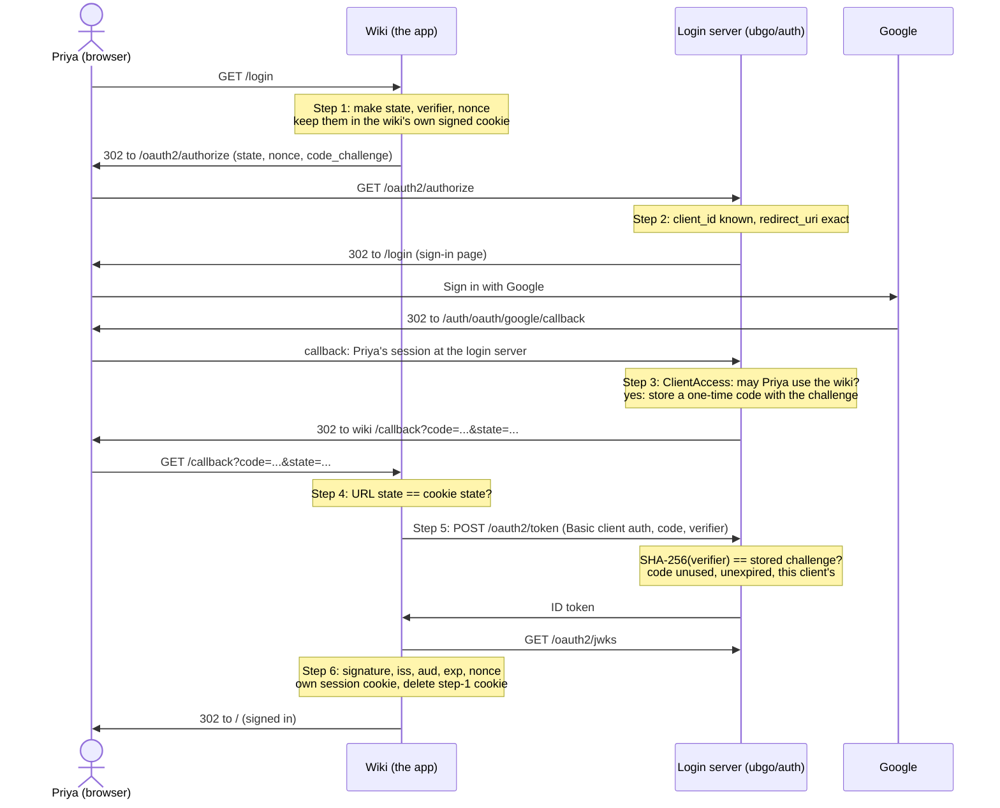

# How an OpenID Connect login works, step by step

This page walks through one sign-in between three parties: an app (the wiki), the ubgo/auth login server, and Google. For each step it shows the real HTTP request and answer, captured from a test run, and the code on each side that handles it. Read it when you run the [SSO login server](../integrations/sso-server.md) and want to understand what your apps are doing, when you write an app that signs in through it, or when the words state, verifier and nonce blur together.

## The story

Example Co. runs a login server at `login.example.com` and an internal wiki at `wiki.example.com`. Priya works at Example Co. and her address is `priya@example.com`.

Priya opens the wiki. The wiki does not know her, so it sends her browser to the login server. The login server does not know her yet either, so it shows one button, "Sign in with Google". She clicks it, Google asks which account, she picks her work account, and Google sends her back to the login server. The login server checks that the wiki's list lets her in (everyone at `example.com` may use the wiki), and sends her back to the wiki with a one-time code. The wiki swaps the code for an ID token, a signed note from the login server that says "this is `priya@example.com`, and she signed in just now, for you". The wiki checks the note and starts its own session. Priya sees the wiki's home page.

Three parties, two of them servers, and one browser carrying messages between them. Every message the browser carries can be read and changed by whoever controls the browser, so each step is built so that reading or changing it gets an attacker nothing.

## When you need this

- You run the [SSO login server](../integrations/sso-server.md) and an app team asks what their app must check.
- You write the app side yourself, with or without an OIDC library. A library does all of this for you; this page tells you what it is doing, so you can configure it and debug it.
- A security review asks why a stolen code, a leaked URL or a replayed callback is harmless.

## The whole flow



When the answer in step 3 is no, the login server sends Priya to its no-access page instead, and the wiki gets nothing at all.

## Before you start

- The login server is [`examples/sso-server`](../../examples/sso-server/main.go); its guide is [SSO login server](../integrations/sso-server.md).
- The app is [`examples/sso-client`](../../examples/sso-client/client.go), a wiki written with the Go standard library only, so every check is in plain sight. Its test runs both servers in-process over TLS, with a stand-in for Google; no real account and no network.
- All the HTTP below comes from one run of `go test -v -run 'TestSSOClient_SignInAndOut$' ./sso-client` (see [Try it](#try-it)). Long values are cut with `…`, and the login server's own signature fields (`ba_…`) are folded into one line.

## Step 1 — The app makes three random values and sends the browser to the login server

Priya's browser asks the wiki for `/login`. The wiki makes three random values of 32 bytes each:

- `state` ties the answer that will come back to this browser.
- the PKCE `verifier` ties the code that will come back to this app.
- `nonce` ties the ID token that will come back to this sign-in.

The wiki keeps all three in its own cookie, signed with the wiki's own session secret. The login server never sees this cookie and never needs that secret. Then it sends the browser to `/oauth2/authorize` with its `client_id`, its `redirect_uri`, the scopes, the `state`, the `nonce`, and not the verifier but its SHA-256 fingerprint, `code_challenge`, with `code_challenge_method=S256`. Nothing secret is in the URL.

<!-- ds:block id=ssoclient-startlogin-qw2xk2fe -->
**App.startLogin** · [`examples/sso-client/client.go:214-233`](../../examples/sso-client/client.go#L214-L233)

```go
func (a *App) startLogin(w http.ResponseWriter, r *http.Request) {
	st := loginState{State: random(), Verifier: random(), Nonce: random(), Expires: a.cfg.Now().Add(loginTTL).Unix()}
	sealed, err := seal(a.cfg.SessionSecret, purposeLogin, st)
	if err != nil {
		a.fail(w, err)
		return
	}
	setCookie(w, cookieLogin, sealed, loginTTL, a.secure())
	q := url.Values{
		"response_type":         {responseTypeCode},
		"client_id":             {a.cfg.ClientID},
		"redirect_uri":          {a.redirectURI()},
		"scope":                 {scopeOpenIDEmail},
		"state":                 {st.State},
		"nonce":                 {st.Nonce},
		"code_challenge":        {challenge(st.Verifier)},
		"code_challenge_method": {challengeMethodS256},
	}
	http.Redirect(w, r, a.meta.AuthorizationEndpoint+"?"+q.Encode(), http.StatusFound)
}
```
<!-- /ds:block hash=d5516b -->

`challenge` is one line of standard SHA-256:

<!-- ds:block id=ssoclient-challenge-v52cq5w6 -->
**challenge** · [`examples/sso-client/client.go:441-444`](../../examples/sso-client/client.go#L441-L444)

```go
func challenge(verifier string) string {
	sum := sha256.Sum256([]byte(verifier))
	return base64.RawURLEncoding.EncodeToString(sum[:])
}
```
<!-- /ds:block hash=b9d7c7 -->

The cookie is a JSON payload and an HMAC over it. Anyone can read it (base64 is not encryption), nobody without the secret can change it, and it carries its own expiry:

<!-- ds:block id=ssoclient-seal-yufauk2x -->
**seal** · [`examples/sso-client/cookie.go:38-45`](../../examples/sso-client/cookie.go#L38-L45)

```go
func seal(secret []byte, purpose string, v any) (string, error) {
	raw, err := json.Marshal(v)
	if err != nil {
		return "", err
	}
	payload := base64.RawURLEncoding.EncodeToString(raw)
	return payload + sealSeparator + sign(secret, purpose, payload), nil
}
```
<!-- /ds:block hash=e0a1db -->

What went over the wire:

```text
browser: GET https://wiki.example.com/login
  ← 302 Found
    Location: https://login.example.com/oauth2/authorize
        client_id=oac_43z2mwmtgsy42rvxf7jzznrd
        code_challenge=qBp0DikGWrrJjWzWOeJ-tMiXrNFbgaXtyzy10hjl_oA
        code_challenge_method=S256
        nonce=d6ighvMGTGpO_XjjtN0lIhy4eMwFAUBh1Ya3eXpGDd8
        redirect_uri=https://wiki.example.com/callback
        response_type=code
        scope=openid email profile
        state=vsxEGEF_8bf84HrcqylTMSVJYiz0jxUWjA1mbXBGpmQ
    Set-Cookie: wiki_login=eyJzdGF0ZSI6InZzeEVHRUZfOGJmODRIcmNxeWxUTVNWSllpejBqeFVXakExbWJYQkdwbVEi… (Max-Age 600)
```

The `state` and `nonce` in the URL are the ones in the cookie. The `code_challenge` is `SHA-256` of the verifier, which appears nowhere yet.

## Step 2 — The login server checks the app and signs Priya in with Google

The login server first checks the request itself: the `client_id` must be a registered, enabled client, and the `redirect_uri` must be one it registered, compared as an exact string. No prefix match, no wildcard, no clean-up, so `https://wiki.example.com/callback/../evil` is not `https://wiki.example.com/callback`:

<!-- ds:block id=oauthprovider-redirectaccepted-44z4eb9d -->
**Plugin.redirectAccepted** · [`plugin/oauthprovider/authorize.go:296-302`](../../plugin/oauthprovider/authorize.go#L296-L302)

```go
func (p *Plugin) redirectAccepted(uri string, registered []string) bool {
	exact := slices.Contains(registered, uri) || loopbackPortMatch(uri, registered)
	if p.redirectValidator == nil {
		return exact
	}
	return p.redirectValidator(uri, slices.Clone(registered), exact) && validRedirectURI(uri)
}
```
<!-- /ds:block hash=5ccc44 -->

A request that fails these checks is answered with an error page on the login server itself: the browser is never sent to an address the request named but nobody registered, so no code can leak there. [`TestSSOClient_UnregisteredRedirect`](ds:block?id=testssoclient-unregisteredredirect-k7t2wq9s&assert=true) checks it.

Priya has no session at the login server yet, so it sends her to its sign-in page. The page gets the whole authorize request plus the login server's signature over it (`sig`), so nothing in between can change what the wiki asked for:

```text
browser: GET https://login.example.com/oauth2/authorize
        client_id=oac_43z2mwmtgsy42rvxf7jzznrd
        code_challenge=qBp0DikGWrrJjWzWOeJ-tMiXrNFbgaXtyzy10hjl_oA
        …the rest of step 1's request
  ← 302 Found
    Location: /login
        client_id=oac_43z2mwmtgsy42rvxf7jzznrd
        …the same request
        exp=1794548066
        sig=pSY1yM0MpCnF+KCpqwhlovicz4RzPB/ZXhkhqiAmNKM=
        ba_…  (the login server's signature over the query)
```

She clicks "Sign in with Google". The login server runs its own OAuth sign-in with Google (with its own state, in its own `__Host-auth_flow` cookie) and, back from Google, gives Priya a session at the login server and sends her back to the authorize request:

```text
browser: GET https://login.example.com/auth/oauth/google/callback
        code=c
        state=ILlukUv6ZssfJf0QcRKoqSABohrjS_XFOE_NSq6Eu_o
    Cookie: __Host-auth_flow
  ← 302 Found
    Location: https://login.example.com/oauth2/authorize
        …the wiki's request, still signed
    Set-Cookie: __Host-auth_flow= (Max-Age -1)
    Set-Cookie: __Host-auth_session=E7uSDUIZP1zocRWqMJP2ocE8F8DxmJW1aHq406RONd4 (Max-Age 0)
```

This half is the same pattern as the whole page, one level down: here the login server is the app and Google is the login server. The [OAuth plugin guide](../plugins/oauth.md) covers it.

## Step 3 — The login server checks who may use the app, then issues a one-time code

Now the login server knows who Priya is. Before any code exists, it asks the access rule (`ClientAccess`) whether she may use this app. In the example server the rule is the wiki's allow list:

<!-- ds:block id=ssoserver-allowlists-2vjtavt3 -->
**allowLists** · [`examples/sso-server/main.go:58-61`](../../examples/sso-server/main.go#L58-L61)

```go
var allowLists = map[string]oauthprovider.AllowList{
	"wiki": {Domains: []string{"example.com"}},
	"ops":  {Emails: []string{"alice@example.com"}},
}
```
<!-- /ds:block hash=87692f -->

A refusal goes to the no-access page, and the wiki gets nothing:

<!-- ds:block id=oauthprovider-refuseaccess-fugdevc8 -->
**Plugin.refuseAccess** · [`plugin/oauthprovider/access.go:144-154`](../../plugin/oauthprovider/access.go#L144-L154)

```go
func (p *Plugin) refuseAccess(z authzContext, in AuthorizeRequest, none bool, err error) (AuthorizeResult, error) {
	switch {
	case !errors.Is(err, ErrNoAccess):
		return AuthorizeResult{}, err
	case none:
		return AuthorizeResult{}, p.fail(z, ErrAccessDenied)
	case p.noAccessPage != "":
		return AuthorizeResult{RedirectTo: p.pageURL(p.noAccessPage, in, true, nil)}, nil
	}
	return AuthorizeResult{}, ErrNoAccess
}
```
<!-- /ds:block hash=ec28ad -->

Sam, a contractor at `sam@partner.io`, takes the same path and stops here:

```text
browser: GET https://login.example.com/oauth2/authorize
        …the wiki's request
    Cookie: __Host-auth_session
  ← 302 Found
    Location: /no-access
        …the wiki's request, signed
browser: GET https://login.example.com/no-access
    Cookie: __Host-auth_session
  ← 403 Forbidden
```

[`TestSSOClient_UnlistedUserSeesNoAccess`](ds:block?id=testssoclient-unlisteduserseesnoaccess-n8w2kq5t&assert=true) checks that the browser ends on the 403 page, the wiki's callback is never reached and the token endpoint is never called.

Priya is on the list, so the login server issues a code. It asks the rule once more (whatever route led here), then stores the code with the client, the user, the session, the redirect URI, the `code_challenge` and the `nonce`, and an expiry:

<!-- ds:block id=oauthprovider-issuecode-fyj9g3rp -->
**Plugin.issueCode** · [`plugin/oauthprovider/authorize.go:709-733`](../../plugin/oauthprovider/authorize.go#L709-L733)

```go
func (p *Plugin) issueCode(ctx context.Context, c *auth.Call, z authzContext, scopes []string, ref string) (AuthorizeResult, error) {
	// The last word before a code exists: whatever route led here, a user
	// ClientAccess refuses gets none.
	if err := p.accessAllowed(ctx, z.client.c, c.User.ID); err != nil {
		return AuthorizeResult{}, err
	}
	code := PrefixCode + auth.NewToken().Reveal()
	id, err := p.core.NewID(codeIDPrefix)
	if err != nil {
		return AuthorizeResult{}, err
	}
	now := p.core.Now()
	if _, err := p.core.Exec(ctx, sqlb.NewInsert(p.core.Dialect()).Into(TableCode).Row(
		sqlb.Set(CodeID, id), sqlb.Set(CodeHash, p.hashSecret(SecretCode, code)), sqlb.Set(CodeClient, z.client.c.ClientID),
		sqlb.Set(CodeUser, c.User.ID), sqlb.Set(CodeSession, c.Session.ID), sqlb.Set(CodeRedirect, z.in.RedirectURI),
		sqlb.Set(CodeScopes, strings.Join(scopes, listSeparator)), sqlb.Set(CodeChallenge, optional(z.in.CodeChallenge)),
		sqlb.Set(CodeMethod, optional(z.in.CodeChallengeMethod)), sqlb.Set(CodeNonce, optional(z.in.Nonce)),
		sqlb.Set(CodeAuthTime, c.Session.CreatedAt), sqlb.Set(CodeExpires, now.Add(p.codeTTL)), sqlb.Set(CodeCreated, now),
		sqlb.Set(CodeResource, optional(z.in.Resource)), sqlb.Set(CodeClaims, joinClaims(z.userInfoClaims)), sqlb.Set(CodeJKT, optional(z.in.DPoPJKT)),
		sqlb.Set(CodeRef, optional(ref)),
	)); err != nil {
		return AuthorizeResult{}, err
	}
	return AuthorizeResult{RedirectTo: p.redirectWith(z.redirect, z.in.State, url.Values{paramCode: {code}})}, nil
}
```
<!-- /ds:block hash=6df448 -->

Three things to notice. The database keeps only a hash of the code, not the code. The code lives for [ten minutes](ds:block?id=oauthprovider-defaultcodettl-r5m2qw8x) at most. And the `state` goes back unchanged: the login server does not check it, it only returns it.

```text
browser: GET https://login.example.com/oauth2/authorize
        …the wiki's request, signed
    Cookie: __Host-auth_session
  ← 302 Found
    Location: https://wiki.example.com/callback
        code=uboc_InYjL1jVRl9oQJQuS4s-2urJRhBwIFi6H95qiQRBeeI
        iss=https://login.example.com
        state=vsxEGEF_8bf84HrcqylTMSVJYiz0jxUWjA1mbXBGpmQ
```

`iss` names the login server that answered (RFC 9207), for an app that trusts more than one.

## Step 4 — The app checks that the answer belongs to this browser

The browser brings the code to the wiki's `/callback`, and with it the wiki's own cookie from step 1. The wiki opens the cookie (signature and expiry, in [`open`](ds:block?id=ssoclient-open-x8x2avc3)), deletes it at once (its values are good for one try), and compares the `state` in the URL with the `state` in the cookie:

<!-- ds:block id=ssoclient-handlecallback-pj2pem52 lines=1-18 -->
**App.handleCallback** · [`examples/sso-client/client.go:241-282`](../../examples/sso-client/client.go#L241-L282)

```go
func (a *App) handleCallback(w http.ResponseWriter, r *http.Request) {
	deleteCookie(w, cookieLogin, a.secure())
	var st loginState
	if err := readCookie(r, cookieLogin, a.cfg.SessionSecret, purposeLogin, a.cfg.Now(), &st); err != nil {
		a.refuse(w, errLoginCookie)
		return
	}
	q := r.URL.Query()
	if subtle.ConstantTimeCompare([]byte(q.Get("state")), []byte(st.State)) != 1 {
		a.refuse(w, errStateMismatch)
		return
	}
	// RFC 9207: the login server names itself on the callback, so an app
	// that trusts several servers can tell which one answered.
	if iss := q.Get("iss"); iss != "" && iss != a.cfg.Issuer {
		a.refuse(w, errWrongIssuer)
		return
	}
```
<!-- /ds:block hash=7ef401 -->

The rest of [`handleCallback`](ds:block?id=ssoclient-handlecallback-pj2pem52) runs steps 5 and 6 and sets the session cookie.

The two `state` values are a matching pair: one half travelled in the URL, the other stayed in Priya's own browser, in a cookie only the wiki can write. That is why reading the URL half is useless to an attacker. Here is the attack it stops. Mallory signs in to the wiki with her own account, stops before her browser follows the redirect to `/callback`, and keeps the URL with her code. She then gets Priya to open that URL (a link, an image, a hidden frame). Without the check, the wiki would swap Mallory's code and sign Priya in as Mallory, and whatever Priya writes next would land in Mallory's account. With the check, the URL carries Mallory's `state`, Priya's browser carries Priya's cookie (or none), they do not match, and the wiki stops before the code goes anywhere. Mallory cannot plant a matching cookie either: the cookie is signed with the wiki's session secret, which she does not have.

[`TestSSOClient_RefusesWrongState`](ds:block?id=testssoclient-refuseswrongstate-7mk4xw9d&assert=true) changes the `state` of a real callback and checks for a 400, no session cookie and no call to the token endpoint.

## Step 5 — The app swaps the code for tokens, server to server

The wiki now calls the login server directly, not through the browser. It sends the code, the same `redirect_uri`, and the real verifier, the value whose fingerprint went out in step 1. It proves who it is with its client id and client secret as HTTP Basic:

<!-- ds:block id=ssoclient-exchangecode-cczc8bm2 -->
**App.exchangeCode** · [`examples/sso-client/client.go:289-316`](../../examples/sso-client/client.go#L289-L316)

```go
func (a *App) exchangeCode(ctx context.Context, code, verifier string) (tokenResponse, error) {
	form := url.Values{
		"grant_type":    {grantAuthorizationCode},
		"code":          {code},
		"redirect_uri":  {a.redirectURI()},
		"code_verifier": {verifier},
	}
	req, err := http.NewRequestWithContext(ctx, http.MethodPost, a.meta.TokenEndpoint, strings.NewReader(form.Encode()))
	if err != nil {
		return tokenResponse{}, err
	}
	req.Header.Set("Content-Type", "application/x-www-form-urlencoded")
	// RFC 6749 section 2.3.1: both halves are form-encoded before Basic.
	req.SetBasicAuth(url.QueryEscape(a.cfg.ClientID), url.QueryEscape(a.cfg.ClientSecret))
	res, err := a.cfg.HTTPClient.Do(req)
	if err != nil {
		return tokenResponse{}, err
	}
	defer res.Body.Close()
	var out tokenResponse
	if err := json.NewDecoder(io.LimitReader(res.Body, maxBody)).Decode(&out); err != nil {
		return tokenResponse{}, fmt.Errorf("sso-client: token endpoint answered %d: %w", res.StatusCode, err)
	}
	if res.StatusCode != http.StatusOK || out.IDToken == "" {
		return tokenResponse{}, fmt.Errorf("sso-client: token endpoint answered %d %s", res.StatusCode, out.Error)
	}
	return out, nil
}
```
<!-- /ds:block hash=1e03dc -->

The client id and secret work like an API key pair: one pair per app, made by `auth oauth-client create`, the secret shown once (or written to a file) and stored by the login server only as a hash. The login server compares the hash of what it is sent with the stored hash in constant time, in [`authenticateClient`](ds:block?id=oauthprovider-authenticateclient-jjwxsb9j).

```text
wiki → login: POST https://login.example.com/oauth2/token
    Authorization: Basic base64(client_id:client_secret)
    form:
        code=uboc_InYjL1jVRl9oQJQuS4s-2urJRhBwIFi6H95qiQRBeeI
        code_verifier=PiPHwcp1OXMbCVkvHg-Nk9nxpQ5SwObzSnBJ81eQD2g
        grant_type=authorization_code
        redirect_uri=https://wiki.example.com/callback
  ← 200 OK
    body:
        access_token: "uboa_PuYBINCZ0X0CVKq…"
        expires_at: 1794551066
        expires_in: 3600
        id_token: "eyJhbGciOiJFZERTQSIsInR5cCI6IkpXVCIsImtpZCI6ImFKSGplV2NfV1ZDUUV0dDEifQ.…
        scope: "openid email profile"
        token_type: "Bearer"
```

On the login server, the code is spent first. The update marks it used only if it was not used yet; a second use of a spent code is a replay and revokes everything issued from it:

<!-- ds:block id=oauthprovider-redeemcode-adngtvxm -->
**Plugin.redeemCode** · [`plugin/oauthprovider/authorize.go:758-783`](../../plugin/oauthprovider/authorize.go#L758-L783)

```go
func (p *Plugin) redeemCode(ctx context.Context, code string) (codeRow, error) {
	hash := p.hashSecret(SecretCode, code)
	now := p.core.Now()
	n, err := p.core.Exec(ctx, sqlb.NewUpdate(p.core.Dialect()).Table(TableCode).Set(sqlb.Set(CodeConsumed, &now)).
		Where(sqlb.Eq(CodeHash, hash), sqlb.IsNull(CodeConsumed)))
	if err != nil {
		return codeRow{}, err
	}
	var r codeRow
	err = p.core.One(ctx, p.core.Select().Columns(r.bindings()...).From(TableCode).Where(sqlb.Eq(CodeHash, hash)))
	if errors.Is(err, sqlb.ErrNoRows) {
		return codeRow{}, ErrInvalidGrant
	}
	if err != nil {
		return codeRow{}, err
	}
	if n == 0 {
		family := r.id
		p.core.AfterTx(ctx, func(ctx context.Context) { p.revokeFamily(ctx, family) })
		return codeRow{}, ErrInvalidGrant
	}
	if !now.Before(r.expires) {
		return codeRow{}, ErrInvalidGrant
	}
	return r, nil
}
```
<!-- /ds:block hash=a4f89c -->

Then the code must belong to this client and this redirect URI, and the verifier must match the stored challenge. The login server hashes the verifier itself and compares:

<!-- ds:block id=oauthprovider-checkpkce-jb5yqv5r -->
**checkPKCE** · [`plugin/oauthprovider/authorize.go:790-804`](../../plugin/oauthprovider/authorize.go#L790-L804)

```go
func checkPKCE(r codeRow, verifier string) error {
	if r.challenge == nil {
		if verifier != "" {
			return ErrInvalidGrant
		}
		return nil
	}
	if !validVerifier(verifier) || deref(r.method) != methodS256 {
		return ErrInvalidGrant
	}
	if subtle.ConstantTimeCompare([]byte(s256(verifier)), []byte(*r.challenge)) != 1 {
		return ErrInvalidGrant
	}
	return nil
}
```
<!-- /ds:block hash=7107ba -->

<!-- ds:block id=oauthprovider-s256-3ek42s37 -->
**s256** · [`plugin/oauthprovider/authorize.go:368-371`](../../plugin/oauthprovider/authorize.go#L368-L371)

```go
func s256(verifier string) string {
	sum := sha256.Sum256([]byte(verifier))
	return base64.RawURLEncoding.EncodeToString(sum[:])
}
```
<!-- /ds:block hash=fe5990 -->

No key is involved. SHA-256 is a public recipe: anyone can compute it from the verifier, nobody can get the verifier back from it. The wiki gave out the fingerprint in step 1 and only now shows the verifier, over a direct connection the browser never sees.

So a stolen code is useless on its own. Whoever takes it from the URL, a log or the browser history still needs the client secret (it stays on the wiki's server) and the verifier (it stayed in the wiki's signed cookie and is now only in this request). [`TestSSOClient_RefusesWrongVerifier`](ds:block?id=testssoclient-refuseswrongverifier-h6c3pz8r&assert=true) sends a real code with another verifier and gets `invalid_grant`, then sends the same code with the right verifier and gets `invalid_grant` again. [`TestSSOClient_CodeWorksOnce`](ds:block?id=testssoclient-codeworksonce-q2v7nd4k&assert=true) signs in, then sends the same code with the right verifier and secret again, and gets `invalid_grant`.

A failed attempt spends the code. When the verifier, the `redirect_uri` or the client is wrong, or the client fails to authenticate, the request is refused and its transaction rolls back, and then a separate write marks the code used, so the rollback does not bring it back:

<!-- ds:block id=oauthprovider-burncode-k4p9vz2h -->
**Plugin.burnCode** · [`plugin/oauthprovider/authorize.go:855-871`](../../plugin/oauthprovider/authorize.go#L855-L871)

```go
func (p *Plugin) burnCode(ctx context.Context, code, family string, refusal error) error {
	e := &grantRefusal{refusal: refusal}
	hash := p.hashSecret(SecretCode, code)
	p.core.AfterTx(ctx, func(ctx context.Context) {
		now := p.core.Now()
		n, err := p.core.Exec(ctx, sqlb.NewUpdate(p.core.Dialect()).Table(TableCode).Set(sqlb.Set(CodeConsumed, &now)).
			Where(sqlb.Eq(CodeHash, hash), sqlb.IsNull(CodeConsumed)))
		if err != nil {
			e.fail(err)
			return
		}
		if n == 0 && family != "" {
			p.revokeFamily(ctx, family)
		}
	})
	return e
}
```
<!-- /ds:block hash=3eceef -->

Whoever stole a code gets one guess, and the right request after a wrong one gets `invalid_grant` too. A refusal after those checks passed (another `resource`, a DPoP proof to redo) leaves the code, since the request proved it came from the app that asked for it. If that write fails, the token endpoint answers with the database error rather than `invalid_grant`, since the code was not spent. If another request redeems the code in the moment between the rollback and that write, the tokens it got are revoked. [`TestOAuthProvider_FailedExchangeBurnsCode`](ds:block?id=testoauthprovider-failedexchangeburnscode-r7k2mx4q&assert=true) checks a wrong verifier, no verifier, a wrong `redirect_uri`, another client and a wrong client secret, each followed by the right request, on SQLite, Postgres and MySQL.

## Step 6 — The app checks the ID token and starts its own session

The ID token is three base64url parts: a header, the claims, and a signature over the first two. From the run above:

```text
id_token header: {"alg":"EdDSA","typ":"JWT","kid":"aJHjeWc_WVCQEtt1"}
id_token claims: {"at_hash":"cjZIuCT5pRrTpkoGSK_WPI3J1Wkt5gR4i4tRK5QaL7M","aud":"oac_43z2mwmtgsy42rvxf7jzznrd","auth_time":1794547466,"azp":"oac_43z2mwmtgsy42rvxf7jzznrd","email":"priya@example.com","email_verified":true,"exp":1794551066,"iat":1794547466,"iss":"https://login.example.com","jti":"IGGFSGKGPUPQIHVKOQXDOG3PKQ","name":"Priya","nbf":1794547466,"nonce":"d6ighvMGTGpO_XjjtN0lIhy4eMwFAUBh1Ya3eXpGDd8","sid":"ses_mgtwdatecalqnmrzkehalca6","sub":"usr_bgvt5iztovjl2smhapw3mrdi"}
```

The login server signs it with its private Ed25519 key in [`idToken`](ds:block?id=oauthprovider-idtoken-pr39wb8q), putting in the nonce stored with the code. It publishes the matching public key at `/oauth2/jwks`:

```text
wiki → login: GET https://login.example.com/oauth2/jwks
  ← 200 OK
    body:
        keys: [{"alg":"EdDSA","crv":"Ed25519","kid":"aJHjeWc_WVCQEtt1","kty":"OKP","us…
```

The private key signs; the public key can only check. The wiki fetches the public key with the `kid` from the header and checks the signature, then the claims: `iss` is the login server, `aud` names the wiki's client id (and `azp`, when present, too), `exp` has not passed, and `nonce` is the one in the wiki's cookie from step 1. A token that fails any check names nobody:

<!-- ds:block id=ssoclient-verifyidtoken-pm49dpuv -->
**App.verifyIDToken** · [`examples/sso-client/client.go:323-357`](../../examples/sso-client/client.go#L323-L357)

```go
func (a *App) verifyIDToken(ctx context.Context, raw, nonce string) (idClaims, error) {
	parts := strings.Split(raw, ".")
	if len(parts) != 3 {
		return idClaims{}, errBadIDToken
	}
	var header struct {
		Alg string `json:"alg"`
		Kid string `json:"kid"`
	}
	if err := decodeSegment(parts[0], &header); err != nil || header.Alg != algEdDSA {
		return idClaims{}, errBadIDToken
	}
	key, err := a.publicKey(ctx, header.Kid)
	if err != nil {
		return idClaims{}, err
	}
	sig, err := base64.RawURLEncoding.DecodeString(parts[2])
	if err != nil || !ed25519.Verify(key, []byte(parts[0]+"."+parts[1]), sig) {
		return idClaims{}, errBadIDToken
	}
	var c idClaims
	if err := decodeSegment(parts[1], &c); err != nil {
		return idClaims{}, errBadIDToken
	}
	switch {
	case c.Issuer != a.cfg.Issuer,
		!slices.Contains(c.Audience, a.cfg.ClientID),
		c.AZP != "" && c.AZP != a.cfg.ClientID,
		!a.cfg.Now().Before(time.Unix(c.Expiry, 0).Add(clockSkew)),
		nonce == "" || subtle.ConstantTimeCompare([]byte(c.Nonce), []byte(nonce)) != 1,
		c.Subject == "":
		return idClaims{}, errBadIDToken
	}
	return c, nil
}
```
<!-- /ds:block hash=e71719 -->

The algorithm is pinned to `EdDSA`, so a token that says `"alg":"none"` is refused before anything else. The nonce check means a valid ID token from another sign-in (Priya's last one, or Mallory's) cannot be passed off as the answer to this one. [`TestSSOClient_RefusesBadIDToken`](ds:block?id=testssoclient-refusesbadidtoken-x4r9mf2j&assert=true) checks that the real token passes and that an altered one, one signed with another key, one with another nonce, an expired one, an unsigned one (`"alg":"none"`) and a malformed one are all refused.

Then the wiki starts its own session: a second signed cookie with `sub`, `email` and `name`. `sub` is Priya's stable id at the login server; use it, not the address, as the key in the app's own tables. The step-1 cookie is already gone:

```text
browser: GET https://wiki.example.com/callback
        code=uboc_InYjL1jVRl9oQJQuS4s-2urJRhBwIFi6H95qiQRBeeI
        iss=https://login.example.com
        state=vsxEGEF_8bf84HrcqylTMSVJYiz0jxUWjA1mbXBGpmQ
    Cookie: wiki_login
  ← 302 Found
    Location: /
    Set-Cookie: wiki_login= (Max-Age -1)
    Set-Cookie: wiki_session=eyJzdWIiOiJ1c3JfYmd2dDVpenRvdmpsMnNtaGFwdzNtcmRpIiwiZW1haWwiOiJwcml5YUBl… (Max-Age 28800)
```

Look at the order in the full trace: the token and jwks calls happen while this request is open, before its answer. The browser never sees the code exchange.

### Signing out

Priya clicks "Sign out". The wiki deletes its session cookie and sends the browser to the login server's end-session endpoint, with the ID token as `id_token_hint` and a post-logout address the wiki registered. The hint names Priya's own session at the login server, so it ends at once and the browser goes back to the wiki:

<!-- ds:block id=ssoclient-logout-awevv2k6 -->
**App.logout** · [`examples/sso-client/client.go:393-403`](../../examples/sso-client/client.go#L393-L403)

```go
func (a *App) logout(w http.ResponseWriter, r *http.Request) {
	var s session
	signedIn := readCookie(r, cookieSession, a.cfg.SessionSecret, purposeSession, a.cfg.Now(), &s) == nil
	deleteCookie(w, cookieSession, a.secure())
	if !signedIn || a.meta.EndSessionEndpoint == "" {
		http.Redirect(w, r, pathHome, http.StatusSeeOther)
		return
	}
	q := url.Values{"id_token_hint": {s.IDToken}, "post_logout_redirect_uri": {a.cfg.BaseURL + pathHome}}
	http.Redirect(w, r, a.meta.EndSessionEndpoint+"?"+q.Encode(), http.StatusSeeOther)
}
```
<!-- /ds:block hash=4020bb -->

```text
browser: POST https://wiki.example.com/logout
    Cookie: wiki_session
  ← 303 See Other
    Location: https://login.example.com/oauth2/end-session
        id_token_hint=eyJhbGciOiJFZERTQSIsInR5cCI6IkpXVCIsImtpZCI6ImFKSGplV2NfV1ZDUUV0dDEifQ.e…
        post_logout_redirect_uri=https://wiki.example.com/
    Set-Cookie: wiki_session= (Max-Age -1)
browser: GET https://login.example.com/oauth2/end-session
        id_token_hint=eyJhbGciOiJFZERTQSIsInR5cCI6IkpXVCIsImtpZCI6ImFKSGplV2NfV1ZDUUV0dDEifQ.e…
        post_logout_redirect_uri=https://wiki.example.com/
    Cookie: __Host-auth_session
  ← 302 Found
    Location: https://wiki.example.com/
    Set-Cookie: __Host-auth_session= (Max-Age -1)
    Set-Cookie: __Host-auth_session_cache= (Max-Age -1)
    Set-Cookie: __Host-auth_oauth_logout_confirmation= (Max-Age -1)
```

The client must be registered with `--end-session` and the address with `--post-logout-uri`. [`TestSSOClient_SignInAndOut`](ds:block?id=testssoclient-signinandout-3s8tq2vb&assert=true) signs in, checks the step-1 cookie is gone and the session cookie is set, signs out, and checks that the next sign-in starts at the login server's sign-in page again.

## State, verifier and nonce

| | state | PKCE verifier | nonce |
|---|---|---|---|
| Who makes it | the app, step 1 | the app, step 1 | the app, step 1 |
| Where the app keeps it | its own signed cookie | its own signed cookie | its own signed cookie |
| What goes in the authorize URL | the value itself | only its SHA-256 fingerprint (`code_challenge`) | the value itself |
| Where it comes back | in the callback URL, unchanged | the app sends the real verifier to `/oauth2/token`, server to server | inside the signed ID token |
| Who checks it | the app, against its cookie (step 4) | the login server, against the stored challenge (step 5) | the app, against its cookie (step 6) |
| The attack it blocks | someone else's callback planted in this browser (login CSRF) | a code stolen from a URL, a log or another app on the device | an ID token from another sign-in replayed into this one |

## Keys and secrets

| Secret | Who holds it | What it protects | If it leaks |
|---|---|---|---|
| The app's session secret (`SESSION_SECRET` in the wiki) | the app only | the app's cookies: the step-1 values and the app's session | anyone can forge the app's cookies; rotate it |
| The client secret | the app's server, and the login server as a hash | the token endpoint: only this app can swap its codes | another server can swap codes it intercepts (it still needs the verifier); delete the client and register a new one |
| The ID token signing key (Ed25519 private key) | the login server only; the public half is at `/oauth2/jwks` | every ID token: no one else can write one an app accepts | anyone can sign in as anyone to every app; replace the key |
| The login server's own secret (`AUTH_SECRET`) | the login server only | its sessions, its signed authorize queries and logout confirmations | forged sessions at the login server; rotate it |

Each secret has one holder and one job. The app never needs the login server's keys, and the login server never needs the app's session secret.

## Questions people ask

**Can't an attacker read the state from the URL?** Yes, and it does not help. The state is checked against the copy in the user's own browser cookie, which only the app can write (it is signed with the app's session secret). Knowing the URL half lets an attacker make a URL, not the matching cookie in someone else's browser. And by the time the callback URL exists, the state has done its job: the app deletes the cookie on the first try, so the same state never works twice.

**How can the login server check the verifier without the app's key?** It does not need a key. The check is "SHA-256 of what you send me now equals what you sent me before", and SHA-256 is a public recipe with no key: the login server runs the same function the app ran in step 1 and compares. What makes it safe is that SHA-256 cannot be run backwards: seeing the fingerprint in step 1 tells nobody the verifier.

**Why does the right verifier fail after a wrong one?** The wrong one spent the code. A code that answered one wrong guess and kept working would let someone who stole it keep guessing, so any failed exchange burns the code, whoever sent it. The app's fix is the same as for any refused code: start the sign-in again.

**Is the verifier the same as the state?** No. Both are random values the app makes and keeps in its cookie, but they protect different things and are checked by different parties. The state protects the browser (is this answer for the sign-in this browser started?) and the app checks it. The verifier protects the code (is the one swapping this code the app that asked for it?) and the login server checks it. The state travels in the URL as is; the verifier never travels through the browser at all.

**What is the difference between signing and hashing?** Hashing (SHA-256) needs no key: anyone can compute the hash of a value, and nobody can get the value back. It answers "is this the same value as before?". Signing needs a key: only the holder of the private key (Ed25519) or the shared secret (HMAC) can make a signature, and the matching public key or the same secret checks it. It answers "did the key holder write exactly this?". PKCE uses hashing, the app's cookies use HMAC signing with the app's secret, and ID tokens use Ed25519 signing with the login server's private key.

## Try it

```sh
cd examples
go test -v -run 'TestSSOClient_SignInAndOut$' ./sso-client
```

Every request the browser and the wiki make is printed as above, then:

```text
--- PASS: TestSSOClient_SignInAndOut (0.04s)
PASS
ok  	github.com/ubgo/auth/examples/sso-client	0.044s
```

`go test -v ./sso-client` runs every case on this page and ends with:

```text
--- PASS: TestSSOClient_SignInAndOut (0.10s)
--- PASS: TestSSOClient_RefusesWrongState (0.06s)
--- PASS: TestSSOClient_CodeWorksOnce (0.06s)
--- PASS: TestSSOClient_RefusesWrongVerifier (0.06s)
--- PASS: TestSSOClient_UnlistedUserSeesNoAccess (0.06s)
--- PASS: TestSSOClient_UnregisteredRedirect (0.04s)
--- PASS: TestSSOClient_RefusesBadIDToken (0.06s)
PASS
ok  	github.com/ubgo/auth/examples/sso-client	0.457s
```

## Pitfalls

| Symptom or trap | Cause | Fix |
|---|---|---|
| `auth oauth-client create` refuses `http://localhost:8082/callback` | A web client's redirect URI must be `https` on a non-loopback host | Serve the app at an `https` address (behind a TLS proxy in development too) |
| The callback fails with "no valid login cookie" | The step-1 cookie did not come back: `SameSite=Strict`, a different host or path, or more than ten minutes passed | `SameSite=Lax` (it is sent on the top-level redirect back), `Path=/`, and start again from the app |
| `invalid_grant` at the token endpoint | The code was used already, expired, belongs to another client, the `redirect_uri` differs from step 1, or the verifier does not match | Send the same `redirect_uri` and the verifier from the cookie, and swap the code at once |
| `invalid_grant` when the app retries the exchange after fixing a wrong verifier, `redirect_uri` or secret | The failed attempt spent the code; a code gets one try | Start the sign-in again from the app (step 1) for a new code; never retry a code |
| The exchange is refused for another `resource`, a DPoP proof to redo, or a server error, and the retry with the same code works | Deliberate: by then the request has proven the verifier and the client credentials, so it came from the app that asked for the code, and spending the code would turn a fixable mistake or a passing outage into a new sign-in. [`TestOAuthProvider_ResourceJWTAccessTokens`](ds:block?id=testoauthprovider-resourcejwtaccesstokens-p735ucxk&assert=true), [`TestOAuthProvider_DPoP`](ds:block?id=testoauthprovider-dpop-bazxe8y2&assert=true) and [`TestOAuthProvider_IDGeneratorFailures`](ds:block?id=testoauthprovider-idgeneratorfailures-rcqftdr5&assert=true) retry the same code after each | Fix the request and retry the code at once, inside its ten minutes |
| `invalid_client` at the token endpoint | Wrong secret, or the Basic header was built without form-encoding the id and secret first | `SetBasicAuth(url.QueryEscape(id), url.QueryEscape(secret))` (RFC 6749 section 2.3.1) |
| ID tokens stop verifying after the login server restarts | The example login server signs with a new key on each start, and the app looks up keys by `kid` | Load a fixed key on the login server; see [jwt-keys](../../examples/jwt-keys/) |
| An app accepts any token that decodes | It reads the claims without checking the signature, or accepts the `alg` the token names | Verify against `/oauth2/jwks` with the algorithm pinned, then `iss`, `aud`, `exp` and `nonce` |
| The app keys its users by email | Addresses change; `sub` does not | Store `sub` |
| The app signs a user out but the next sign-in is silent | Only the app's session ended; the login server's session is still alive | Send the browser to `/oauth2/end-session` with `id_token_hint`, and register the client with `--end-session` |

## Related

- [SSO login server](../integrations/sso-server.md): the server side of this page, with allow lists, client registration and taking access away.
- [`examples/sso-client`](../../examples/sso-client/): the wiki app and its tests.
- [`examples/sso-server`](../../examples/sso-server/): the login server.
- [OAuth provider](../plugins/oauthprovider.md): every option of the provider plugin.
- [OAuth](../plugins/oauth.md): the login server's own sign-in with Google and other providers.
- [JWT](../plugins/jwt.md): the signing keys and the jwks endpoint.
- [Security](security.md): the library's security properties.
