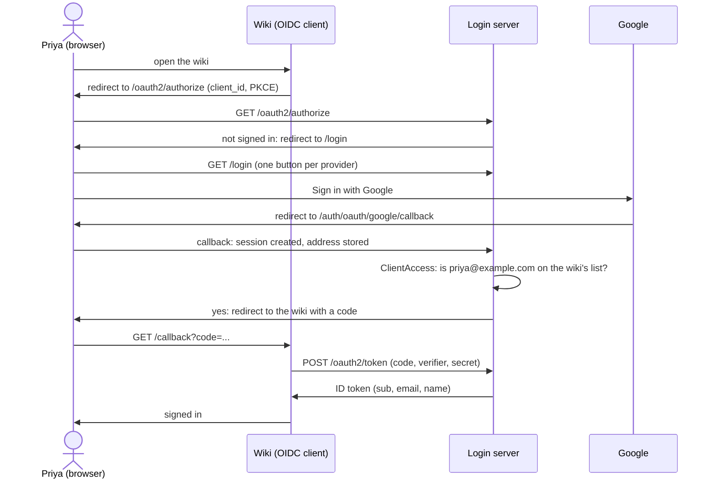

# SSO login server: one company login for your own apps

You will have a login server for your company's internal apps. People sign in once, with Google, and every app trusts that sign-in. Each app has its own list of who may use it. The server is an OpenID Connect provider, so each app is an ordinary OIDC client: it needs no code from this library.

## The story

Example Co. has two internal apps: a wiki everyone uses, and an ops console for two people. Both send their users to `login.example.com`.

Priya works at Example Co. She opens the wiki. The wiki sends her browser to the login server. She sees one button, "Sign in with Google", and clicks it. Google asks which account; she picks her `priya@example.com` account. She lands back in the wiki, signed in. The wiki knows her name and her verified address from the ID token.

Sam is a contractor with a `sam@partner.io` address. He opens the ops console and signs in with Google the same way. The ops console's list does not name him, so the login server shows him a page that says "Your account does not have access to ops." The ops console never gets a code, so it never learns anything about him.

Later the team adds Sam to the ops list. Sam opens the ops console again and gets in. When his contract ends, they take him off the list. His next sign-in is refused, and so is the app's next token refresh.

## When to use it

Use it when several of your own apps should share one login, and you want to decide in one place who may use which app.

Pick something else when:

- **You have one internal tool and need no accounts.** Use the [login gate](login-gate.md): no database, a sealed cookie, one allow rule.
- **Your customers bring their own identity provider.** That is enterprise SSO into your app: use [`plugin/sso`](../plugins/sso.md).
- **Other companies' apps sign your users in, with consent screens and self-registration.** That is a public OAuth provider: start from the [OAuth provider guide](../plugins/oauthprovider.md). This guide is the same plugin, set up for your own apps only.

## How a sign-in goes



When the answer to the `ClientAccess` question is no, the server redirects to the no-access page instead, and the wiki gets nothing.

## Before you start

- The example is [`examples/sso-server`](../../examples/sso-server/main.go). Its test plays the whole browser flow against a stand-in for Google.
- The modules: `github.com/ubgo/auth`, `github.com/ubgo/auth/plugin/oauthprovider` and `github.com/ubgo/auth/authui/social`. The pages module does not bring in the password plugin or argon2.
- A Google OAuth client. Register `https://login.example.com/auth/oauth/google/callback` as its redirect URI.
- A secret of at least [32 bytes](ds:block?id=minsecretsize-7wq2kx9m) in `AUTH_SECRET`: `openssl rand -base64 32`.

## Step 1 — Write down who may use each app

An allow list belongs to one app. It names whole domains, single addresses, or both. Here the wiki is open to everyone at `example.com`, and the ops console to one person:

<!-- ds:block id=ssoserver-allowlists-2vjtavt3 -->
**allowLists** · [`examples/sso-server/main.go:58-61`](../../examples/sso-server/main.go#L58-L61)

```go
var allowLists = map[string]oauthprovider.AllowList{
	"wiki": {Domains: []string{"example.com"}},
	"ops":  {Emails: []string{"alice@example.com"}},
}
```
<!-- /ds:block hash=87692f -->

The rules are simple on purpose:

- Only verified addresses count. Google says which addresses are verified; an unverified one never matches.
- Case does not matter. `Priya@Example.COM` matches `example.com`.
- A domain matches exactly. `example.com` does not let in `eu.example.com`.
- An app with no list lets nobody in. A new app is closed until someone writes its list.

In a real deployment, load the lists from your own configuration file. The server asks for the list on every decision, so a list you reload applies at once.

## Step 2 — Wire the server

`newAuth` puts the pieces together:

<!-- ds:block id=ssoserver-newauth-6zux32wb -->
**newAuth** · [`examples/sso-server/main.go:68-83`](../../examples/sso-server/main.go#L68-L83)

```go
func newAuth(db *sql.DB, secret []byte, key ed25519.PrivateKey, upstream oauth.Provider) (*auth.Auth, *oauthprovider.Plugin, error) {
	jw := jwt.New(jwt.WithSigningKey(key), jwt.Issuer(baseURL))
	op := oauthprovider.New(jw,
		oauthprovider.Issuer(baseURL),
		oauthprovider.LoginPage(social.DefaultLoginPath),
		oauthprovider.ConsentPage(social.DefaultConsentPath),
		oauthprovider.NoAccessPage(social.DefaultNoAccessPath),
		oauthprovider.ClientAccess(oauthprovider.AllowListAccess(func(_ context.Context, c oauthprovider.Client) (oauthprovider.AllowList, bool) {
			l, ok := allowLists[c.Name]
			return l, ok
		})),
	)
	a, err := auth.New(auth.WithDB(db, sqlb.SQLiteDialect{}), auth.WithBaseURL(baseURL), auth.WithSecret(secret),
		auth.WithPlugins(email.New(email.NoMail()), oauth.New(oauth.WithProviders(upstream), oauth.RequireVerifiedEmail()), jw, op))
	return a, op, err
}
```
<!-- /ds:block hash=aecf55 -->

What each part does:

- `oauthprovider.ClientAccess(oauthprovider.AllowListAccess(...))` is the access rule. `AllowListAccess` turns "find this app's list" into the rule. The server asks it at authorize, when an authorization continues or is consented to, when a code is issued, when the app swaps the code for tokens, and at every refresh.
- `oauthprovider.NoAccessPage` is where a refused person goes. The page gets the signed authorization query, so it can name the app. Posting that query onward gets nowhere, because every route asks the rule again.
- `email.New(email.NoMail())` stores the address Google verified, and sends no mail: there is no mailer, and the routes that would mail are not served. Without an email plugin, no address is stored at all, so ID tokens would carry no email and the lists would see nothing.
- `oauth.RequireVerifiedEmail()` refuses a Google account whose address is not verified.

`ClientAccess` takes any function, not only lists. An app that keeps access in its own database writes a function that reads it; the function gets the app's client record and the user with their verified addresses.

## Step 3 — Mount the endpoints and the pages

<!-- ds:block id=ssoserver-newhandler-p8y5z28q -->
**newHandler** · [`examples/sso-server/main.go:89-100`](../../examples/sso-server/main.go#L89-L100)

```go
func newHandler(a *auth.Auth, op *oauthprovider.Plugin) (http.Handler, error) {
	pages, err := social.New(a, op, social.Brand("Example login"))
	if err != nil {
		return nil, err
	}
	mux := http.NewServeMux()
	mux.Handle(authPrefix+"/", authhttp.Handler(a, authhttp.Prefix(authPrefix)))
	mux.Handle("/.well-known/", op.Handler())
	mux.Handle(oauthprovider.DefaultBasePath+"/", op.Handler())
	mux.Handle("/", pages.Handler())
	return mux, nil
}
```
<!-- /ds:block hash=63b7ec -->

`authui/social` serves three pages:

| Page | What the person sees |
|---|---|
| Sign in (`/login`) | One button per provider configured in `plugin/oauth`, and nothing else: no password box, no email box |
| No access (`/no-access`) | "Your account does not have access to ops.", the address they signed in with, and no way onward. The status is 403 |
| Consent (`/consent`) | The app's name and what it asks for, with Allow and Deny. Only apps registered without `--skip-consent` show it |

The endpoints under `/oauth2/` and `/.well-known/` are the provider's: discovery, authorize, token, userinfo, keys and end-session.

## Step 4 — Register an app

Every app is a client with an id and a secret. The provider plugin adds `auth oauth-client` to the app's command line, through `authcli`:

```sh
go run ./sso-server auth oauth-client create --name wiki \
  --redirect-uri https://wiki.example.com/callback \
  --post-logout-uri https://wiki.example.com/ \
  --skip-consent --end-session --secret-file wiki.secret
```

- `--name` is the name the allow lists use. `create` refuses a name another client already has, so a name always picks one client.
- `--skip-consent` makes it a first-party app: your own apps do not ask your own staff for consent.
- `--end-session` lets the app sign its users out through the server.
- `--secret-file` writes the secret to a new file with mode 0600 and never prints it. Without it the secret is printed once. Either way it cannot be read back later.

Check: `go run ./sso-server auth oauth-client list` shows the wiki, and [`TestOAuthClientCLI`](ds:block?id=testoauthclientcli-3zqydh5j&assert=true) runs every subcommand against a real database.

The same is available from Go: `op.CreateClient`, `op.AllClients` (every stored client, for an admin page), `op.Client` and `op.DeleteClient`.

## Step 5 — Change an app later

The wiki moves its sign-out page. Change only that field:

```sh
go run ./sso-server auth oauth-client update wiki --post-logout-uri https://wiki.example.com/signed-out
```

`update` changes only the flags you give and keeps everything else. A list flag given as `""` clears that list. `--disabled=true` switches the app off without deleting it. The authentication method never changes; for a new one, register a new client.

From Go, `op.PatchClient(ctx, clientID, oauthprovider.ClientPatch{PostLogoutRedirectURIs: &uris})` does the same: a nil field is kept, and the result is checked as strictly as a new registration. [`TestOAuthProvider_PatchClient`](ds:block?id=testoauthprovider-patchclient-ctwjkqxc&assert=true) checks that the other fields stay as they were.

To remove an app, look first, then delete:

```sh
go run ./sso-server auth oauth-client delete wiki --dry-run
go run ./sso-server auth oauth-client delete wiki
```

## Step 6 — What the app does

The app needs only its client id, its secret and the server's issuer URL. Any OIDC client library works.

1. It reads `https://login.example.com/.well-known/openid-configuration` to find the endpoints.
2. To sign someone in, it sends the browser to the authorize endpoint with its `client_id`, its redirect URI, `scope=openid email profile`, a `state`, and a PKCE challenge.
3. The browser comes back to its redirect URI with a `code`. The app swaps the code at the token endpoint, with its secret and the PKCE verifier.
4. It verifies the ID token against the keys at `/oauth2/jwks`, and reads `sub`, `email` and `name`. `sub` is the stable id of the person; use it as the key in the app's own tables.
5. To sign out, it sends the browser to the end-session endpoint with the ID token as `id_token_hint` and one of its registered post-logout URIs.

Check: [`TestSSOServer_ListedUserGetsACode`](ds:block?id=testssoserver-listedusergetsacode-u9qre9x6&assert=true) goes from an authorize request through the sign-in page and back with a code, and the ID token names the address.

## Step 7 — Take access away

Remove the address from the app's list, or the domain if a whole company should lose it. Nothing else is needed:

- The person's next sign-in to that app ends on the no-access page.
- The app's next refresh for that person fails with `invalid_grant`, so an app that keeps someone signed in with refresh tokens stops at the next refresh.
- Access tokens already issued stay valid until they expire. Keep them short (`oauthprovider.AccessTokenTTL`) if access must end within minutes.

Check: [`TestSSOServer_UnlistedUserSeesNoAccess`](ds:block?id=testssoserver-unlisteduserseesnoaccess-cy9q45e9&assert=true) ends on the no-access page with no code. [`TestOAuthProvider_ClientAccess`](ds:block?id=testoauthprovider-clientaccess-fyceyruw&assert=true) checks every route: authorize, continue, consent, the code exchange and refresh.

## What can go wrong

| Symptom | Cause | Fix |
|---|---|---|
| Everyone lands on the no-access page | The app's list is keyed by another name than the client's, or the app has no list | Compare `auth oauth-client list` with the list keys |
| The ID token has no `email` claim | No email plugin is registered, so the address was never stored | Register `email.New(email.NoMail())` |
| `auth.New` fails naming `NoAccessPage` | The page is on an origin the app does not trust | Use a same-site path, or add the origin with `auth.WithTrustedOrigins` |
| Google says `redirect_uri_mismatch` | The callback registered at Google differs from `<issuer>/auth/oauth/google/callback` | Register exactly that URL, or set `oauth.CallbackURL` |
| `create` says another client has this name | Names must be unique so they can stand for a client | Pick another name, or update the existing client |
| ID tokens stop verifying after a restart | The example signs with a new key on each start | Load a fixed key; see [jwt-keys](../../examples/jwt-keys/) |

## Next

- [OAuth provider](../plugins/oauthprovider.md): every option of the provider, consent, MCP servers and tokens for APIs.
- [OAuth](../plugins/oauth.md): more upstream providers beside Google, or your own OIDC issuer.
- [CLI](cli.md): wiring `authcli` into your binary.
- [Going to production](../start/production.md): secrets, migrations, HTTPS and several instances.
