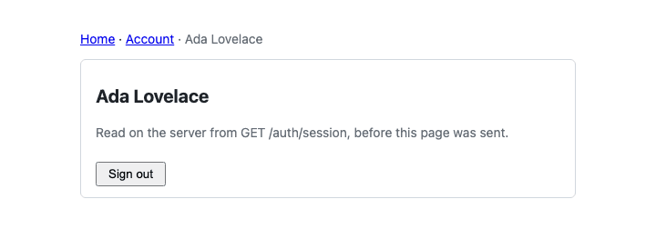

# The React kit with the Next.js App Router

A Next.js 16.4.0 App Router app that wires `@ubgo/auth-react` to Next: the provider lives in a client component mounted from the root layout, its `navigate` is `router.push` and its `Link` is `next/link`. `/auth` is rewritten to the Go server, so the browser sees one origin. It also shows what server rendering does with the session: the kit's hooks never read it on the server, so a page that must be protected before it is sent asks the Go server itself, with the browser's cookie. The guide is [docs/client/react-routers.md](../../docs/client/react-routers.md#nextjs-app-router).

| What | Where |
|---|---|
| The provider, `router.push` and the `next/link` wrapper | `app/providers.tsx` (`"use client"`) |
| The provider around every page | `app/layout.tsx`, a server component |
| The components that call the kit's hooks | `app/auth-ui.tsx` (`"use client"`), rendered by server pages |
| `/auth` on the app's origin | `next.config.ts`: a `rewrites` entry to the Go server |
| A page checked on the server | `app/account/page.tsx` calls `serverUser()` (`lib/server-session.ts`: `GET /auth/session` with the request's cookie) and redirects a signed-out visitor to `/sign-in?redirectTo=%2Faccount` |
| The page a magic link opens | `app/magic-link/page.tsx` reads `token` from the server page's `searchParams` and passes it down, so the server's HTML and the browser's first render agree |



## Run it

The app talks to the React demo's Go server ([`examples/react-demo`](../react-demo/)), which has every plugin it uses, seeds `ada@example.com` with the password `correct horse battery staple`, and keeps mail in memory (`GET /dev/mail`). Ports 8121 (API) and 5201 (app), apart from the demo's own. The rewrite's target is read when the config loads, from `NEXT_API_PORT` (default 8121) or `AUTH_API_URL`.

```sh
task ui:install                                   # once: pnpm install of the kit and the examples
cd examples && PORT=8121 APP_URL=http://localhost:5201 DEMO_DB=/tmp/nextjs-app.db go run ./react-demo
cd examples/nextjs-app && pnpm exec next dev --port 5201   # another terminal; open http://localhost:5201
```

Or let the test build the app, start the API and `next start`, and drive it headless with Playwright. Besides the browser steps, it reads the HTML Next sends with and without the session cookie; each step that navigates checks that a marker set on the page after the first load survived, which a full page load would have wiped:

```sh
task ui:nextjs
```

```text
       GET /account: 307 → /sign-in?redirectTo=%2Faccount
  ok   server HTML for an anonymous visitor: / holds SignedIn's fallback, /account is a redirect
  ok   in the browser, signed out, the home page links to paths.signIn through next/link
  ok   /account, checked on the server, sends a signed-out visitor to /sign-in?redirectTo=%2Faccount
  ok   signing in comes back to /account through router.push, and the server knows the user
  ok   server HTML with the session cookie: /account names the user, / still holds the fallback
  ok   the header's Home link keeps the session without a reload
  ok   signOut() lands on paths.afterSignOut (/sign-in) through router.push
       link: http://localhost:5201/magic-link?token=…
  ok   a mailed magic link opens /magic-link, whose server page passes the token down
nextjs-app: all 8 steps passed
```

A failed step prints the path of a screenshot in the system's temporary directory.

## Layout

| Path | What it is |
|---|---|
| `lib/auth.ts` | The client, created once; importing it on the server is safe because creating it touches no browser API |
| `lib/server-session.ts`, `lib/api-url.ts` | The server-side session read, and the Go server's URL it and the rewrite share |
| `app/` | The layout, the provider, the client components and the pages (`/`, `/sign-in`, `/account`, `/magic-link`) |
| `next.config.ts` | The `/auth` and `/dev` rewrites; `turbopack.root` only because this example links the kit from `clients/`, outside its folder |
| `scripts/with-servers.sh` | Builds the demo API and the app, starts both on a temporary SQLite file, runs a command, stops both |
| `scripts/e2e.ts` | The Playwright run above, type-checked with the app |

## Checked by

- `task ui:check`: `next build`, then `tsc --noEmit` (strict, the app and the e2e script).
- `task ui:nextjs`: the eight steps above, headless.

Neither is part of `task check`, because both need `node_modules` (`task ui:install`).
