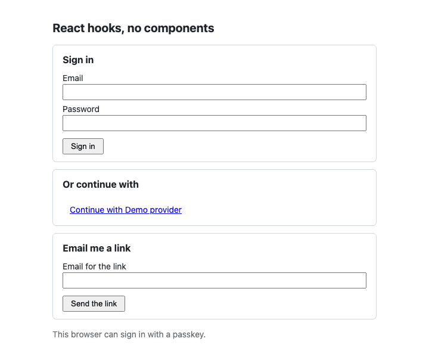

# The React kit's hooks without its components

A Vite and React page that uses only `@ubgo/auth-react`'s provider and hooks, with markup the app writes itself: no shadcn registry component, no Tailwind, no router. It is the starting point for an app with its own design system, and the shortest complete use of each hook. The guide is [docs/client/react.md](../../docs/client/react.md).

| Hook or export | Where in `web/src/app.tsx` |
|---|---|
| `AuthProvider` with custom `paths` and `localization` | `App`: one-page app, so `afterSignOut` and `twoFactor` are query flags on `/`; one error message reworded |
| `SignedIn` / `SignedOut` (with `fallback`) | `App`: neither side renders until the first session read answers |
| `useSession` | `Account`: the signed-in user's name |
| `useSessionActions` | `Account`: `signOut({ redirectTo: null })` stays on the page, `signOut({ everywhere: true })` goes to `paths.afterSignOut`; `PasswordSignIn`: `refreshSession()` after a sign-in |
| `useAuth` | `PasswordSignIn`: `navigate` and `paths.twoFactor` for a sign-in that needs a second factor; `OAuthButtons`: `baseURL` |
| `usePluginClient` | `PasswordSignIn` (`password.signIn`), `MagicLink` (`magiclink.send`) |
| `usePlugin` | `MagicLink`, `PasskeySupport`: render a method only when the client has its plugin |
| `useOAuthProviders` + `oauthStartURL` | `OAuthButtons`: one `<a>` per provider the server has; OAuth is a page navigation, never a fetch |
| `useErrorMessage` | every form: the provider's override for a code, else the server's message |
| `SESSION_QUERY_KEY` | `Rename`: a `client.profile` call the kit knows nothing about, then `queryClient.invalidateQueries({ queryKey: SESSION_QUERY_KEY })` so `useSession` shows the new name |
| `supportsPasskeys` | `PasskeySupport`: whether to offer a passkey button in this browser |



## Run it

The page talks to the React demo's Go server ([`examples/react-demo`](../react-demo/)), which has every plugin it uses, seeds `ada@example.com` with the password `correct horse battery staple`, and serves a pretend OAuth provider. Vite proxies `/auth` and `/dev` to it, so the session cookie is first-party. Ports 8113 (API) and 5190 (page), apart from the demo's own.

```sh
task ui:install                                   # once: pnpm install of the kit, the demo and this example
cd examples && PORT=8113 APP_URL=http://localhost:5190 DEMO_DB=/tmp/headless.db go run ./react-demo
cd examples/react-headless/web && pnpm dev        # another terminal; open http://localhost:5190
```

Or let the test start and stop both servers and drive the page headless with Playwright:

```sh
task ui:headless
```

```text
       supportsPasskeys: "This browser can sign in with a passkey."
  ok   SignedOut renders the app's own form, the server's providers and the passkey check
       message: "That email and password do not match."
  ok   a wrong password shows the provider's localized message (useErrorMessage)
  ok   the right password signs in and SignedIn shows useSession's user
  ok   a profile change of the app's own shows after invalidating SESSION_QUERY_KEY
  ok   signOut({ redirectTo: null }) stays on the page and SignedOut comes back
  ok   usePluginClient('magiclink') sends a link
  ok   oauthStartURL is a page navigation that signs in through the provider
  ok   signOut({ everywhere: true }) goes to the custom paths.afterSignOut
react-headless: all 8 steps passed
```

A failed step prints the path of a screenshot in the system's temporary directory.

## Layout

| Path | What it is |
|---|---|
| `web/src/app.tsx` | The client (created once, outside React), the provider, and one small component per hook |
| `web/src/main.tsx`, `web/index.html`, `web/src/styles.css` | Vite entry and a few lines of plain CSS |
| `web/vite.config.ts` | Ports from `HEADLESS_WEB_PORT` / `HEADLESS_API_PORT`; the `/auth` and `/dev` proxy; `dedupe` so the linked kit and the page share one React and one query cache |
| `web/scripts/with-servers.sh` | Builds and starts the demo API on a temporary SQLite file, starts Vite, runs a command, stops both |
| `web/scripts/e2e.ts` | The Playwright run above, type-checked with the page |

## Checked by

- `task ui:check`: `tsc -b` (strict, the page and the e2e script) and a production `vite build`.
- `task ui:headless`: the seven steps above, headless.

Neither is part of `task check`, because both need `node_modules` (`task ui:install`).
