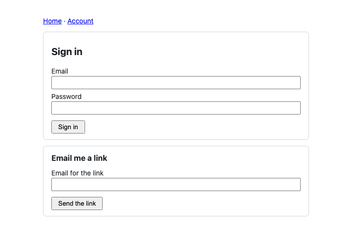

# The React kit with React Router

A Vite app on React Router 8.4.0 (data mode, `createBrowserRouter`) that wires `@ubgo/auth-react` to the router: the provider's `navigate` is `useNavigate()`, its `Link` is a wrapper turning `href` into React Router's `to`, and the provider is mounted in the root route's element. The pages use the kit's hooks with markup of their own, so every navigation the kit makes (after a sign-in, a sign-out, a guard's redirect) goes through the router without a page load. The guide is [docs/client/react-routers.md](../../docs/client/react-routers.md#react-router).

| What | Where |
|---|---|
| The `Link` wrapper and the provider in the root route | `src/root.tsx`: `RouterLink`, `Root` |
| The routes, at the kit's default paths | `src/main.tsx` |
| A page only a signed-in user sees | `src/pages.tsx`: `RequireUser` sends a signed-out visitor to `/sign-in?redirectTo=…` |
| Back to where the guard came from | `src/pages.tsx`: `SignInPage` calls `navigate(safeRedirect(redirectTo, paths.afterSignIn))` |
| The page a magic link opens | `src/pages.tsx`: `MagicLinkPage` reads `?token=` from `useSearchParams` |



## Run it

The app talks to the React demo's Go server ([`examples/react-demo`](../react-demo/)), which has every plugin it uses, seeds `ada@example.com` with the password `correct horse battery staple`, and keeps mail in memory (`GET /dev/mail`). Vite proxies `/auth` and `/dev` to it, so the session cookie is first-party. Ports 8120 (API) and 5200 (app), apart from the demo's own.

```sh
task ui:install                                   # once: pnpm install of the kit and the examples
cd examples && PORT=8120 APP_URL=http://localhost:5200 DEMO_DB=/tmp/react-router-app.db go run ./react-demo
cd examples/react-router-app && pnpm dev          # another terminal; open http://localhost:5200
```

Or let the test start and stop both servers and drive the app headless with Playwright. Each step that navigates also checks that a marker set on the page after the first load survived, which a full page load would have wiped:

```sh
task ui:router
```

```text
  ok   signed out, the home page links to paths.signIn through the router's Link
  ok   the guarded /account sends a signed-out visitor to /sign-in?redirectTo=%2Faccount
  ok   signing in comes back to /account through the provider's navigate
  ok   the header's Home link keeps the session without a reload
  ok   signOut() lands on paths.afterSignOut (/sign-in) through the router
       link: http://localhost:5200/magic-link?token=…
  ok   a mailed magic link opens /magic-link, which reads the token from the router's search params
react-router-app: all 6 steps passed
```

A failed step prints the path of a screenshot in the system's temporary directory.

`RequireUser` decides in the browser, after the first session read, so it fits a single-page app whose data comes from authenticated API calls. A page whose HTML must not reach a signed-out visitor needs a check on the server: see [examples/nextjs-app](../nextjs-app/).

## Layout

| Path | What it is |
|---|---|
| `src/auth.ts` | The client, created once outside React |
| `src/root.tsx`, `src/main.tsx`, `src/pages.tsx` | The router wiring, the routes, the pages |
| `vite.config.ts` | Ports from `RR_WEB_PORT` / `RR_API_PORT`; the `/auth` and `/dev` proxy; `dedupe` so the linked kit and the app share one React and one query cache |
| `scripts/with-servers.sh` | Builds and starts the demo API on a temporary SQLite file, starts Vite, runs a command, stops both |
| `scripts/e2e.ts` | The Playwright run above, type-checked with the app |

## Checked by

- `task ui:check`: `tsc -b` (strict, the app and the e2e script) and a production `vite build`.
- `task ui:router`: the six steps above, headless.

Neither is part of `task check`, because both need `node_modules` (`task ui:install`).
