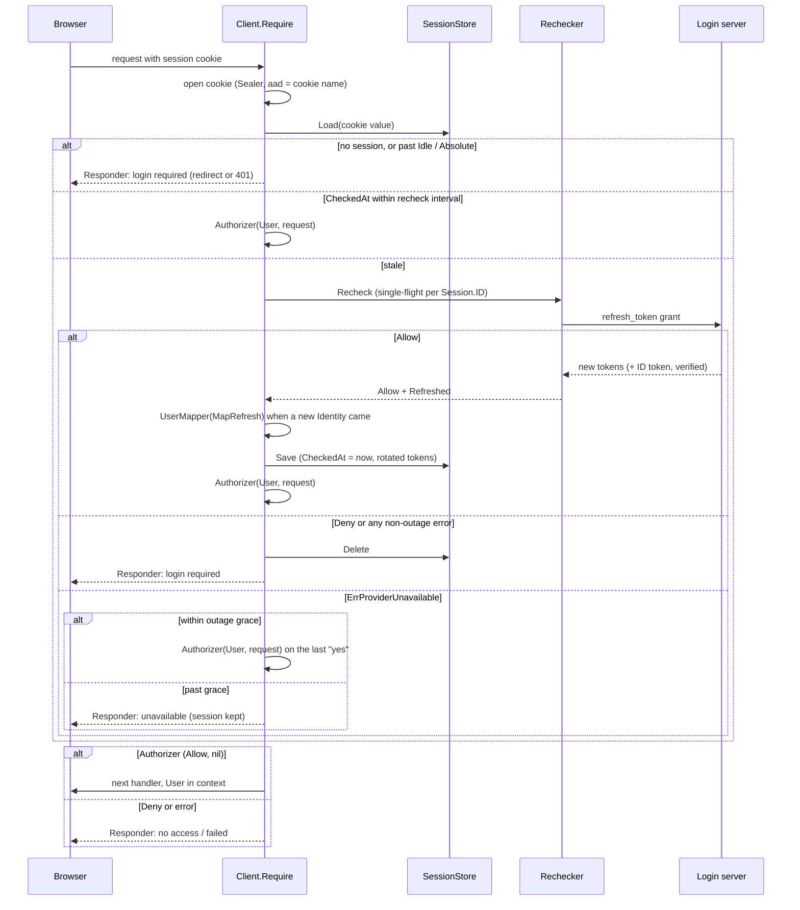

# oidcclient design

A relying party for any OpenID Connect server, standard library only. This page is the model, the request lifecycle, why each seam has its shape, the floors, and what is left open. The godoc of each name is the reference; this page does not repeat it.

## The model: two clocks

- **Session lifetime** says how long a browser stays signed in without seeing the login server's pages: `Lifetimes{Idle: 7d, Absolute: 30d}`. Idle slides with use (advanced at most once a minute, so a busy session does not rewrite its cookie per request). Closing the browser does not sign out: the cookie has an expiry.
- **Re-check interval** says how long the login server's last "yes" stands: `WithRecheckInterval`, 1 minute by default. When a request arrives after it, the `Rechecker` asks the server again (by default by redeeming the refresh token, which ubgo/auth's provider answers by re-asking its `ClientAccess` rule). A "no" ends the session on that request.
- The two are independent on purpose. A long session is convenience; the re-check is authority. A saved copy of an old cookie carries a refresh token the server has already refused, so it is worth nothing after the next re-check: removal takes effect within one interval, whatever the browser holds.
- **Outage grace** sits between them: when the server cannot be reached (`ErrProviderUnavailable`, not a "no"), the last "yes" stands for `WithOutageGrace` (5 minutes) from `Session.CheckedAt`, then requests are answered "unavailable" while the session is kept, so the person is back the moment the server is.

## Request lifecycle

Concurrent requests of one session share one `Recheck` call in process (keyed by `Session.ID`), so two tabs never spend one refresh token twice from one instance. A finished re-check is also remembered for 10 seconds for requests that still carry the session it started from: two tabs whose requests do not overlap (the second leaves the browser before the first one's new cookie arrives) would otherwise present the rotated refresh token again, which a strict server reads as theft and answers by revoking the whole family, signing both tabs out. A remembered "no" is a "no" too, so a saved cookie copy gains nothing from it. The re-check runs detached from the request's cancellation (bounded at 30 seconds), because a refresh the server already rotated must be saved even if the browser that asked has gone. Across instances the provider's refresh-reuse grace (`RefreshReuseInterval`) covers the same race; this package cannot see other processes.

`Client.Optional` runs the same decision for pages anyone may see: the User is in the context when `Require` would have let the request through, and absent otherwise. It never calls the `Responder`, a session the server refused is ended exactly as under `Require`, and an anonymous visit is not reported as a refusal.

## Seams, and why each has its shape

| Area | Default | API | Why this shape |
|---|---|---|---|
| Session storage | sealed cookie | `SessionStore` (`Save` returns cookie bytes, `Load`, `Delete`), `WithSessionStore`, `CookieStore()`, `NewMemoryStore()` | The package owns the cookie, sealing and chunking; a store only maps bytes to a session. So Redis, SQL and the app's own session system (through `ctx`) are three methods with no HTTP, and every store gets the same cookie floors. |
| Back-channel lookup | unsupported (stateless) | upgrade `SessionRevoker.RevokeSessions(ctx, LogoutTarget)`; `LogoutTarget.Matches` | Optional upgrade, not required config: a stateless store cannot end a session it does not hold, and says so (501, `ErrBackchannelUnsupported`). `Matches` is exported so every store applies one rule. |
| Cookie sealing | AES-256-GCM, HKDF-SHA256 key, cookie name as aad | `Config.SessionSecret` + `PreviousSessionSecrets`, `NewSecretSealer`, `WithSealer(Sealer)` | Same method set as the core's `auth.Sealer`, so `auth.RingSealer` or a KMS sealer plugs in without an import. Rotation is current-plus-previous, as the core's `KeyRing`. |
| Identity mapping (OnLogin) | `DefaultUser(Identity)` | `WithUserMapper(UserMapper)`, `MapUserRequest{Reason, Identity, Previous, AccessToken, Provider}` | A request struct, so fields can be added. Runs at sign-in and at each refresh that brings a new ID token, so roles from claims stay current. |
| App authorization | none | `WithAuthorizer(Authorizer)` returning `(Decision, error)` | `Decision`'s zero value is `Deny`, and an error overrides `Allow`: a forgetful or failing authorizer refuses. Per-route rules read `AuthorizeRequest.Request`, or live in the app's own middleware after `Require` using `UserFrom`. |
| Re-check | refresh every 1 minute | `WithRechecker(Rechecker)`: `RecheckByRefresh`, `RecheckByIntrospection`, `RecheckByUserInfo`, `RecheckBackchannelOnly`; `WithRecheckInterval` (`RecheckEveryRequest` = 0) | How and how often are separate options. New tokens reach the session only as `*Refreshed`, which only `Provider.Refresh` builds, so a custom rechecker cannot hand over an unverified ID token. |
| Login server down | last "yes" for 5 minutes | `WithOutageGrace(d)`, `NoOutageGrace` | A duration covers every stated need (fail closed, longer grace). Only `ErrProviderUnavailable` starts it; every other error is a "no". |
| Lifetimes | 7 days idle, 30 absolute | `WithLifetimes(Lifetimes)` | Zero field = default; Idle above Absolute refused. |
| Public pages | none | `Client.Optional` | Same decision as `Require`, never refuses; the User is present only when `Require` would have allowed. |
| Responses | redirect for pages, 401 JSON for API, plain no-access page | `WithResponder(Responder)`, `Refusal{Kind, Reason, LoginURL, Err}`, `DefaultResponder()`, `IsPageRequest` | One method with a struct; `Kind` is what to show, `Reason` why. A custom responder can delegate to `DefaultResponder`. It cannot change the decision. |
| Return after login | the same-site path the user came from | `WithReturnPolicy(ReturnPolicy)`: `ReturnToRequested`, `ReturnToFixed`, `ReturnToAllowed` | The policy's answer is checked again against the same-site floor, so a policy can only narrow. |
| Cookie options | `__Host-oidc_session`, Secure, HttpOnly, Lax, Path=/ | `WithCookie(CookieOptions{Name, Domain, SameSite})` | Only what browsers allow varies: a Domain cookie must be `__Secure-`, a host cookie `__Host-`; None is refused. |
| Routes | `/auth/{login,callback,logout,backchannel}` | `WithPaths(Paths)`, `PathsUnder(prefix)`, `Handler()`, `LoginHandler()`, `CallbackHandler()`, `LogoutHandler()`, `BackchannelHandler()` | One `Paths` value is the truth for what `Handler` serves, where `Require` redirects and which redirect URI is sent. |
| Client authentication | client_secret_basic | `WithClientAuth(ClientAuth)`: `ClientSecretBasic`, `ClientSecretPost`, `PublicClient`; `ClientAuthRequest{Endpoint, Form, Header}` | private_key_jwt and KMS-held keys are realistic second models; mTLS is the HTTP client plus `PublicClient`. An empty secret without `PublicClient` is refused, never read as "public". |
| Plumbing | stdlib client (10 s, no redirects), `slog.Default()`, `time.Now`, discovery on first use | `WithHTTPClient`, `WithLogger`, `WithClock`, `WithDiscovery(ProviderMetadata)`, `WithScopes`, `WithAuthParams`, `WithPostLogoutPath` | `New` makes no network call, so the app starts while the login server is down. |
| Observer | none | `WithObserver(Observer)`, `Event{Kind, Reason, SessionID, Subject, Count, Err}` with login, refresh, grace, refuse, logout, back-channel logout | Observers see decisions after they are made and cannot change them. |
| Escape hatch | | `Client.Provider()` (`Metadata`, `Refresh`, `Introspect`, `UserInfo`) | One handle to call the server as this client, with the floors applied inside each method. |
| Framework | `net/http` | later `contrib/` adapters | Deferred until an app needs one. |

## Floors, and how they cannot be turned off

- **No option names them.** PKCE S256, state, nonce, the algorithm allow-list (RS256, ES256, EdDSA, the set `plugin/oauth` accepts; `none` and HMAC never), iss, aud, exp (30 s leeway), azp when present, and the userinfo sub match are inside unexported code with no `Config` field or `Option` reaching them.
- **No option can set their parameters.** `WithAuthParams` refuses `state`, `nonce`, `code_challenge`, `redirect_uri` and the other protocol parameters at `New`; `WithScopes` always keeps `openid`.
- **Constant-time compares** for state, nonce, at_hash and every secret. The core's `guard_test.go` walks this module too, and `TestGuard_ConstantTime` here applies the same rule with nonce, jti and sealed added to the names.
- **Tokens**: the JWS is parsed strictly (one base64url spelling), a `crit` header is refused, the algorithm must be in the allow-list before any key lookup (so a forged token cannot make the app fetch keys), and each key verifies only under the algorithm its type implies (RSA at least 2048 bits, P-256 checked on the curve, Ed25519). An ID token needs iss exactly the discovered issuer, aud naming the client, azp the client when present and present when there are several audiences, iat (not more than 30 s ahead), exp (30 s leeway), sub, the flow's nonce at sign-in, the same sub at refresh, and at_hash matching when sent.
- **State**: the flow cookie holds up to three pending sign-ins (two tabs that both found their session expired must both finish), each spent on first use and dropped after 10 minutes.
- **Return URLs** go through the `ReturnPolicy`, then the same-site check (`/x`, not `//x`, no backslash, no control character at all, no scheme); anything else lands on `/`. Control characters are refused, not only line breaks, because browsers strip tabs and newlines from a URL before parsing it: `/<TAB>/evil` becomes `//evil`. A return path that is one of the four auth routes also lands on `/` (landing on the login route would start another sign-in, on the logout route sign the person out).
- **Hooks fail closed by type.** `Decision` and `RecheckResult` are `Deny` at zero; an error with `Allow` is a refusal; a `UserMapper` error writes no session; a mapper that changes `Issuer` or `Subject` is refused (they key back-channel logout).
- **Cookies** are always Secure, HttpOnly, Path=/, prefixed, Lax or Strict; the flow cookie is always Lax (the login server's redirect back is cross-site) and sealed under its own name, so it cannot be replayed as a session.
- **Origins** (`Issuer`, `AppURL`, every discovered endpoint) are https, or http on a loopback host. The discovery document must name the configured issuer. The HTTP client never follows redirects.
- **Logout revokes the refresh token** at the discovery `revocation_endpoint` (RFC 7009, the configured `ClientAuth`, `token_type_hint=refresh_token`) before the end-session redirect. Deleting the session forgets nothing under the stateless `CookieStore`, and ubgo/auth's provider keeps an `offline_access` refresh token after its own session ends (plugin/oauthprovider/backchannel.go), so without the revocation a cookie copy saved before logout would refresh and be let in. It is best effort: a failure (or a server with no revocation endpoint) is logged and observed as `EventRevokeFailed` (with `Err`, just before the sign-out's `EventLogout`), the same kind the TypeScript client reports as `revoke_failed`, and the person is still signed out of the app and sent on. A server that publishes no `revocation_endpoint` is logged once (at `New` for a `WithDiscovery` document, otherwise at the first discovery); with it and the cookie store, a saved copy keeps working until the server refuses its refresh, so such a deployment wants a server-side `SessionStore`, whose `Delete` does end the session.
- **Logout** is POST from this origin only: the `Origin` header must be the app's origin, or without one `Sec-Fetch-Site` must be `same-origin`; a request with neither is refused. A store that cannot delete the session is answered as a failure, never hidden behind the redirect, because a cookie copy would still open it.
- **Back-channel logout tokens** need the back-channel event as a JSON object, sub or sid, a jti, no nonce (which keeps an ID token from being replayed as one), iat within 2 minutes plus leeway, and the ID token's iss/aud/azp/exp checks. Each jti is accepted once per process until it expires; a token whose sessions the store failed to end can be delivered again. `typ` is not required: the events claim and the missing nonce are what section 2.6 uses to tell a logout token apart, and servers differ on `typ`.
- **Errors are classified**: no answer, a 5xx, a 429, an unexpected status or an unreadable body is `ErrProviderUnavailable` (outage grace); any other 4xx is `ErrProviderRefused` (the session ends). A failed discovery is answered from memory for a minute, so an outage is not multiplied by every request.

## Deliberately not configurable

- The floors above: each has one correct value, and an option to weaken it would be the first thing a hurried integration turns off.
- Single-flight: there is no reason to allow two concurrent refreshes of one session in one process.
- JWKS caching (refetch on an unknown kid at most once a minute, re-read daily) and discovery caching: the values `plugin/oauth` already uses, with no realistic second model.
- Sliding granularity (one minute): a value, not a policy.
- Cookie chunk count: a browser limit, not a choice (3 cookies of 3800 bytes); an oversized session is `ErrSessionTooLarge` at sign-in, never a silently dropped cookie. At a refresh it ends the session, since its refresh token is already spent. A server-side store (the cookie then carries only the ID) is the answer for big sessions.
- The remembered re-check (10 s), the pending-flow limit (3) and the jti memory (10 000 live entries, refusing beyond): values sized to the races they close, with no realistic second model.
- `MemoryStore` expires rows by the wall clock: the Client applies the Lifetimes on every request, so the store's expiry only bounds memory.
- Under `SameSite=Strict`, the callback lands through a same-site page instead of a redirect, because a redirect chain started cross-site does not carry Strict cookies on its first request. Automatic, not an option.

## Decisions taken in review

1. **User is a fixed struct**, not a type parameter (`ID`, `Roles`, `Claims` cover linking and roles).
2. **Cookie size**: up to 3 chunked cookies, `ErrSessionTooLarge` beyond; a server-side store for big sessions.
3. **Default scopes include `offline_access`**; the Google recipe (`WithScopes("openid","email","profile")`, `WithAuthParams(access_type=offline, prompt=consent)`) belongs in the guide.
4. **A refused re-check answers "login required"**, not "no access": the login server then shows its own no-access page if the person was removed, or signs them straight back in if only the refresh token expired.
5. **`Client.Optional`** is in v0.1.0. `AccessTokenFrom(ctx)`, local-only logout and PS256 wait until an app needs them; PS256 would be a fixed addition to the allow-list, never an option.
6. **Cross-instance refresh race**: single-flight and the remembered re-check are per process; multi-instance apps using `RecheckByRefresh` need the provider's `RefreshReuseInterval` (the login-server deployment sets 10 s; the library default stays 0).

## What changed from the reviewed API

- Added `Client.Optional` and `ReasonProviderInvalid` (the discovery document or a server answer broke a floor, answered as a failure rather than as an outage).
- `Sealer.Open`: only `ErrSealedCorrupt` reads as "no session"; any other error (a KMS that cannot be reached) is a failure (`ReasonStoreFailed`), so a key-service outage is not shown as a silent sign-out followed by a sign-in loop.
- The return-URL floor refuses every control character and the auth routes, not only line breaks (the tab bypass above).
- `Provider.Refresh` refuses an empty `RefreshRequest.Subject` with `ErrInvalidConfig`, so a custom `Rechecker` cannot skip the same-person check.
- Logout revokes the session's refresh token (RFC 7009) before the end-session redirect; a failed revocation is its own event, `EventRevokeFailed` (TypeScript `revoke_failed`), so an observer can alert on it without inspecting every logout.
- The flow cookie holds up to three pending sign-ins instead of one; a finished re-check is remembered for 10 seconds; the back-channel route answers 503 when the keys cannot be read and 400 for a replayed jti.
